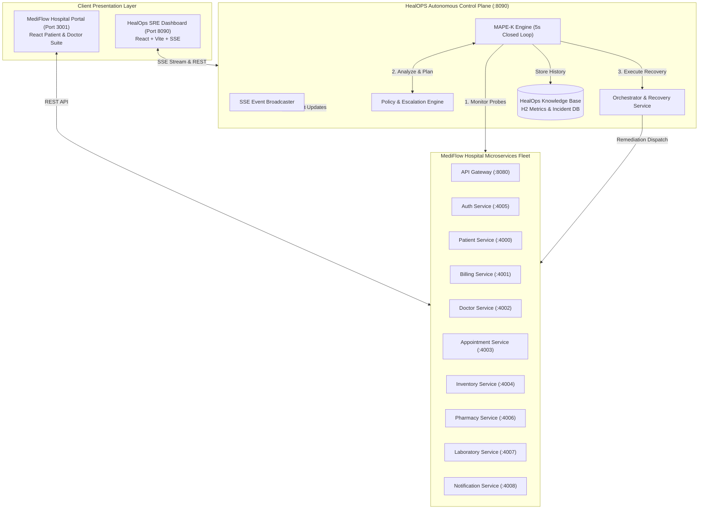
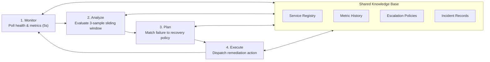

# HealOPS & MediFlow — Autonomous Self-Healing Healthcare Microservices Platform

[](https://spring.io/projects/spring-boot)
[](https://openjdk.org/)
[](https://vitejs.dev/)
[]()
[](LICENSE)

**HealOPS** is an intelligent, autonomous self-healing platform and observability suite designed to guarantee zero-downtime high availability for **MediFlow**, a mission-critical distributed hospital management microservices fleet.

By implementing the autonomic computing **MAPE-K (Monitor-Analyze-Plan-Execute over Knowledge)** closed-loop control model, HealOPS continuously monitors distributed services, detects operational anomalies (CPU spikes, memory exhaustion, database outages, SLA latency breaches, and HTTP 5xx errors), and autonomously triggers multi-tier remediation actions before outages impact patients or healthcare personnel.

---

## 📑 Table of Contents
- [Key Features](#-key-features)
- [System Architecture](#-system-architecture)
- [The MAPE-K Self-Healing Engine](#-the-mape-k-self-healing-engine)
- [Microservices Fleet & Port Matrix](#-microservices-fleet--port-matrix)
- [Failure Detection & Remediation Matrix](#-failure-detection--remediation-matrix)
- [Chaos Engineering Subsystem](#-chaos-engineering-subsystem)
- [Technology Stack](#-technology-stack)
- [Getting Started & Installation](#-getting-started--installation)
- [REST API Reference](#-rest-api-reference)
- [Live Demonstration Workflow](#-live-demonstration-workflow)
- [Author & License](#-author--license)

---

## 🌟 Key Features

1. **MAPE-K Autonomous Closed Loop**:
   - Polling health and telemetry probes every 5 seconds.
   - Sliding-window evaluation (3 consecutive breach samples) to prevent flapping and false positives.
   - Automated root-cause correlation and explainable remediation recommendations.

2. **Multi-Tier Escalation Policies**:
   - Hierarchical policy engine with configurable retries, cooldown thresholds (15s minimum), and automated escalation:
     `Clear Fault / Reset` ➔ `Memory GC / DB Pool Refresh` ➔ `Service Restart` ➔ `Container Restart` ➔ `On-Call Alert`.

3. **Chaos Engineering & Fault Injection**:
   - Built-in `/chaos` endpoints across every microservice to simulate real-world production incidents on-demand (CPU burn, memory leaks, latency injection, DB disconnects, and 500 errors).

4. **Real-Time Telemetry & Event Streaming**:
   - Zero-polling Server-Sent Events (`SSE`) streaming live metrics, incident events, and recovery logs directly to the browser.

5. **Dual Interactive Dashboards**:
   - **HealOps Dashboard (Port 8090)**: Central SRE command center featuring real-time health scorecards, live latency & CPU sparklines, incident timeline, policy editor, and one-click chaos simulator.
   - **MediFlow Hospital Portal (Port 3001)**: Fully functional healthcare clinical portal for managing patients, doctor appointments, billing invoices, pharmacy prescriptions, and lab reports.

6. **Polyglot Communication**:
   - RESTful JSON APIs, gRPC binary protocols for high-throughput inter-service RPC (Patient ➔ Billing), and Apache Kafka asynchronous event streaming.

---

## 🏛 System Architecture



---

## 🔄 The MAPE-K Self-Healing Engine

HealOPS strictly follows the IBM MAPE-K autonomic control loop:



1. **Monitor**: Every 5 seconds, `SelfHealingEngine` probes Spring Boot Actuator endpoints (`/actuator/health`, `/actuator/metrics`) and `/chaos/status` across all registered microservices.
2. **Analyze**: Samples are buffered in an in-memory sliding window of 3 intervals. A breach is only declared when persistent failures exceed safety thresholds, avoiding noisy false alarms.
3. **Plan**: When an incident is flagged, the policy engine matches the specific `FailureType` to the most cost-effective recovery strategy with calculated Mean-Time-To-Detect (MTTD) and estimated Mean-Time-To-Recover (MTTR).
4. **Execute**: `OrchestratorService` dispatches the resolution command (clearing chaos thread pools, invoking JVM garbage collection, cycling HikariCP database connection pools, or restarting the process/container).
5. **Knowledge**: Telemetry, actions taken, and resolution timestamps are recorded in the relational knowledge repository for post-mortem auditing.

---

## 🏥 Microservices Fleet & Port Matrix

| Service | Port | Technology | Responsibilities | Key Dependencies |
| :--- | :--- | :--- | :--- | :--- |
| **HealOps Core & UI** | `8090` | Spring Boot 3, H2, SSE, React | Autonomous monitoring, MAPE-K engine, SRE control dashboard | Target services |
| **MediFlow Web Portal** | `3001` | React, Vite, Tailwind | Patient intake, appointments, clinical records, billing UI | Microservices fleet |
| **Patient Service** | `4000` | Spring Boot 3, JPA, gRPC Client | Patient profiles, medical history, Kafka event publisher | Billing, Auth |
| **Billing Service** | `4001` | Spring Boot 3, gRPC Server, JPA | Invoice generation, payments, gRPC account verification | Patient, Auth |
| **Doctor Service** | `4002` | Spring Boot 3, JPA | Doctor directories, specialties, OPD schedules | Auth |
| **Appointment Service** | `4003` | Spring Boot 3, JPA | Booking consultations, appointment status tracking | Doctor, Patient |
| **Inventory Service** | `4004` | Spring Boot 3, JPA | Hospital medicine supplies, surgical equipment stock | Auth |
| **Auth Service** | `4005` | Spring Boot 3, JWT, Security | User authentication, token issuance, RBAC | All services |
| **Pharmacy Service** | `4006` | Spring Boot 3, JPA | Prescription processing, medicine dispensing | Inventory, Patient |
| **Laboratory Service** | `4007` | Spring Boot 3, JPA | Pathology test requests, diagnostic lab report generation | Patient, Doctor |
| **Notification Service** | `4008` | Spring Boot 3 | SMS, email, and emergency dispatch alerts | Fleet events |
| **API Gateway** | `8080` | Spring Cloud Gateway | Unified reverse proxy, routing, JWT authentication filter | Backend services |

---

## ⚡ Failure Detection & Remediation Matrix

| Failure Type | Trigger Condition | Automated Remediation | Estimated MTTR | Explainable Reasoning |
| :--- | :--- | :--- | :--- | :--- |
| **`HIGH_CPU`** | CPU utilization > 95% across samples | `CLEAR_CHAOS` / `THREAD_KILL` | ~1,800 ms | Spiked CPU over 95% threshold across consecutive samples. Clearing stress burner threads. |
| **`HIGH_MEMORY`** | Heap consumption > 300 MB leak | `FORCE_JVM_GC` | ~2,400 ms | Memory saturation detected above safety threshold. Forcing JVM Garbage Collection and buffer release. |
| **`DATABASE_LOST`** | HikariCP database pool down | `RECONNECT_DB_POOL` | ~3,200 ms | Database connection pool unreachable. Triggering HikariCP pool refresh and reconnect as cheapest step. |
| **`SLOW_RESPONSE`** | Response latency ≥ 3,000 ms | `RESET_CIRCUIT_BREAKER` | ~1,500 ms | Latency exceeded 3000ms SLA. Tripping circuit breaker to shed load and resetting delay. |
| **`HTTP_5XX_ERRORS`** | Consecutive HTTP 500 error spikes | `CLEAR_CHAOS` | ~1,200 ms | 5xx error spikes detected in sliding window. Clearing faulty mock state and restoring normal handler. |
| **`SERVICE_CRASH`** | Process unreachable / timeout > 2s | `RESTART_CONTAINER` | ~5,500 ms | Process unreachable across probes. Escalating to container/process restart. |

---

## 💥 Chaos Engineering Subsystem

Each MediFlow microservice exposes an embedded `/chaos` controller for testing resilience:

```bash
# 1. Trigger High CPU Stress (burns threads for N seconds)
curl -X POST "http://localhost:4000/chaos/cpu?seconds=20"

# 2. Trigger Memory Leak (allocates 200MB into memory sink)
curl -X POST "http://localhost:4000/chaos/memory?mb=200"

# 3. Simulate Database Outage (drops connection pool)
curl -X POST "http://localhost:4000/chaos/db-disconnect"

# 4. Inject Latency (delays requests by N milliseconds)
curl -X POST "http://localhost:4000/chaos/latency?ms=3500"

# 5. Inject 500 Internal Server Errors
curl -X POST "http://localhost:4000/chaos/500?enable=true"

# 6. Check Chaos State
curl -X GET "http://localhost:4000/chaos/status"

# 7. Manual Reset / Recovery
curl -X POST "http://localhost:4000/chaos/reset"
```

---

## 🛠 Technology Stack

- **Backend Framework**: Java 21, Spring Boot 3.x, Spring Cloud Gateway, Spring Data JPA, Spring Actuator
- **Frontend**: React 18, Vite, Tailwind CSS, Lucide Icons, Recharts (Metrics Sparklines)
- **Database & Storage**: H2 In-Memory Database (with pre-seeded microservice records), PostgreSQL support
- **Inter-Service Communication**: REST (JSON), gRPC (Protobuf), Apache Kafka (Event Streaming)
- **Monitoring & Observability**: Server-Sent Events (SSE), Health Actuators, Custom Metrics Collectors
- **Platform Orchestration**: Batch launchers, Docker container management hooks

---

## 🚀 Getting Started & Installation

### Prerequisites
- **Java Development Kit (JDK 21 or higher)**
- **Apache Maven 3.9+**
- **Node.js (v18 or higher) & npm**
- **Git**

### One-Click Launchers (Windows)
The root directory includes automated batch scripts for quick setup:

1. **Launch the HealOps Autonomous Platform & Dashboard**:
   ```cmd
   start-healops.bat
   ```
   *Starts Patient Service (:4000), launches HealOps Core (:8090), and opens `http://localhost:8090` in your browser.*

2. **Launch the Full MediFlow Microservices Fleet (8 Microservices)**:
   ```cmd
   start-mediflow-fleet.bat
   ```
   *Launches Patient, Billing, Doctor, Appointment, Inventory, Pharmacy, Laboratory, and Notification services across ports 4000–4008.*

3. **Launch the MediFlow Hospital Web Portal**:
   ```cmd
   start-mediflow-web.bat
   ```
   *Starts the React frontend on `http://localhost:3001`.*

---

### Manual Launch Guide

#### 1. Start HealOps Core & Dashboard
```bash
cd healops-core
mvn spring-boot:run
```
Access the dashboard at **`http://localhost:8090`**.

#### 2. Start a Microservice (e.g., Patient Service)
```bash
cd patient-service
mvn spring-boot:run
```
Runs on **`http://localhost:4000`**.

#### 3. Start MediFlow Frontend Portal
```bash
cd mediflow-web
npm install
npm run dev
```
Runs on **`http://localhost:3001`**.

---

## 📡 REST API Reference (HealOps Core)

| Endpoint | Method | Description |
| :--- | :--- | :--- |
| `/api/stream/events` | `GET` | **Live SSE Stream**: Real-time metric events and incident updates |
| `/api/overview` | `GET` | System health summary, active counts, recoveries today, uptime % |
| `/api/services` | `GET` | List all monitored internal microservices and external endpoints |
| `/api/services` | `POST` | Register a new service dynamically for monitoring |
| `/api/services/{id}/detail` | `GET` | Detailed diagnostic breakdown, sparkline metrics, and MTTR stats |
| `/api/metrics?serviceId={id}` | `GET` | Historical CPU, memory, latency, and error metrics |
| `/api/incidents` | `GET` | Top 20 recent failure incidents and resolution records |
| `/api/incidents/{id}/actions` | `GET` | Step-by-step recovery actions executed for a specific incident |
| `/api/policies` | `GET` | View active multi-tier escalation policies |
| `/api/policies/{id}` | `PUT` | Update policy retries, action, or cooldown duration |
| `/api/simulate` | `POST` | Dispatch chaos simulation (`HIGH_CPU`, `HIGH_MEMORY`, `DATABASE_LOST`, etc.) |

---

## 🧪 Live Demonstration Workflow

To demonstrate autonomous self-healing in action:

1. Open the **HealOps Dashboard** at `http://localhost:8090`. All microservices will show `HEALTHY` (100% health score).
2. Go to the **Chaos Simulator** panel on the dashboard.
3. Select `patient-service` and choose **CPU Spike** or **Database Disconnect**, then click **Inject Fault**.
4. Observe the real-time change:
   - Within 5 seconds: Service status changes from `HEALTHY` ➔ `WARNING`.
   - After 3 consecutive probe breaches: Status escalates to `CRITICAL`.
   - The **Incident Timeline** records the incident with explanation: *"Spiked CPU over 95% threshold across consecutive samples."*
   - HealOps immediately triggers the automated recovery action (`CLEAR_CHAOS`).
   - The incident transitions to `RECOVERED` with real-time MTTR measurement (~1,800 ms).
   - Health score recovers to `HEALTHY` (95–100%) with zero human intervention required.

---

## 👤 Author & License

- **Developer**: [Orange1008](https://github.com/Orange1008)
- **Repository**: [https://github.com/Orange1008/healOPS](https://github.com/Orange1008/healOPS)
- **License**: Licensed under the [MIT License](LICENSE).