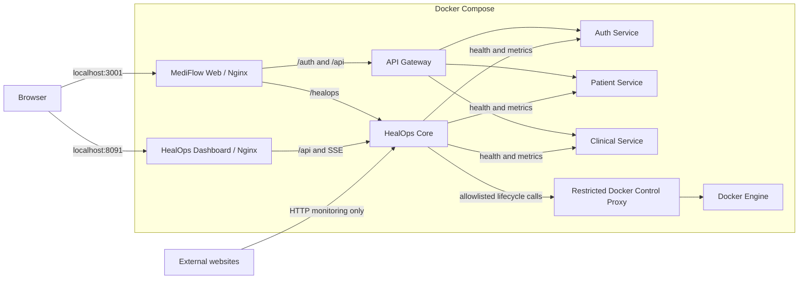

# HealOps + MediFlow

**HealOps + MediFlow** is a local, multi-service healthcare demo paired with a small operations control plane. MediFlow demonstrates patient and clinical workflows. HealOps monitors configured services, records incidents, applies a limited set of policy-based actions to managed Docker containers, and verifies recovery with later health checks. External websites are monitored for HTTP availability only and are never automatically restarted.

> **Project scope:** This repository is an educational engineering project. It is not a production EHR, a regulatory/compliance certification, or a replacement for Kubernetes or enterprise observability platforms. The source implements bounded rules and actions; it does not implement machine-learning diagnosis or guarantee zero downtime.

## What it does

### MediFlow

- React browser application for patient, doctor, and appointment views, with additional clinical controls in the UI.
- Auth Service verifies credentials with BCrypt and issues a signed JWT.
- API Gateway routes requests; its configured JWT validation filter protects Patient API routes.
- Patient Service persists patient records and supports CRUD operations.
- Clinical Service consolidates doctor, appointment, inventory, laboratory, and pharmacy APIs in the default Docker Compose stack.
- Optional Patient integrations include gRPC to Billing and Kafka event publishing; those paths are not all active in the default stack.

### HealOps

- Schedules HTTP health probes for registered managed services and external targets.
- Stores service metrics, incidents, policies, operational events, and recovery-action history in its configured H2 database.
- Uses a three-sample status window and configured failure thresholds to classify target health.
- Selects enabled recovery steps by failure type, retry limits, and cooldown settings.
- Requests selected lifecycle actions through a restricted Docker-control proxy, then checks the service again before closing an incident.
- Treats external targets as **Monitor Only**: it records HTTP availability/latency and INFO incidents, but does not invoke container recovery.
- Serves an operations dashboard using REST polling and Server-Sent Events (SSE).

The health score is a status indicator, not an SLA or measured uptime percentage. HealOps currently samples selected health, process CPU, and JVM heap signals; it does not include Hikari pool gauges in its health-score sampler.

## Architecture



### Login and patient request

1. The browser posts credentials to `/auth/login` through MediFlow Nginx and the API Gateway.
2. Auth looks up the user, verifies the password hash, and returns a JWT when valid.
3. The browser sends the JWT as a Bearer token to `/api/patients`.
4. Gateway validates the token with Auth before forwarding the Patient request.
5. Patient Service reads or writes its own database and returns the API response.

### HealOps recovery loop

```text
Scheduled probe
  → health state / metric update
  → repeated failure detection
  → incident and policy lookup
  → supported recovery action for a managed target
  → later health probes verify the result
  → incident and action history update
```

A successful Docker control response means the action was accepted; it does not by itself mean the application recovered. External website failures follow a separate monitor-only path.

## Services and local ports

The default Compose file starts the following containers:

| Component | Local URL / port | Notes |
|---|---|---|
| MediFlow Web | [http://localhost:3001](http://localhost:3001) | Browser app; Nginx proxies API requests |
| HealOps Dashboard | [http://localhost:8091](http://localhost:8091) | Operations UI |
| API Gateway | `localhost:8080` | Auth, Patient, and Clinical routes |
| HealOps Core API | `localhost:8090` | Monitoring, incident, policy, and SSE APIs |
| Auth Service | `localhost:4005` | Login and JWT validation |
| Clinical Service | `localhost:4002` | Consolidated clinical APIs |
| Patient Service | Docker network only | Reached through the Gateway; no host port is published by default |
| Docker-control proxy | Docker internal network only | Restricted routes; not a public UI/API |

Ports can conflict with software already running on the host. Check the effective Compose configuration before changing mappings.

### Optional Compose profiles

| Profile | Component(s) | Notes |
|---|---|---|
| `billing` | Billing gRPC service | Optional; the default stack does not start it. |
| `extended` | Notification Service | Optional; the default stack does not start it. |
| `messaging` | Kafka | Optional. The Compose service uses `pull_policy: never`; make sure the referenced Kafka image is already available locally. Analytics Service is not included in the default Compose graph. |

Some older standalone domain modules remain in the repository. The default stack uses `clinical-service` for those domains rather than starting each legacy service independently.

## Run locally with Docker Compose

### Requirements

- Docker Engine with Docker Compose v2 (Docker Desktop can provide these on Windows/macOS).
- A supported build environment for the Dockerfiles in this repository.
- A private JWT signing secret supplied through the root `.env` file.

Generate a random Base64 secret with PowerShell:

```powershell
[Convert]::ToBase64String([Security.Cryptography.RandomNumberGenerator]::GetBytes(32))
```

Create `.env` in the repository root (it is ignored by Git):

```dotenv
JWT_SECRET=PASTE_THE_GENERATED_VALUE_HERE
```

Do not commit `.env` or use a development secret for a public deployment.

### Start

```powershell
docker compose up -d --build
docker compose ps
```

Open:

- MediFlow: [http://localhost:3001](http://localhost:3001)
- HealOps: [http://localhost:8091](http://localhost:8091)

The repository also contains Windows launch scripts, including `start-mediflow-fleet.bat` and `start-silent.ps1`. Review scripts before using them in environments with different Docker settings.

### Logs and stop

```powershell
docker compose logs -f

docker compose stop
```

To stop and remove containers/networks while keeping named database volumes:

```powershell
docker compose down
```

**Data warning:** Do not use `docker compose down -v` unless you intentionally want to remove the named volumes and their stored data. The default named volumes include `healops-data`, `patient-data`, and `clinical-data`. Auth persistence is configured separately; inspect the active database URL and mounts before relying on container replacement for data retention.

## API overview

The Gateway is the normal entry point for MediFlow requests. The exact request and response DTOs are defined by the corresponding controllers and DTO classes.

| Method | Public path | Purpose |
|---|---|---|
| `POST` | `/auth/login` | Verify credentials and issue JWT |
| `GET` | `/auth/validate` | Validate Bearer JWT |
| `GET`, `POST` | `/api/patients` | List/create patients (JWT filter applies) |
| `GET`, `PUT`, `DELETE` | `/api/patients/{id}` | Read/update/delete patient (JWT filter applies) |
| `GET`, `POST` | `/api/doctors` | List/create doctors |
| `GET`, `PUT`, `DELETE` | `/api/doctors/{id}` | Read/update/delete doctor |
| `GET`, `POST` | `/api/appointments` | List/create appointments |
| `GET` | `/api/appointments/patient/{patientId}` | Find appointments by patient |
| `GET` | `/api/appointments/doctor/{doctorId}` | Find appointments by doctor |
| `GET`, `POST` | `/api/inventory`, `/api/laboratory`, `/api/pharmacy` | Clinical-domain list/create operations |
| `GET` | `/api/overview`, `/api/services`, `/api/incidents`, `/api/recovery-actions`, `/api/policies` | HealOps operations data |
| `POST` | `/api/services` | Register a monitoring target |
| `DELETE` | `/api/services/{id}` | Stop/remove monitoring target according to target category |
| `POST` | `/api/simulate` | Trigger a supported simulation path |
| `GET` | `/api/stream/events` | HealOps Server-Sent Events stream |

The current gateway configuration visibly applies JWT validation to the Patient route. Review route configuration and deployment controls before exposing other MediFlow or HealOps endpoints outside a trusted local environment.

## Technology

- **Backend:** Java 21, Spring Boot, Spring MVC, Spring Cloud Gateway, Spring Security, Spring Data JPA, Hibernate, HikariCP, Actuator/Micrometer, Maven.
- **Authentication:** BCrypt password hashing and signed JWTs (JJWT).
- **Data:** H2 databases in the local Compose configuration; selected services use named Docker volumes. PostgreSQL drivers are present in some POMs, but the default Compose datasource configuration uses H2.
- **Frontend:** React, Vite, JavaScript/JSX, Fetch API, Lucide icons; HealOps Dashboard also uses Recharts.
- **Edge/runtime:** Docker, Docker Compose, Nginx, REST/HTTP, and SSE.
- **Optional integrations:** gRPC/protobuf and Kafka. Their presence in source does not mean they run in the default Compose stack.

## How HealOps differs from other tools

| Tool | Main role | Difference from HealOps |
|---|---|---|
| Docker | Runs containers and exposes lifecycle controls | HealOps adds health interpretation, incidents, policy decisions, and verification; Docker remains the execution layer. |
| Docker Compose | Defines and operates a local multi-container application | HealOps adds ongoing application-level monitoring and a recovery workflow. |
| Kubernetes | Cluster scheduling and desired-state reconciliation | HealOps does not schedule replicas or nodes. Kubernetes is much broader for cluster operations; HealOps' contribution is a small app-specific incident/action history. |
| Prometheus | Metrics collection, time-series storage, query/rules | HealOps has narrower metrics but includes a custom bounded recovery path. Prometheus is not included in this repo. |
| Grafana | Dashboards and visualization across data sources | HealOps includes a custom operations UI and control workflow; Grafana has a broader visualization ecosystem. |
| Datadog / New Relic / Dynatrace | Commercial observability platforms | They provide broader integrations and telemetry products; HealOps is a smaller source-visible educational implementation tied to its local services. |

HealOps is best described as an **educational microservice operations and reliability prototype with limited policy-based recovery**. It is not a replacement for the platforms above. See [the technical and viva guide](docs/PROJECT_VIVA_TECHNICAL_GUIDE.md) for a deeper, source-bounded comparison and limitations.

## Limitations and security notes

- The health score is a simple status mapping and arithmetic average; it is not an SLA/uptime calculation.
- The recovery policy only supports actions implemented in the current code; it cannot repair arbitrary application failures.
- No machine-learning or predictive failure detection is implemented.
- Kafka, Billing, Notifications, and Analytics are not all part of the default runtime.
- The HealOps API authentication boundary and MediFlow route protections are limited in the current source. Keep the project on a trusted local network until route authorization, secrets, and operational APIs are reviewed and secured.
- H2 and local Compose are convenient for development and demonstration. Production operation requires a deliberate database, backup/restore, security, observability, and availability design.
- No live runtime certification is implied by this README.

## Project structure

```text
api-gateway/         Gateway routing and Patient JWT validation
 auth-service/       Credential verification and JWT handling
 patient-service/    Patient APIs and persistence
 clinical-service/   Consolidated doctor/appointment/inventory/lab/pharmacy APIs
 healops-core/       Probes, incidents, policy, recovery, and operations API
 healops-dashboard/  HealOps React dashboard
 mediflow-web/       MediFlow React application
 billing-service/    Optional gRPC Billing module
 notification-service/ Optional notification module
 analytics-service/  Optional Kafka consumer (not in default Compose graph)
 infrastructure/      Docker-control and infrastructure configuration
 docs/                Source-based technical/viva guide
```

Standalone `doctor-service`, `appointment-service`, `inventory-service`, `laboratory-service`, and `pharmacy-service` folders are also present; the default Compose setup uses their consolidated Clinical Service counterparts.

## Further reading

- [Project technical and viva guide](docs/PROJECT_VIVA_TECHNICAL_GUIDE.md)
- [Docker Compose configuration](docker-compose.yml)
- [HealOps Core monitoring engine](healops-core/src/main/java/com/healops/core/engine/SelfHealingEngine.java)
- [Gateway route configuration](api-gateway/src/main/resources/application.yml)
- [Authentication controller](auth-service/src/main/java/com/pm/authservice/controller/AuthController.java)
- [Patient controller](patient-service/src/main/java/com/pm/patientservice/controller/PatientController.java)

## License

This project is distributed under the [MIT License](LICENSE).
