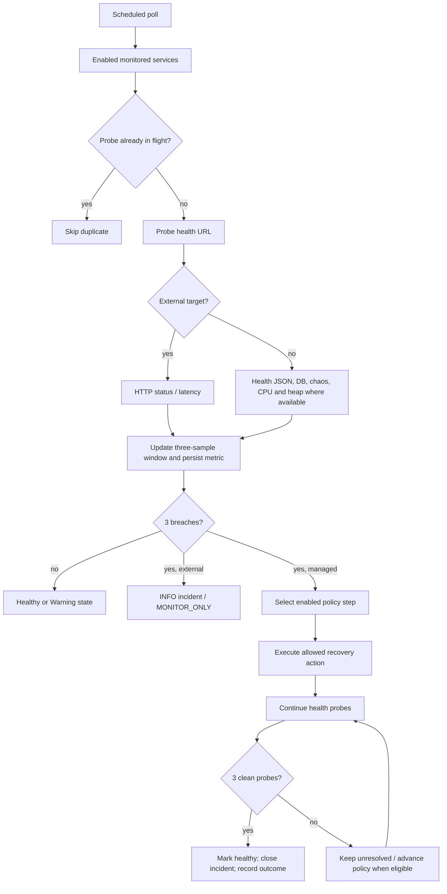

# HealOps + MediFlow: Source-Based Technical and Viva Guide

> **Evidence boundary.** This guide describes the checked-in source and the Docker/configuration files in this workspace. Source code can establish intended behavior, but it cannot certify that a currently running browser, container, database, or host port behaves accordingly. The repository contains runtime reports from earlier sessions, but they are not used as proof here. Any claim that depends on running the system must be verified against that live system before calling it passed.

## 1. Project at a glance

HealOps is a Spring Boot monitoring and recovery control plane for a local collection of MediFlow services. MediFlow is a healthcare-records demonstration application split into a React client, a gateway, an authentication service, a patient service, and a combined clinical service. HealOps Core polls registered targets, stores measurements and incidents, applies configured recovery policies to managed services, and exposes operational data to a React dashboard. The two systems share the default Docker network so the control plane can reach the application services.

This is a service-oriented application with HTTP APIs, persistence in H2, and optional asynchronous integrations. It is not a Kubernetes deployment, and the checked-in default Compose topology is a local Docker deployment. Monitoring and recovery are implemented in HealOps code; their actual success depends on live connectivity, database state, service health, and the restricted Docker-control helper.

### Source/configuration versus runtime

| Evidence type | What it establishes | What it does not establish |
|---|---|---|
| Java/JS/HTML source | Implemented routes, control flow, state handling, and algorithms | That compiled artifacts are current or runtime behavior is healthy |
| `docker-compose.yml`, properties, Nginx config | Intended container wiring, ports, environment, volumes, probes | That the host has those containers running or ports reachable |
| Tests | The paths exercised by those tests passed in their test environment | Browser production behavior, long soak stability, or untested paths |
| Live browser/container/API/DB inspection | Behavior at the inspected time and environment | Future stability or another environment's behavior |

## 2. Repository map

| Path | Role in the current source tree |
|---|---|
| `api-gateway/` | Spring Cloud Gateway routes and the patient JWT validation filter |
| `auth-service/` | Login, password verification, and JWT issuance/validation |
| `patient-service/` | Protected patient REST API, H2 persistence, async integrations and fault endpoints |
| `clinical-service/` | Combined clinical REST service for doctors, appointments, inventory, laboratory, and pharmacy |
| `healops-core/` | Service registry, probes, metrics, incidents, policies, recovery orchestration, and operational API |
| `healops-dashboard/` | React/Vite HealOps user interface, charts, polling, and SSE client |
| `mediflow-web/` | React/Vite MediFlow client, packaged behind Nginx in Compose |
| `billing-service/` | Optional gRPC billing endpoint; Compose profile `billing` |
| `notification-service/` | Optional notification module; Compose profile `extended` |
| `analytics-service/` | Kafka consumer module; not started by the default Compose file |
| `doctor-service/`, `appointment-service/`, `inventory-service/`, `laboratory-service/`, `pharmacy-service/` | Standalone/legacy service modules. The default Compose topology uses their consolidated counterparts in `clinical-service/` instead. |
| `integration-tests/` | Java integration test sources; test coverage is not equivalent to a live browser certification |
| `api-requests/`, `grpc-requests/` | Request examples for manual API and gRPC use |
| `infrastructure/` | AWS CDK/local infrastructure and Docker-control Nginx configuration |
| `docker-compose.yml` | Default local runtime topology, optional profiles, health checks, ports, mounts, and resource caps |

The `.codex-*` and `.local-data` directories are workspace/runtime artifacts rather than application modules. Root scripts are Windows launch/stop helpers; their presence does not prove that a given launch completed successfully.

## 3. Runtime topology from Compose

The default Compose file starts eight application/control containers: API Gateway, HealOps Core, Docker control, Patient Service, Clinical Service, Auth Service, MediFlow Web, and HealOps Dashboard. Kafka is an optional `messaging` profile; Billing is `billing`; Notifications are `extended`; Analytics is not part of the default Compose graph.

| Component | Container port | Host exposure in default Compose | Persistence / operational note |
|---|---:|---:|---|
| MediFlow Web | 80 | 3001 | Nginx serves frontend and proxies API paths |
| API Gateway | 8080 | 8080 | Routes `/auth/**` and `/api/**` |
| HealOps Core | 8090 | 8090 | H2 file under `/data`, named `healops-data` volume |
| HealOps Dashboard | 80 | 8091 | Nginx proxies `/api/` to Core |
| Auth Service | 4005 | 4005 | H2 in container filesystem; no named Auth volume shown |
| Patient Service | 4000 | Not published to host | H2 under `/tmp`, named `patient-data` mounted at `/tmp` |
| Clinical Service | 4002 | 4002 | H2 under `/tmp`, named `clinical-data` mounted at `/tmp` |
| Docker control | 80 | Not published to host | Isolated internal control network; Docker socket mount |

The Compose file sets memory caps for the principal containers and Docker restart policies. Patient, Clinical, Gateway, Core, Auth, and web images have configured health checks/dependencies. A health check is a periodic probe with its own timeout; a healthy container status is not proof that every business route is responsive. `depends_on` health conditions constrain startup ordering but do not by themselves guarantee that a dependent remains healthy after startup.

The Docker-control helper is intentionally separated on an internal network and exposes a limited set of allowed Docker operations through Nginx. It is not equivalent to exposing the entire Docker Engine API to application containers. The HealOps control configuration allowlists selected lifecycle routes for Patient, Clinical, Auth, and Gateway.

## 4. Technology inventory

| Area | Technologies evidenced in manifests/source |
|---|---|
| Backend runtime | Java 21, Spring Boot 3.4.1, Maven |
| HTTP | Spring MVC/Tomcat for services and Core; Spring Cloud Gateway/Netty for the gateway |
| Persistence | Spring Data JPA, Hibernate, H2; HikariCP through Spring Boot JDBC auto-configuration |
| Authentication | Spring Security, BCrypt, JJWT, HMAC JWT signing |
| Monitoring | Spring Actuator, Micrometer metrics, scheduled Java executors, REST probes |
| Frontend | React 19, JavaScript/JSX, Vite; Tailwind CDN references and project CSS |
| UI libraries | Lucide icons; Recharts in HealOps Dashboard |
| Delivery | Docker Compose, Dockerfiles, Nginx static/reverse proxy |
| Optional integrations | Kafka/protobuf, gRPC; separate Analytics and Billing modules |

Axios, Lombok, Kubernetes, OpenTelemetry, Prometheus, and Grafana are not evidenced as active dependencies/implementations in the examined runtime path. A dependency being present is not evidence that its feature is configured or used. Resilience4j appears as a dependency, but the active source does not demonstrate an applied circuit-breaker policy; the chaos-reset operation should not be described as a circuit breaker.

## 5. Request and data flows

### Patient sign-in

1. MediFlow React submits JSON credentials to same-origin `POST /auth/login`.
2. MediFlow Nginx proxies `/auth/` to API Gateway on port 8080.
3. Gateway's `/auth/**` route targets `http://auth-service:4005` and strips the first path segment, so `/auth/login` reaches Auth as `/login`.
4. `AuthController.login` passes the email/password DTO to the authentication service.
5. The service looks up the email through `UserRepository.findByEmail`, compares the submitted password with the stored BCrypt hash, and returns empty for absent user or mismatch.
6. A valid match causes `JwtUtil` to create a signed JWT with email subject, role claim, issue time, and expiry (10 hours in the current implementation).
7. Auth returns the token DTO; the frontend stores it in `sessionStorage` under `mediflow.authToken`.
8. Subsequent Patient requests go to `/api/patients`; Gateway's patient route strips `/api`, applies `JwtValidation`, and calls Auth `/validate` using the Bearer token before forwarding the original request to Patient.

The source establishes the intended flow but does not establish that the browser, built Nginx image, gateway, Auth database, or BCrypt value is currently correct. A 401 from login means the HTTP request was handled and credentials were rejected (or a security layer rejected it); a 502/failed fetch suggests a connectivity/upstream problem and must be traced separately. Never infer which stage failed from the user-facing text alone.

### Patient records

`PatientController` maps Patient CRUD endpoints under `/patients` and `/api/patients`. In the default gateway path, `GET /api/patients` is rewritten to `/patients`. The controller validates DTO fields, delegates persistence to `PatientService`, and maps entities to response DTOs. The frontend sends the Bearer token on protected calls. A 401 clears the stored session token and returns the UI to sign-in; successful authentication and patient loading are separate HTTP operations.

Patient records use UUID identity and fields for name, email, address, date of birth, and registration date. The service checks duplicate email, saves through Spring Data JPA, and then schedules a best-effort integration callback. Patient persistence is not transactionally rolled back merely because optional downstream billing/Kafka integration fails.

### Clinical requests

The default Compose service is `clinical-service`, a single Spring Boot deployment with five domain packages. Clinical API routes are proxied by Gateway to the service. The source path shows no cross-service JPA relation to Patient; patient identifiers in appointments, lab reports, and prescriptions are scalar IDs. The gateway's configured filters protect the patient route; do not claim the same JWT enforcement for clinical routes unless the active route configuration is changed and verified.

### HealOps probe and recovery loop

`SelfHealingEngine` schedules a monitor pass at the configured polling interval (default 5 seconds) after an initial delay. It finds enabled monitored services and dispatches probes to a four-thread `ThreadPoolTaskExecutor` with a bounded queue. A per-service in-flight set suppresses duplicate concurrent probes. HTTP health requests use a `RestTemplate` with configured connection/read timeouts; managed services may additionally expose chaos and Actuator metric endpoints.

The engine records response time, error rate, database-up signal, CPU and heap where available, and a running state. CPU and heap failure thresholds are applied to managed targets. The source shown does not read Hikari pool metrics as part of the probe algorithm, even though Actuator may expose them. External targets are treated as HTTP availability checks: any 2xx is successful, including an HTML page; JSON health components are not expected. A successful external response is not judged by the managed-service slow-response threshold.

The recent probe window is three booleans. No breach yields HEALTHY with score 100. Any breach in the window yields WARNING with score 65 until all three samples breach; three breaches yield CRITICAL with score 15. RECOVERING is represented at score 45. The overview system score is the rounded arithmetic mean of enabled services' scores, with 100 as the empty-set default; the `uptimePercent` field is currently null. This is a code-defined operational indicator, not a statistically weighted SLA.

For managed services, failure type, policy step, retries, cooldown, and allowed action determine recovery. A successful Docker API request means the control action was accepted; HealOps still checks subsequent probes. The engine closes an incident after three clean verification probes, not simply when a restart call returns. External targets are excluded from recovery execution; after three failing samples they create INFO incidents with `MONITOR_ONLY`, and successful probes later close incidents as recovered.

## 6. Authentication and security details

### Auth endpoints

| Endpoint | Behavior from source |
|---|---|
| `POST /login` (publicly proxied as `/auth/login`) | Validate credentials; 200 with token on match, 401 if no matching user/password |
| `GET /validate` | Requires a valid `Bearer ` header; returns 200 for valid JWT, 401 for missing/invalid token |

Auth's security configuration disables CSRF for this stateless-style API and permits requests at the Spring Security matcher level. Credentials are still checked by the login controller/service. BCrypt encoder is configured. The JWT's role is a claim; the examined code does not establish broad role-based authorization for every MediFlow route. The JWT secret must be supplied through runtime configuration and must be strong and private; never put a real secret in a report or source control.

Gateway's patient filter calls Auth validation before forwarding. Missing authorization fails closed with 401; Auth HTTP errors are propagated, while communication errors map to a service-unavailable response. The request's original Authorization header is retained for the downstream Patient service. Frontend-to-Nginx requests are same-origin in the Docker production path, so CORS should not be needed for that path; standalone dev-server proxies and direct service access are different origins and require separate CORS verification.

Security review scope: this guide maps the implemented authentication boundary; it is not a penetration test. Check production CORS, secrets, cookie/token handling, CSRF assumptions, rate limiting, auditability, and authorization before external deployment.

## 7. API catalog (source-defined)

Paths below are public path shapes. Gateway prefix stripping and service context must be considered when invoking them directly.

### MediFlow APIs

| Service | Public path | Operations evidenced |
|---|---|---|
| Auth | `/auth/login` | `POST` credential login |
| Auth | `/auth/validate` | `GET` Bearer token validation |
| Patient | `/api/patients` | `GET`, `POST` |
| Patient | `/api/patients/{id}` | `GET`, `PUT`, `DELETE` |
| Doctors | `/api/doctors` | `GET`, `POST`; `/{id}` `GET`, `PUT`, `DELETE` |
| Appointments | `/api/appointments` | `GET`, `POST`; `/{id}` operations; patient/doctor lookup; status update |
| Inventory | `/api/inventory` | `GET`, `POST`; `/{id}` operations; stock update |
| Laboratory | `/api/laboratory` | `GET`, `POST`; `/{id}` operations; patient lookup; result update |
| Pharmacy | `/api/pharmacy` | `GET`, `POST`; `/{id}` operations; patient lookup; dispense update |

Appointment status update uses `PUT /api/appointments/{id}/status?status=...`; inventory stock uses `PUT /api/inventory/{id}/stock?quantity=...`; lab result uses `PUT /api/laboratory/{id}/result?result=...&status=...`; dispensing uses `PUT /api/pharmacy/{id}/dispense`. Confirm DTOs and validation in the controller before constructing writes.

### HealOps APIs

| Path | Operations evidenced |
|---|---|
| `/api/overview` | Aggregate counts, recovery count, average health score, currently-null uptime |
| `/api/services` | `GET` active/enabled service list; `POST` register target |
| `/api/services/{id}` | `DELETE`; external target is disabled while history is preserved; internal service follows the internal deletion path |
| `/api/services/{id}/detail` | Metrics, incidents, recent recovery actions, diagnosis and summary fields |
| `/api/metrics?serviceId=...` | Recent metrics for a service |
| `/api/incidents` | Recent incidents |
| `/api/incidents/{id}/actions` | Recovery action history for an incident |
| `/api/recovery-actions` | Recent recovery actions |
| `/api/audit-events` | Recent operational events |
| `/api/policies` | Recovery policy list |
| `/api/policies/{id}` | `PUT` policy update |
| `/api/simulate?serviceName=...&failureType=...&durationSeconds=...` | `POST` simulated fault trigger |
| `/api/stream/events` | Server-sent event stream |

Dashboard polling and SSE are separate update mechanisms. Poll results can be stale until the next response; event streaming can disconnect independently. External Stop Monitoring is a soft disable in storage, so active lists omit the target while historical metrics/incidents remain available. An in-flight probe may already have written a final metric before the enabled-state check prevents later status/incident side effects.

## 8. Persistence, migrations, and data safety

### Databases

The configured relational store in the local Compose setup is H2. HealOps uses a named data volume mounted at `/data`; Patient and Clinical use named volumes mounted at `/tmp`. Auth's Compose configuration does not show a named persistent volume. The fact that an H2 URL points to a file does not alone prove that the file survives container replacement: persistence depends on the mount path and volume configuration. Before any deployment operation, inspect Compose mounts and the live container's effective JDBC URL.

Spring Data JPA repositories provide CRUD/query operations. Hibernate schema update is configured for the main Patient/Clinical/Core modules as shown by their properties. Auth initialization includes `defer-datasource-initialization=true`, and `data.sql` creates/seeds the user table idempotently according to its SQL. The mere property does not prove that SQL ran; verify startup logs and query the same live datasource. H2's DDL, SQL compatibility, locking, and file path must be checked against the active container, not inferred from source.

HealOps includes schema compatibility logic for selected historical column/enum changes, a one-time legacy history importer, and a migration to normalize external incidents to INFO/MONITOR_ONLY and remove old external recovery action records. The external migration can alter operational history; review its code and a backup before accepting it in a data-sensitive environment. The importer marker prevents repeated import after success. These migrations are not a general-purpose migration framework with versioned immutable scripts.

### Main entity relationships

HealOps links monitored services to metrics/incidents, and incidents to recovery actions. Clinical objects refer to patients/doctors via scalar identifiers rather than cross-service ORM relations. This avoids a distributed transaction, but referential consistency across services is not enforced by a shared database constraint. Patient is the system of record for patient demographic records; other services may store names/IDs as snapshots.

### Safe database investigation checklist

1. Read the effective JDBC URL and volume mounts from the running container.
2. Take a consistent backup/copy using an H2-supported procedure and stop or quiesce writers if required.
3. Inspect startup logs for schema/SQL/migration exceptions and H2 file lock messages.
4. Query schema and rows from the same database used by the service; avoid an accidental new empty H2 file.
5. Check connection pool active/idle/pending/timeouts and thread/transaction state before attributing latency to H2.
6. Preserve the original volume; test recovery against a copy. Do not remove volumes as a troubleshooting shortcut.

## 9. Concurrency, health probes, and stability limits

The important concurrency mechanisms in deployed code are scheduled monitoring, a bounded HealOps probe executor, per-target in-flight suppression, a per-service synchronized recovery lock, and Patient's bounded async integration executor. Patient's async pool is configured with core 2 / max 4 worker threads, queue capacity 100, and CallerRuns rejection behavior; it waits briefly on shutdown. The callback performs a short-deadline gRPC call and then Kafka send, catching integration failures. A blocking caller-runs policy can transfer slow integration work onto a request thread when saturated, so this path needs queue/latency observations under load.

Patient's JDBC pool is supplied by Spring Boot/Hikari. The checked-in HealOps configuration includes leak detection, but the monitoring engine does not consume Hikari gauges as part of its current health-score algorithm. A service can therefore have a successful Actuator health probe while user requests are waiting for a saturated database pool. A stable Hikari pool must be established from live Actuator metrics/logs during representative load; source alone cannot certify pool stability.

### Failure modes and evidence to collect

| Symptom | Candidate layer | Useful evidence before changing code |
|---|---|---|
| Login 401 | Request DTO, user lookup, BCrypt, security matcher | Browser request body/status; Gateway route logs; Auth request log; SQL query/row; BCrypt match result in safe debug instrumentation |
| Login 502 / failed fetch | Nginx, Gateway upstream, Auth listener/network | Browser Network timing; Nginx access/error logs; Gateway route and connect errors; Auth container readiness/listener |
| Patient 401 after login | Missing/stale token, validation route, expiry, header forwarding | Browser request headers; Gateway filter logs; Auth `/validate`; token subject/expiry without exposing token |
| Patient 5xx/timeout | Patient thread pool, Hikari, H2 lock, integration/blocking path | Thread dump, Hikari active/idle/pending/timeouts, H2 lock logs, request traces and DB query latency |
| Health shows down while endpoint works | Probe URL, DNS, container network, timeout, health parser | Probe URL from Core container; elapsed time; response status/body; service actuator health components |
| External page reported down | HTTP status, TLS, DNS, target behavior | Direct `curl` from Core container; record HTTP status and elapsed time; confirm HTML 2xx handling |

Do not “fix” a timeout by raising arbitrary time limits. First identify which hop timed out and whether the wait is caused by connectivity, queueing, pool exhaustion, lock contention, JVM pauses, or an actual slow endpoint.

## 10. Health, incident, recovery, and external monitoring semantics

### Health score

The service score is a deterministic status indicator based on the last three probe results, not a probabilistic model. Core's system score averages enabled services, so adding/removing a target changes the average even if no existing service changes. An external HTML response is accepted if status is 2xx; content must not be assumed to be JSON. Health score is not uptime percentage, and the source currently returns null for `uptimePercent`.

### Incident lifecycle

For repeated failures, Core creates an incident with the failure classification. Recovery actions are selected from enabled policy steps, with configured attempt limits and cooldowns. A recovery action can be accepted without service recovery. The monitor loop verifies the target; after three clean probes it marks service healthy and closes unresolved/in-progress incident history as recovered. A failed verification can leave an incident unresolved and advance to a later policy step. A simulation path can clear chaos instead of restarting for the simulated crash case; this is not equivalent to a real process crash.

### External monitor-only contract

External website targets are represented as `EXTERNAL_API`. Their probe success is based on HTTP availability, including HTML 2xx responses. Failures eventually produce INFO incidents whose recommended action is `MONITOR_ONLY`. The recovery engine explicitly skips external categories. No orchestration call should be made for those targets. When the site recovers, clean probes close the incident. Stop Monitoring disables the target, removes it from the active enabled list, records an operational event, and preserves history; it is not a history purge.

The historical migration converts existing external incidents to INFO/MONITOR_ONLY and deletes external recovery action logs. This ensures the current source data model presents external incidents as observation-only after migration, but older DB rows must be checked after startup to verify migration completion.

## 11. Frontend behavior and UI limitations

### MediFlow Web

The app is a React component organized around state/tab selection rather than a router-based URL map. It stores the patient token in session storage, submits login through `fetch`, and includes the Bearer token on protected patient requests. A 401 clears the token. Patient loading, login, and general service-health banners are separate state paths; a stale banner can persist if polling/state-clearing behavior is wrong even when the backend has recovered. Verify live API responses and React state transitions instead of treating visible UI copy as authoritative health.

The UI includes patient, doctor, appointment, inventory, pharmacy, laboratory, and other tabs. The existence of a tab or local array does not prove all operations are connected to persisted backend endpoints. The current polling/data-fetch implementation determines which page data is live. In particular, review each tab's fetch and mutation handlers before describing it as fully integrated.

### HealOps Dashboard

The main dashboard is a React/Vite SPA. Its app polls overview/services/incidents/recovery/audit/policy endpoints, and also subscribes to an SSE endpoint. The landing view has a separate refresh cycle. Tabs include overview, fleet, external targets, topology/cascades, chaos, incidents, recovery history, policies, knowledge/assistant, and telemetry. The knowledge/assistant UI is code-driven guidance, not evidence of an LLM or autonomous AI model.

External cards should visibly convey Monitor Only. Dashboard counts/status derive from API state and may briefly lag until polling/event delivery. A failed fetch must be distinguished from a healthy response with zero records; inspect network status and error state.

### Browser verification checklist

Use a clean browser session and preserve evidence (timestamp, URL, screenshot, HAR or request list):

1. Open DevTools before loading MediFlow; enable Preserve log and disable cache for the session.
2. Record frontend origin, `/auth/login` status/body/timing, then the protected patient request status and headers.
3. Verify there are no CORS failures, unexpected 404s, React exceptions, or unhandled promise rejections.
4. Confirm the token is stored only in the expected session storage key after successful login; do not copy the token into a report.
5. Confirm successful `/api/patients` data renders; separately inspect any HealOps overview/poll results that drive availability banners.
6. Open HealOps and verify `/api/overview`, services, incidents, actions, and SSE connection in Network.
7. Capture UI screenshots only after confirming the corresponding API payload; a screenshot alone cannot establish API correctness.

## 12. Implemented design patterns and algorithms

| Pattern/technique | Where / why |
|---|---|
| Layered controller-service-repository | Separates HTTP DTO/controller logic, business service, and persistence access |
| Gateway / reverse proxy | Central HTTP route and patient token-validation boundary; Nginx serves frontend and proxies API paths |
| Repository pattern | Spring Data JPA query and persistence abstraction |
| DTO mapping / validation | Request and response contracts decouple HTTP payloads from entities and validate input |
| Strategy/configured policy sequence | Recovery action steps selected by failure type and policy order |
| Observer/event stream | HealOps SSE broadcasts state/event updates to dashboard consumers |
| Scheduled polling | Periodically samples registered services and applies monitoring state transitions |
| Bounded worker pools | Prevents unbounded creation of monitor/integration threads; bounded queue and rejection policy define overload behavior |
| Sliding-window detector | Three recent breach booleans reduce response to a single transient failure while bounding detection delay |
| Soft deletion | External Stop Monitoring disables active monitoring but preserves related history |
| Outbound async integration | Patient creation dispatches gRPC/Kafka side effects separately from the database save |
| Idempotent seed/migration checks | SQL/table markers and repository checks reduce repeated bootstrap duplication |

There is no source evidence for a machine-learning anomaly model, a learned failure predictor, an SLA-grade uptime calculator, or an always-on circuit breaker. Recovery “estimates” and assistant recommendations should be explained according to their code path, not product labels.

## 13. Implemented features versus limitations

### Implemented in source/configuration

- Patient CRUD and DTO validation backed by JPA/H2.
- Email/password login with BCrypt verification and JWT issuance/validation.
- Gateway routing with a JWT validation filter on the Patient route.
- Combined clinical APIs for doctors, appointments, inventory, lab, and pharmacy.
- HealOps target registry, scheduled probes, metrics persistence, incidents, policy-driven recovery, action history, audit events, REST APIs, and SSE.
- External target polling with monitor-only incident semantics and soft-stop behavior.
- Optional Patient-to-Billing gRPC and Patient-to-Kafka integration paths.
- Docker health checks, Compose networks, named volumes for selected databases, and a restricted control proxy.

### Limits visible from the current source

- A green container health check is not an end-to-end user transaction.
- Core's score is a three-sample status score averaged across enabled services; it is not a measured SLA.
- Core does not currently read Hikari pool gauges in its probe metric sampler.
- `uptimePercent` is null in the overview response.
- The optional Kafka/Billing paths are not active in default Compose, and Analytics is not in the default runtime graph.
- Several legacy single-purpose service folders coexist with the consolidated Clinical Service; they should not be mistaken for default deployed services.
- Patient's async integrations can encounter queue saturation; CallerRuns may put work on the caller thread.
- Source configuration cannot establish that the compiled image contains the same code or that live H2 data is healthy.
- Frontend tab existence is not proof of fully implemented API persistence for each tab.
- Auth persistence is not shown on a named Compose volume; validate the current effective configuration before relying on container replacement for data durability.
- Some MediFlow routes other than Patient do not visibly pass through the same JWT gateway filter.
- H2 and local Docker are suitable for this project setup, but scale-out/high-availability and multi-instance file database semantics require a different deployment/data design.

## 14. Suggested future work (not implemented and not part of this documentation change)

These are architectural/product considerations only; they are not changes made here: adopt versioned database migrations; define explicit backup/restore and restore drills; add end-to-end browser tests; expose and alert on Hikari queue/pool metrics; use distributed tracing across Nginx/Gateway/services; define an explicit token renewal/expiry UX; document authorization policy per route; assess external URL/SSRF controls for target registration; use a production database and secret manager for deployment; and define SLOs before interpreting health averages as reliability. Any such work needs its own design and scope approval.

## 15. Viva preparation: 120 questions and answers

Each answer is intentionally grounded in the current implementation. “Follow-up” gives a likely examiner probe; “Avoid” calls out a common overclaim.

### A. System and architecture

1. **What problem does HealOps solve?** It periodically checks registered MediFlow services, stores operational measurements, detects repeated failures, records incidents, and can execute configured recovery steps for managed services. It also tracks external URLs without attempting to heal them. **Follow-up:** What proves recovery? Three clean verification probes. **Avoid:** Saying a restart request alone proves recovery.

2. **What is MediFlow?** It is the healthcare application comprising a browser client, gateway, Auth, Patient, and Clinical service. Patient data is protected by a JWT check in the gateway path. **Follow-up:** Which service owns patient data? Patient Service. **Avoid:** Calling HealOps the patient database owner.

3. **Is this a monolith or microservices system?** The code is split into independently runnable Spring modules and communicates over HTTP, with optional gRPC/Kafka; default Compose deploys several containers. **Follow-up:** Is it production-grade distributed infrastructure? Not established by module count. **Avoid:** Equating multiple modules automatically with resilient microservices.

4. **What does the API Gateway do?** It maps public routes to service URLs, strips prefixes, and validates JWTs for the Patient route. **Follow-up:** Does every route get the same auth filter? The source route config does not show that. **Avoid:** Claiming universal authorization.

5. **Why use Nginx in front of the frontend?** It serves built static files and proxies browser API paths to backend containers, giving the Docker UI a same-origin access path. **Follow-up:** Does it replace Gateway? No; it forwards to Gateway/Core. **Avoid:** Treating Nginx as business logic.

6. **What is the default deployment topology?** Eight containers are defined for Gateway, Core, Docker control, Patient, Clinical, Auth, and two frontend servers. **Follow-up:** Is Kafka always running? No, it is profile-gated. **Avoid:** Including optional modules as default live services.

7. **Why consolidate clinical domains?** The active Compose setup uses one Clinical deployment containing five domain packages, reducing local service/container count while retaining distinct domain controllers/models. **Follow-up:** Are entities related by JPA? Not across domains in the shown code. **Avoid:** Saying the legacy service folders are all running.

8. **What are the main layers?** Controller, service, repository, and persistence/entity layers; gateway and frontend form the edge. **Follow-up:** Why DTOs? To validate and shape API payloads independently of entities. **Avoid:** Saying every class follows identical layering without inspecting it.

9. **What is the role of HealOps Core?** It owns monitored-target state, probe scheduling, metrics, incidents, policy selection, recovery actions, and operational APIs. **Follow-up:** Does it run in the browser? No, it is Spring Boot. **Avoid:** Conflating Core and Dashboard.

10. **What is the role of HealOps Dashboard?** It polls Core APIs and consumes SSE to render operational views. **Follow-up:** Is its chart the monitor? No, Core performs probes. **Avoid:** Treating UI colors as source health evidence.

11. **Which parts are optional?** Kafka/messaging, Billing, and Notifications use Compose profiles; Analytics is not started by default. **Follow-up:** What happens if a profile is absent? Its integration may fail or remain unused. **Avoid:** Assuming optional dependencies are available.

12. **What is the main trust boundary?** Browser/Nginx to Gateway, Gateway to Auth validation and Patient, plus HealOps control traffic through an allowlisted internal Docker proxy. **Follow-up:** Why restrict Docker access? Docker control is highly privileged. **Avoid:** Describing the helper as harmless because it is Nginx.

13. **How do service modules communicate?** Mainly HTTP REST; optional gRPC to Billing and Kafka event publishing. **Follow-up:** Are they one distributed transaction? No. **Avoid:** Claiming atomicity across HTTP/gRPC/Kafka.

14. **Is the system cloud-native?** It has containerization and service separation, but the default runtime is local Compose and no Kubernetes runtime is shown. **Follow-up:** What else is needed for cloud-native operations? Orchestration, deploy/rollback, observability, scaling, and persistence strategy. **Avoid:** Claiming Kubernetes support from Dockerfiles.

15. **What does “source-based analysis” mean?** It means describing code/configuration behavior and clearly separating it from current runtime observations. **Follow-up:** How prove runtime? Live browser/API/container/database evidence. **Avoid:** Calling source inspection certification.

### B. Java, Spring, and API design

16. **What Java and Spring versions are declared?** POMs declare Java 21 and Spring Boot 3.4.1. **Follow-up:** What runs in the container? Confirm Docker build/runtime image. **Avoid:** Assuming the local JDK equals container JRE.

17. **What is Spring Data JPA used for?** It generates repository operations for entities and supports derived queries such as email lookup. **Follow-up:** Where does SQL execute? Through Hibernate/JPA and JDBC. **Avoid:** Saying repository calls are in-memory.

18. **What does a controller do?** It binds HTTP paths, methods, query/body parameters, validates request DTOs, and maps service results to HTTP responses. **Follow-up:** Where should persistence logic live? Usually service/repository layers. **Avoid:** Putting response status behavior in the browser.

19. **Why use request DTOs?** They define the accepted input contract and validation constraints, reducing direct exposure of persistence entities. **Follow-up:** Does DTO validation guarantee business uniqueness? No; service/repository checks duplicate email. **Avoid:** Assuming `@Valid` enforces database constraints.

20. **What is the gateway route prefix behavior?** A StripPrefix filter removes a leading public segment before forwarding, e.g. `/auth/login` becomes `/login`. **Follow-up:** Why test the final path? Misconfigured stripping causes 404. **Avoid:** Sending the public path directly to Auth without checking mapping.

21. **What is the difference between 401 and 502 here?** 401 indicates a request was rejected as unauthenticated/invalid credentials; 502 generally indicates an upstream/proxy failure. **Follow-up:** How distinguish root cause? Inspect hop-by-hop status/logs. **Avoid:** Treating all login errors as bad passwords.

22. **What does `ResponseEntity` enable?** Explicit control of response status and body, such as token success versus invalid credentials. **Follow-up:** Why status codes matter? Clients branch on them. **Avoid:** Returning 200 for every outcome.

23. **What database is configured in the default local setup?** H2 file databases are configured for the local services. **Follow-up:** Is PostgreSQL used because its driver is present? Not necessarily. **Avoid:** Inferring the active DB from a dependency alone.

24. **What is Hibernate `ddl-auto=update`?** It asks Hibernate to adjust schema to mapped entities at startup. **Follow-up:** Is it a migration system? No; it is not versioned migration history. **Avoid:** Relying on it as a backup or deterministic migration plan.

25. **What does Actuator provide?** Operational endpoints such as health and Micrometer measurements when exposed/configured. **Follow-up:** Does every metric get consumed by HealOps? No. **Avoid:** Claiming all exposed metrics affect the score.

26. **Why is a health endpoint useful?** It provides a lightweight readiness/liveness signal and may include component status. **Follow-up:** Can it pass while business requests fail? Yes, e.g. pool saturation or a route-specific failure. **Avoid:** Calling it end-to-end proof.

27. **What does `@Scheduled` do here?** It triggers recurring monitoring/retention work in Core. **Follow-up:** What controls cadence? Properties with defaults. **Avoid:** Assuming exact scheduling without reading config.

28. **Why bound thread pools?** To cap concurrency and queue growth and make overload behavior explicit. **Follow-up:** What is the downside? Queueing/rejection or caller-runs can increase request latency. **Avoid:** Saying a bounded pool eliminates starvation.

29. **What does `CallerRunsPolicy` mean?** If the Patient async executor is saturated, the submitting thread may execute the task itself. **Follow-up:** Why can that hurt? It can make an HTTP request thread perform slow external work. **Avoid:** Calling it a dropped-task policy.

30. **Why is a gRPC deadline important?** It bounds how long a blocking call waits for Billing. **Follow-up:** Does it guarantee Billing succeeds? No. **Avoid:** Equating deadline with retry.

### C. Authentication and security

31. **Describe the login flow.** Browser posts credentials; Gateway routes to Auth; Auth looks up email, checks BCrypt, signs a JWT, and returns it. **Follow-up:** Where is token used? Authorization header on Patient API requests. **Avoid:** Saying login itself loads records.

32. **What is BCrypt?** A salted adaptive password hash function; verification compares plaintext input against stored hash using the encoder. **Follow-up:** Why not decrypt it? Password hashes are one-way. **Avoid:** Storing or logging raw passwords.

33. **What does `findByEmail` do?** It asks the Auth repository for the user associated with submitted email. **Follow-up:** What if absent? Login returns unauthorized. **Avoid:** Claiming it checks the password itself.

34. **What is inside this JWT?** The current implementation sets email subject, role claim, issue time, and expiry, then signs with an HMAC secret. **Follow-up:** Is the payload encrypted? No, signed, not encrypted. **Avoid:** Putting sensitive patient data in claims.

35. **How does Gateway validate the patient token?** It calls Auth's `/validate` with the Bearer token before forwarding the Patient request. **Follow-up:** What happens if Auth is unreachable? The filter maps communication failures to service-unavailable behavior. **Avoid:** Assuming token validation is offline.

36. **What happens when the token is missing?** The gateway filter rejects the Patient request with 401. **Follow-up:** Does the UI clear stale token on 401? Its handler does. **Avoid:** Retrying indefinitely with no token.

37. **Where does the browser store the token?** `sessionStorage`, under `mediflow.authToken`. **Follow-up:** What is the lifetime scope? Browser tab/session storage lifetime. **Avoid:** Calling it an HttpOnly cookie.

38. **Is the JWT role enforced everywhere?** The role is included as a claim, but broad role-based authorization is not shown for every route. **Follow-up:** What should be checked? Route matchers, method security, and gateway filters. **Avoid:** Treating a role claim as authorization by itself.

39. **Why disable CSRF in Auth?** The API is designed around explicit request credentials/Bearer tokens rather than ambient session cookies. **Follow-up:** Is disabling CSRF always safe? No; it depends on browser credential model and endpoints. **Avoid:** Generalizing this setting to cookie-authenticated apps.

40. **Does same-origin Nginx eliminate all CORS concerns?** It removes CORS from that specific browser path, but direct/dev-server requests can still cross origins. **Follow-up:** How verify? Inspect browser preflight and response headers. **Avoid:** Saying CORS is impossible.

41. **What is the risk of a weak JWT secret?** Attackers may forge tokens if they can guess the signing secret. **Follow-up:** How manage it? Strong secret injection/rotation. **Avoid:** Committing real secrets.

42. **Does a valid JWT mean a Patient Service is healthy?** No. It proves token acceptance at validation time; downstream service availability is separate. **Follow-up:** Which request proves records? Successful Patient API response. **Avoid:** Treating auth health as full login-to-data success.

43. **How investigate a login 401?** Inspect browser body/status, Gateway forwarding, Auth logs, SQL result, BCrypt match, and signing only after credential verification. **Follow-up:** How avoid secret leakage? Log stages/results, never passwords or full tokens. **Avoid:** Changing seed hashes before identifying mismatch.

44. **How investigate a login 502?** Follow Nginx, Gateway, DNS/upstream connection, Auth listener and logs, then request timing. **Follow-up:** Why not change BCrypt? A 502 is usually not credential comparison. **Avoid:** Treating transport failures as invalid credentials.

45. **What should a production security review add?** Route authorization review, secret management, abuse/rate controls, token lifecycle, audit policy, and threat modeling. **Follow-up:** Which route is visibly JWT-filtered? Patient path. **Avoid:** Claiming this guide is a penetration test.

### D. Patient and clinical data

46. **What fields does Patient store?** UUID, name, email, address, birth date, and registration date. **Follow-up:** What validates email? Request DTO constraints. **Avoid:** Assuming all clinical identifiers are foreign keys.

47. **How is duplicate patient email handled?** Service checks repository existence before saving. **Follow-up:** Can concurrent requests race? Yes, database uniqueness should also be considered. **Avoid:** Calling the pre-check sufficient under concurrency.

48. **What is the Patient API base route?** Controller supports `/patients` and `/api/patients`; Gateway strips `/api` for its route. **Follow-up:** What path reaches the container? `/patients`. **Avoid:** Confusing external and upstream paths.

49. **What happens after a Patient save?** An asynchronous integration callback is submitted; it attempts optional Billing and Kafka side effects. **Follow-up:** Does callback failure undo the save? Not in the shown flow. **Avoid:** Claiming distributed atomicity.

50. **What is stored in Appointment for a patient?** A scalar `patientId` and descriptive fields, not a cross-service JPA relationship. **Follow-up:** How is consistency handled? Application-level identifiers and API behavior. **Avoid:** Assuming database cascades across services.

51. **What domains are in Clinical Service?** Doctors, appointments, inventory, lab reports, and prescriptions/pharmacy. **Follow-up:** Why one service? Current deployment consolidation. **Avoid:** Listing the separate legacy modules as default active containers.

52. **How is an appointment status changed?** Through a status update route with status parameter. **Follow-up:** Is state transition validity guaranteed? Inspect controller/service validation. **Avoid:** Assuming arbitrary status input is safe.

53. **How is lab data associated with a patient?** By patient identifier and patient-name snapshot fields. **Follow-up:** What tradeoff? Loose coupling, but possible stale name. **Avoid:** Saying it joins the Patient DB automatically.

54. **What does repository abstraction buy?** Less boilerplate and consistent persistence access. **Follow-up:** Does it remove need for indexes/transactions? No. **Avoid:** Treating JPA as performance optimization by itself.

55. **Why validate registration dates?** Prevent malformed or invalid request data at the API boundary. **Follow-up:** Are semantic rules fully covered? Verify actual constraints/service checks. **Avoid:** Assuming annotations enforce all business invariants.

56. **What is an entity versus DTO?** Entity maps persistence structure; DTO defines transport data. **Follow-up:** Why map? Avoid leaking internals and control fields. **Avoid:** Returning every entity field by default.

57. **What happens if Billing is unavailable?** The gRPC call has a deadline and integration errors are caught; patient creation can still remain saved. **Follow-up:** Is a retry queue present? Not established in the shown callback. **Avoid:** Claiming guaranteed eventual delivery.

58. **What happens if Kafka is disabled?** The optional producer path may fail/log an error; default Compose does not start Kafka unless profile enabled. **Follow-up:** Is Analytics consuming by default? No. **Avoid:** Claiming real-time analytics always runs.

59. **What does the Analytics module do?** Its consumer reads patient protobuf events and logs/handles them as coded; it is outside the default Compose graph. **Follow-up:** Does it calculate clinical analytics? Not shown. **Avoid:** Overstating analytics capability.

60. **What does Billing gRPC return?** The current server implementation returns a fixed account ID/status response, not a full billing ledger. **Follow-up:** What is a gRPC stub? Generated typed client/server interface. **Avoid:** Describing this as production billing.

### E. HealOps monitoring and recovery

61. **How often does Core poll?** Default scheduled interval is 5 seconds after initial delay, configurable by property. **Follow-up:** Why avoid assuming exact time? Deployment overrides may differ. **Avoid:** Saying every service is probed exactly every 5 seconds under load.

62. **How does Core limit duplicate probes?** It tracks in-flight service IDs and avoids submitting another probe for an already active target. **Follow-up:** What clears the marker? Runnable `finally`. **Avoid:** Assuming marker prevents all overlapping recovery effects.

63. **What happens if a health URL returns HTML 200?** External target is considered available; JSON health parsing is only for internal/managed targets. **Follow-up:** Is content semantic correctness tested? No. **Avoid:** Calling an HTML 200 a comprehensive website health check.

64. **How many failed samples trigger CRITICAL?** Three breaches in the three-sample window. **Follow-up:** What is warning? Any breach short of all three. **Avoid:** Claiming one failure immediately restarts a service.

65. **What is the service health-score mapping?** Healthy 100, Warning 65, Recovering 45, Critical 15 in the current implementation. **Follow-up:** Is it an SLA? No. **Avoid:** Calling it a learned score.

66. **How is system health score computed?** Rounded arithmetic average of enabled monitored service scores. **Follow-up:** What is empty default? 100. **Avoid:** Assuming service criticality weights exist.

67. **Does Overview provide uptime percentage?** The source response has a null uptime field. **Follow-up:** How could uptime be computed? Persist availability intervals and define a window/denominator. **Avoid:** Reading health score as uptime.

68. **How are recovery policies selected?** Query enabled policies by failure type in step order, then apply retry and cooldown limits. **Follow-up:** Why cooldown? Avoid rapid repeated actions. **Avoid:** Assuming every failure uses the same action.

69. **What happens after a restart command succeeds?** Core enters recovery/verification and keeps probing; the incident closes only after clean samples. **Follow-up:** What if service stays down? Policy escalation/unresolved incident path. **Avoid:** Equating Docker API 200 with service recovery.

70. **How is recovery serialized?** A per-service lock prevents concurrent recovery sequences for the same monitored service. **Follow-up:** Does that serialize different services? No. **Avoid:** Claiming one global lock.

71. **What does the bounded probe executor protect against?** Unbounded probe-thread growth. **Follow-up:** What if its queue fills? Submissions can be rejected, so inspect executor behavior/logs. **Avoid:** Saying bounded queues remove overload.

72. **Does HealOps measure Hikari directly?** Actuator may expose Hikari metrics, but the active sampler reads CPU and JVM heap metrics, not Hikari gauges. **Follow-up:** How verify pool? Query live Actuator metrics and logs. **Avoid:** Claiming Hikari is part of score.

73. **Why can a health probe pass while requests time out?** Health may be a lightweight path while business requests queue on DB pool, locks, or worker threads. **Follow-up:** What evidence distinguishes? Hikari, thread dump, endpoint timing, DB lock logs. **Avoid:** Blaming network by default.

74. **How are incidents closed?** After repeated clean probes, unresolved/in-progress incident records are transitioned to recovered/closed state. **Follow-up:** Does manual action close it? Not necessarily. **Avoid:** Assuming recovery history is updated by the restart alone.

75. **What is a simulated fault?** An endpoint/chaos mechanism that induces a configured test failure for a duration. **Follow-up:** Is that equivalent to killing a container? No. **Avoid:** Claiming a chaos HTTP response models all real outages.

76. **What does the simulated crash special case do?** It can select chaos-clearing behavior rather than actual container restart. **Follow-up:** Why must it be labeled? Simulated and real crash paths differ. **Avoid:** Using simulation as proof of Docker restart.

77. **What are HealOps metrics?** Per-probe values such as response time, error rate, service state, CPU/heap where available, and database status. **Follow-up:** How retained? Repository persistence plus cleanup schedule. **Avoid:** Claiming every metric is measured for every target.

78. **What is the retention job?** Scheduled cleanup removes metrics older than configured retention (default 24 hours in source). **Follow-up:** Are incidents also deleted? Not by this metric cleanup. **Avoid:** Assuming all history follows one retention rule.

79. **What is SSE used for?** Pushes Core events to an open browser connection. **Follow-up:** Is SSE a replacement for REST polling? No; dashboard uses both. **Avoid:** Assuming SSE reconnection guarantees no missed state.

80. **What is a recovery policy step?** A failure-specific action with order, retry count, cooldown, and enabled flag. **Follow-up:** Why step order? Escalation. **Avoid:** Treating policy as arbitrary AI selection.

### F. External website monitoring

81. **How is an external target distinguished?** It is stored with external category such as `EXTERNAL_API`. **Follow-up:** Why explicit category? Prevent managed-service recovery behavior. **Avoid:** Relying only on URL hostname heuristics.

82. **Can external targets be restarted?** The recovery method explicitly skips external services. **Follow-up:** What does a failure do? Creates an INFO/MONITOR_ONLY incident after threshold. **Avoid:** Promising no possible bug without live call verification.

83. **What severity is an external outage?** INFO with recommended action `MONITOR_ONLY`. **Follow-up:** What happens on recovery? Clean probes close incident. **Avoid:** Describing it as managed critical outage.

84. **Why accept HTML pages?** External health means HTTP availability in this implementation; many websites return HTML rather than actuator JSON. **Follow-up:** Is a 200 login page enough? It proves HTTP response only. **Avoid:** Equating response with content correctness.

85. **What does Stop Monitoring do?** It disables an external target and preserves historical metrics/incidents. **Follow-up:** Is it a physical delete? No, it is a soft stop. **Avoid:** Saying history is erased.

86. **Can a final metric appear after Stop Monitoring?** An already in-flight probe may save a metric before it checks the disabled flag; subsequent status/incident updates are guarded. **Follow-up:** How eliminate this race? Cancel/join probes or check enabled before metric write. **Avoid:** Guaranteeing an absolutely empty tail.

87. **How should external recovery be verified?** Cause or select an HTTP failure, confirm an INFO/MONITOR_ONLY incident, verify no control/orchestrator action, restore HTTP 2xx and wait for clean probes to close incident. **Follow-up:** What logs prove no restart? Core/control proxy logs. **Avoid:** Relying only on a badge.

88. **What can an external monitor actually prove?** Reachability from Core's network and observed HTTP status/latency. **Follow-up:** What does it not prove? User experience, page content correctness, or reachability from every region. **Avoid:** Calling it full synthetic monitoring.

89. **What is the security risk of user-supplied monitor URLs?** SSRF or access to internal/private endpoints if validation is weak. **Follow-up:** What defense? Allowlist/resolve/revalidate address ranges and restrict egress. **Avoid:** Assuming an external label makes a URL safe.

90. **Why migrate existing external incidents?** To normalize legacy rows to INFO/MONITOR_ONLY and remove old associated recovery actions. **Follow-up:** How confirm? Query migrated rows after startup. **Avoid:** Assuming migration ran because class exists.

### G. Frontend, operations, and debugging

91. **Does MediFlow use React Router?** The examined UI is state/tab based; no router-based page flow is evidenced. **Follow-up:** What does browser URL represent? Primarily app origin. **Avoid:** Inventing URL routes for tabs.

92. **What storage holds MediFlow auth state?** Session storage token plus React component state. **Follow-up:** Does React state survive reload? No, token can be reread from session storage. **Avoid:** Saying localStorage is used.

93. **What causes a stale unavailable banner?** Potentially stale polled API data or UI state not cleared on recovery/login; source investigation must follow the exact setter/clearer and API response. **Follow-up:** What evidence? Network payload and React state transitions. **Avoid:** Hiding it instead of correcting its source.

94. **How often does the dashboard refresh?** Main app polls several Core APIs at a short fixed interval and subscribes to SSE; landing view has its own refresh timer. **Follow-up:** What can go wrong? Overlapping requests, stale response ordering, disconnected SSE. **Avoid:** Assuming UI updates synchronously with backend state.

95. **Why is frontend fetch status important?** Browser-visible status/body identifies whether failure is network, proxy, auth, or application response. **Follow-up:** What else inspect? Request URL, timing, headers, console. **Avoid:** Debugging from a toast alone.

96. **What is the correct first step for a 404?** Confirm requested path after Nginx/Gateway prefix rewriting and compare controller mapping. **Follow-up:** Which layer logs forwarded path? Gateway access/debug logs. **Avoid:** Rewriting controller routes before checking proxy config.

97. **How can browser CORS be ruled out?** Inspect console and preflight/response headers for the actual origin/request. **Follow-up:** Is same-origin Docker flow cross-origin? No. **Avoid:** Assuming all environments use that flow.

98. **What should a browser screenshot prove?** Visual rendering at a moment only; it does not prove API success. **Follow-up:** What should accompany it? Network response evidence and timestamp. **Avoid:** Using screenshot as health check.

99. **Why preserve log in DevTools?** It retains requests across navigation/reload and helps capture transient auth failures. **Follow-up:** Why disable cache? Isolate stale frontend assets. **Avoid:** Clearing all storage before capturing a bug without recording it.

100. **How verify a deployment's frontend bundle matches source?** Compare image build context/build timestamp or asset hashes with source build output. **Follow-up:** Why relevant? Browser may run stale bundle. **Avoid:** Assuming editing source updates a running image.

101. **What does a Docker health status mean?** Only that the configured health check passed at its last run. **Follow-up:** Does it guarantee host port works? No. **Avoid:** Treating `healthy` as all routes reachable.

102. **How investigate host port failures with healthy containers?** Check published port bindings, host firewall/process conflicts, Nginx/Gateway listener, and test from host and container network separately. **Follow-up:** Why test both? Docker internal and host paths differ. **Avoid:** Restarting everything before collecting evidence.

103. **What does a container restart count tell you?** That Docker restarted the container, not the cause. **Follow-up:** What else correlate? Exit code, OOM, health state, logs, restart timestamps. **Avoid:** Calling any restart count a restart loop without timing.

104. **How certify memory stability?** Record container working set/limit and JVM heap over time under representative requests; inspect GC and OOM logs. **Follow-up:** Is one sample enough? No. **Avoid:** Calling heap-used metric total process memory.

105. **How certify CPU stability?** Sample container CPU over a defined workload and duration, note host normalization and idle/busy context. **Follow-up:** Does Core's process metric equal container CPU? No, different metric semantics. **Avoid:** Comparing percentages without understanding denominator.

### H. Database, testing, and presentation

106. **How investigate H2 corruption safely?** Preserve the volume, back it up, inspect logs/file state, and open a copy with a compatible H2 version. **Follow-up:** What should never be first? Deleting the volume. **Avoid:** Resetting H2 to make startup green.

107. **What does `defer-datasource-initialization` do?** Delays SQL data initialization until after JPA schema setup in the Boot initialization order. **Follow-up:** Does it prove `data.sql` succeeded? No; startup logs and a live query do. **Avoid:** Treating the property as evidence of a user row.

108. **How verify the seed user exists?** Query `users` in the exact database used by Auth and correlate startup SQL logs. **Follow-up:** Should a password be printed? No. **Avoid:** Copying hashes or credentials into logs/reports.

109. **What proves BCrypt match?** A safe boolean from the actual encoder comparison for the request against the fetched hash, correlated to that user row. **Follow-up:** Should plaintext be logged? Never. **Avoid:** Assuming the seed hash is correct based on an earlier environment.

110. **What is the difference between unit/integration and browser tests?** Unit/integration tests exercise code or service interactions; browser tests exercise built frontend, proxy, browser storage, and cross-service flow. **Follow-up:** What does a passing test not prove? Long-run stability. **Avoid:** Claiming full live certification from Maven test success.

111. **What is the best presentation flow?** Explain architecture, show login and patient retrieval, show HealOps target state, demonstrate one managed recovery, then external monitor-only behavior, and finish with limitations and evidence. **Follow-up:** What makes the demo credible? Timestamps, API evidence, logs, and preserved history. **Avoid:** Triggering an uncontrolled production outage.

112. **How demonstrate managed recovery safely?** In a disposable/local environment, capture healthy baseline, inject one supported fault, correlate detection/incident/action, verify clean probes and closure, then inspect recovery history. **Follow-up:** Why one fault? Clear causal evidence. **Avoid:** Faking screenshots or changing state without recording it.

113. **How demonstrate external monitoring?** Register a safe test URL, verify 2xx availability, induce/choose a controlled failure, show INFO/MONITOR_ONLY and no orchestrator action, restore URL, then stop monitoring and confirm history remains. **Follow-up:** What logs are key? Core and control-proxy logs. **Avoid:** Using a real critical third-party site for fault injection.

114. **What should a soak report include?** Start/end timestamps, sampling interval, CPU/memory, Hikari active/idle/pending, incident count, restart counts, workload, and anomalies. **Follow-up:** Why report workload? Resource stability depends on load. **Avoid:** Calling idle operation under no requests a meaningful capacity test.

115. **What is thread starvation?** Runnable work cannot get sufficient execution time/worker availability, causing queueing and delayed requests. **Follow-up:** How confirm? Thread dump, executor queue/rejection stats, blocked stacks, latency. **Avoid:** Diagnosing it from CPU alone.

116. **What is Hikari pool exhaustion?** All available connections are borrowed and callers wait or time out. **Follow-up:** How identify? Active=max, idle=0, pending borrowers/timeouts. **Avoid:** Increasing max pool without checking DB capacity/leaks.

117. **What is a database lock contention symptom?** Transactions wait on locks, increasing latency and possibly causing timeouts. **Follow-up:** How separate from connection leak? Inspect lock waits and connection borrow duration. **Avoid:** Assuming every JDBC timeout means corrupt H2.

118. **Why preserve database volumes during runtime fixes?** Volumes contain user/business/operational history; container replacement should not be confused with deleting stored data. **Follow-up:** What is the safe procedure? Backup, change container only, verify same mounted path. **Avoid:** `down -v` as routine cleanup.

119. **What does “READY” require?** A defined acceptance checklist with successful live browser/API/recovery/external-monitor/soak evidence and no unresolved critical failure. **Follow-up:** Can source analysis alone declare ready? No. **Avoid:** Certifying without current runtime evidence.

120. **What is this guide's scope?** It documents source/configuration behavior and viva explanations; it does not modify application behavior or claim an active system passed. **Follow-up:** What is next for certification? Run the prescribed checks in the target environment and attach evidence. **Avoid:** Presenting a source walkthrough as a live operational sign-off.

## 16. Oral defense: concise walkthrough

1. **Start with scope:** “MediFlow owns healthcare workflows and data; HealOps monitors and recovers selected managed services. External websites are observation-only.”
2. **Trace one request:** Show browser login, Nginx, Gateway rewrite, Auth lookup/BCrypt/JWT, then the protected Patient request and validation filter.
3. **Explain persistence:** Identify H2 files and actual volume mounts; show that preserving the data path is part of safe container operations.
4. **Explain detection:** Show scheduled probe, bounded executor, three-sample window, persisted metric and status transition.
5. **Demonstrate recovery:** Use a controlled managed fault and correlate incident, policy action, verification probes, incident closure, and history.
6. **Demonstrate external monitoring:** Show 2xx availability, INFO/MONITOR_ONLY failure, no recovery call, recovery closure, and stop-monitoring history retention.
7. **Close with honest limits:** Explain score/uptime distinction, absent Hikari integration in the score, optional profile modules, and the requirement for live runtime certification.

## 17. Final evidence checklist for a live certification

This checklist is intentionally **not marked passed** by this source guide.

- [ ] Browser login request reaches Gateway and Auth; correct status and JSON response captured.
- [ ] Auth SQL logs and live query establish schema and expected user row; BCrypt match is verified without exposing credentials.
- [ ] JWT is returned and accepted by Auth validation; protected Patient request includes Bearer header and returns records.
- [ ] Browser console has no runtime/auth/CORS errors; Network has no unexpected failed auth/patient requests.
- [ ] HealOps managed baseline is healthy; one controlled fault yields detection, incident, policy action, verification, closure, and history update.
- [ ] External target accepts HTML 2xx; controlled failure yields INFO/MONITOR_ONLY, with no Docker-control/orchestrator request; recovery closes incident.
- [ ] Stop Monitoring removes external target from active list and preserves history.
- [ ] Dashboard overview, Fleet, incidents, recovery history, and external target views agree with API payloads.
- [ ] 30–60 minute soak log includes five-minute CPU, memory, Hikari, open incidents, and restart-count samples under documented load.
- [ ] Thread dumps/logs show no starvation; Hikari has no sustained pending borrowers/timeouts; no restart loop.
- [ ] H2 named volumes are identified and preserved; startup/migration logs contain no corruption, lock, or migration failure.
- [ ] Evidence includes timestamps, API responses/log extracts, browser screenshots, container metrics, and exact build/image identity.

**Certification decision:** Not determined by this document. Mark READY only after every live checklist item passes in the intended runtime environment.

## 18. Source files to consult

The principal implementation references are:

- `docker-compose.yml`
- `api-gateway/src/main/resources/application.yml`
- `api-gateway/src/main/java/com/pm/apigateway/filter/JwtValidationGatewayFilterFactory.java`
- `auth-service/src/main/java/com/pm/authservice/controller/AuthController.java`
- Auth service, security, repository, JWT utility, `application.properties`, and `data.sql` under `auth-service/src/main/`
- Patient controller/service/repository/entity, async configuration, integration classes, and `application.properties` under `patient-service/src/main/`
- Controller/model/repository packages and `application.properties` under `clinical-service/src/main/`
- `healops-core/src/main/java/com/healops/core/engine/SelfHealingEngine.java`
- HealOps controller, orchestrator, repositories, models, initializers and migration classes under `healops-core/src/main/`
- `healops-dashboard/src/App.jsx`, `LandingPage.jsx`, `index.css`, and `nginx.conf`
- `mediflow-web/src/App.jsx`, `index.html`, and `nginx.conf`

## 19. Architecture diagrams

### Default runtime and request paths

```mermaid
flowchart LR
  Browser[Browser]
  subgraph Docker[Default Docker Compose network]
    Web[MediFlow Web Nginx + React]
    Dash[HealOps Dashboard Nginx + React]
    GW[API Gateway :8080]
    Auth[Auth Service :4005]
    Patient[Patient Service :4000]
    Clinical[Clinical Service :4002]
    Core[HealOps Core :8090]
    Control[Restricted Docker Control Proxy]
    DockerEngine[Docker Engine socket]
    Web -->|/auth and /api| GW
    Web -->|/healops| Core
    Dash -->|/api| Core
    GW --> Auth
    GW --> Patient
    GW --> Clinical
    Core -->|health, metrics, chaos| Patient
    Core -->|health, metrics, chaos| Clinical
    Core -->|health| Auth
    Core -->|allowlisted lifecycle action| Control
    Control --> DockerEngine
  end
  Browser -->|:3001| Web
  Browser -->|:8091| Dash
  Browser -->|:8080 optional direct| GW
  Browser -->|:8090 optional direct| Core
  Ext[External HTTP websites] -->|polled HTTP(S), monitor only| Core
```

The arrows show configured communication paths, not proof of live availability. Optional Billing/gRPC, Kafka, and Notification paths are omitted from this default-runtime diagram because they are not part of the default eight-container topology.

### Login and protected patient read

```mermaid
sequenceDiagram
  participant B as Browser / MediFlow React
  participant N as MediFlow Nginx
  participant G as API Gateway
  participant A as Auth Service
  participant DB as Auth H2 / UserRepository
  participant P as Patient Service
  B->>N: POST /auth/login (JSON credentials)
  N->>G: proxy /auth/login
  G->>A: strip /auth prefix; POST /login
  A->>DB: findByEmail(email)
  DB-->>A: user row or empty
  A->>A: BCrypt matches; sign JWT on match
  A-->>G: 200 token or 401
  G-->>N: upstream response
  N-->>B: token response
  B->>N: GET /api/patients + Bearer JWT
  N->>G: proxy /api/patients
  G->>A: GET /validate + Bearer JWT
  A-->>G: 200 valid or 401 invalid
  G->>P: forward original request + Authorization
  P-->>G: patient response
  G-->>N: patient response
  N-->>B: patient JSON
```

### Monitoring and recovery loop



## 20. Technology audit: usage, rationale, and non-usage

“Why chosen” is not stated as author intent in source. The rationale below is a functional explanation inferred from where the technology is used; it should be presented as engineering interpretation, not a recorded design decision.

| Technology / concept | Status | Where and what it does | Practical benefit and limitation |
|---|---|---|---|
| Java 21 | Implemented/configured | Backend POMs declare Java 21; Spring services and Core are Java | Mature JVM/Spring ecosystem. JVM memory and thread behavior still need runtime tuning and measurement. |
| Spring Boot | Implemented/configured | Service entry points, dependency wiring, HTTP, Actuator, persistence, scheduling | Reduces framework setup and standardizes service wiring; auto-configuration must be inspected when debugging. |
| Spring Security | Implemented in Auth | `SecurityConfig`, BCrypt bean, request matcher setup | Supplies security primitives; current route-level authorization is narrower than “all APIs secured.” |
| JWT / JJWT | Implemented | Auth utility issues and validates signed tokens; Gateway calls Auth validation | Stateless bearer credential; token is signed, not encrypted, and validation depends on Auth availability in this implementation. |
| React | Implemented | `mediflow-web/src/App.jsx`, `healops-dashboard/src/App.jsx`, landing page | State-driven interactive UI; large single components and async state flows can be harder to maintain. |
| Vite | Implemented/configured | Frontend package manifests and Vite configs | Development server/build pipeline; production browser behavior depends on built image and Nginx. |
| Tailwind CSS | Partially implemented by CDN | Referenced by frontend HTML using CDN; classes appear in JSX | Utility classes speed layout styling; external CDN creates network/version dependency and is not a bundled npm build in the observed setup. |
| CSS | Implemented | Inline/index styles and dashboard CSS files | Fine control of presentation; styling is split between JSX utility classes and CSS. |
| Fetch API | Implemented | Browser requests in both frontends (`fetch`) | Native browser API, no extra client dependency; error/status handling must be done explicitly. |
| Axios | Not implemented in active frontend source | No Axios package/use found | Do not attribute interceptors or Axios retry semantics to the app. |
| REST/HTTP | Implemented | Controllers, Nginx, Gateway, HealOps APIs | Simple interoperable request/response boundary; synchronous calls can fail or block. |
| Spring Data JPA | Implemented | Entity repositories in Patient, Auth, Clinical, Core | Repository abstraction and mapping; query shape, transaction boundaries, schema evolution still matter. |
| Hibernate | Implemented through JPA starter | ORM/schema behavior for relational services | Maps Java entities to SQL; automatic schema update is not a substitute for versioned migration scripts. |
| H2 | Implemented/configured | Local file databases, Docker mounts for selected services | Convenient embedded DB; file locking, version compatibility, persistence paths, and multi-instance semantics limit production use. |
| PostgreSQL | Dependency present, not default-configured in Compose | PostgreSQL drivers appear in multiple service POMs; observed Compose datasource configuration uses H2 | Driver presence permits a future/configured datasource but is not evidence PostgreSQL is active or tested. |
| HikariCP | Implemented via JDBC auto-configuration | JDBC connection pools in Spring services | Efficient connection pooling; current HealOps probe sampler does not incorporate its gauges into health score. |
| Maven | Implemented | Independent module POMs | Dependency/build management; repository root is not a single Maven aggregator build. |
| Docker | Implemented | Service Dockerfiles and Docker Engine | Repeatable container packaging; runtime health requires host/daemon/network evidence. |
| Docker Compose | Implemented | Root `docker-compose.yml` | Defines local containers, networks, mounts, profiles, health checks and dependencies; not a cluster orchestrator. |
| Nginx | Implemented | `mediflow-web/nginx.conf`, dashboard Nginx config, restricted control proxy | Static hosting and path proxying; prefix rewrites and upstream reachability are common failure boundaries. |
| Actuator | Implemented/configured | Service health and metrics endpoints, notably Core's service probes | Exposes operational state; which endpoint/metric is enabled and consumed differs by service. |
| Jackson | Implemented via Boot | JSON DTO binding; Core `ObjectMapper` parses probe data and legacy import | JSON interoperability; parsing health payload is not the same as validating business availability. |
| Java Streams | Implemented | Mapping/filter/count/aggregate operations in Patient/Core | Concise collection processing; stream pipeline is synchronous unless explicitly parallelized (none found here). |
| Java `ExecutorService` | Not directly implemented in active runtime modules | No direct `ExecutorService` instance/use found in deployed services | Thread pools exist through Spring's `ThreadPoolTaskExecutor`, which wraps Java executor machinery. |
| `ScheduledExecutorService` | Not implemented | No direct instance/use found | Scheduling uses Spring `@Scheduled` instead. |
| Spring scheduling | Implemented | `@EnableScheduling` and Core scheduled methods | Central recurring monitoring/retention jobs; schedule runs inside Spring-managed infrastructure. |
| Spring `ApplicationReadyEvent` | Implemented in Core | `SelfHealingEngine` event listener records readiness after startup runners | Prevents monitor work from beginning before migrations/runners are finished; not present as a general startup synchronization feature across all services. |
| `@Async` | Implemented in Patient | `PatientIntegrationService` uses named executor after patient save | Separates optional external integration from response path; queue saturation and CallerRuns can still couple latency. |
| Java thread pools | Implemented through Spring abstractions | Core has a bounded four-thread probe executor; Patient has bounded async integration executor core 2/max 4 and queue 100 | Bounds worker concurrency; does not prove no starvation under blocking tasks. |
| Concurrent collections | Implemented | Core uses `ConcurrentHashMap`, concurrent key set for probe tracking and recovery state; test/chaos code has atomics | Safe primitive operations for shared registries; mutable list values still need care when compound operations occur. |
| Atomics | Implemented in chaos controls | Atomic flags/counters represent injected fault state | Thread-safe individual state updates; not equivalent to atomic multi-field transactions. |
| `synchronized` | Implemented in recovery | Per-service lock synchronized during recovery sequence | Serializes same-service recovery; can block that service's recovery path while a slow call is executing. |
| SLF4J | Implemented | Logging in Core, Patient integration, exception/chaos handling | Facade decouples application from logging backend; logs must avoid credentials and token contents. |
| Logback | Spring Boot default logging backend when present through starter dependencies | Logging backend selected by Spring Boot starter classpath; application code uses SLF4J facade | Provides default local logging; no centralized log aggregation or custom structured log pipeline is evidenced. |
| Apache HttpClient 5 | Present through Docker Java transport dependency | `docker-java-transport-httpclient5` is declared in HealOps Core for Docker client transport | HTTP transport used by Docker client integration; it is not the browser API client and does not mean all REST calls use Apache HttpClient. |
| Spring DI / beans | Implemented | Constructor injection and `@Bean` configuration across modules | Centralized lifecycle/wiring and testability; default beans are singleton unless scoped otherwise. |
| Spring bean lifecycle | Implemented through framework | Spring creates/configures singleton services/executors/repositories and shuts down managed components | Simplifies resource ownership; lifecycle hooks and async shutdown behavior should be verified for resources such as gRPC channels. |
| Spring custom application events | Not found as a domain-event mechanism | Core listens to framework `ApplicationReadyEvent`; no custom application event bus found | Do not call SSE broadcasts or Kafka messages “Spring application events.” |
| Spring events | Partially used | Framework readiness event in Core; SSE is a separate browser push channel | Useful for startup coordination; not evidence of event-driven business logic throughout the system. |
| Kafka / protobuf | Optional implementation | Patient producer and Analytics listener; Compose profile for messaging, Analytics omitted by default | Decoupled event integration when enabled; no default end-to-end consumer proof or delivery guarantee from source alone. |
| gRPC | Optional implementation | Patient blocking client to Billing service | Typed RPC and deadline; Billing service optional and client channel lifecycle should be reviewed. |
| Recharts | Implemented in HealOps UI | Metrics charts | Visualization only; charts do not calculate monitoring state. |
| Lucide | Implemented in UIs | Icon components | Visual icons; no business behavior. |
| Resilience4j | Dependency present, feature use not established | HealOps Core POM contains starter; active code does not establish circuit-breaker annotations/config | Do not claim circuit-breaker protection merely from dependency presence. |
| AWS CDK / AWS SDK | Implemented in infrastructure module only | Infrastructure source builds AWS/local stack resources | Separate deployment tooling; not part of default Compose runtime. |
| Springdoc OpenAPI | Dependency present in several modules | OpenAPI UI starter in service POMs | Can expose API docs if configured/available; dependency alone does not prove docs endpoint works in runtime. |

## 21. Threading and startup ordering in detail

### Active runtime threads and schedules

| Work | Mechanism and capacity | Purpose / cadence | Safety and caveat |
|---|---|---|---|
| HealOps polling | Spring `@Scheduled`; each scheduled pass dispatches probes to `healthProbeExecutor` | Initial delay 15 seconds; configurable fixed delay defaults to 5 seconds | Four worker threads, bounded queue 20; a target ID is tracked in `probesInFlight` to avoid duplicate concurrent probe tasks. |
| HealOps retention | Spring `@Scheduled(cron=...)` | Defaults to 03:15; removes old metrics by configured age (24h default) | Shares Spring scheduling infrastructure; actual overlap behavior depends on configured scheduler. |
| HealOps recovery | Invoked from probe/control flow, not a direct `ScheduledExecutorService` | Applies failure-specific policy actions and waits for subsequent probes to verify | `ConcurrentHashMap<Long,Object>` supplies per-service locks; synchronized critical region serializes recovery for one service. |
| Patient async integration | Spring `@Async("patientIntegrationExecutor")` | After save, invokes Billing gRPC and Kafka producer | Core 2, max 4, queue 100; `CallerRunsPolicy` means saturation may execute work on submitting request thread. |
| HTTP request/DB work | Spring MVC/Tomcat and Hikari-managed JDBC execution | Normal request handling and SQL operations | Exact Tomcat and Hikari pool sizes are runtime/config-version dependent unless explicitly configured; inspect effective settings. |
| Gateway requests | Reactive Gateway/Netty event loop | Route and filter HTTP calls | Avoid blocking event-loop threads; source should be checked before adding blocking integrations. |
| Dashboard polling | Browser `setInterval`/fetch and `EventSource` | Main HealOps API polling; landing page refresh every 8 seconds | Browser events, not Java worker threads. Fetches use 5-second abort timeout in the main Dashboard. |
| MediFlow polling | Browser fetch/interval and `EventSource` paths | Fetch service and HealOps status data | Browser-only; independent of Java server scheduling. |

No active deployed module directly instantiates `ScheduledExecutorService`, `CompletableFuture`, or a raw `ExecutorService`. `Executors` APIs are not the primary scheduling implementation. Source has standalone/legacy chaos modules; their memory-injection behavior may differ from the active Patient/Clinical modules and must not be conflated with default Compose runtime.

HikariCP is a connection pool, not the thread that runs each SQL query: JDBC work normally runs on the calling server/request/async thread while borrowing a pooled connection. Hikari maintains internal housekeeping/connection-management activity, and the database engine performs its own work. The effective Tomcat, Spring scheduler, Reactor Netty, Hikari and H2 threads should be enumerated from live thread dumps/JMX for an operational thread-count claim; source declarations only establish the custom pool sizes listed above.

### Core startup race prevention

Core has database schema/history initialization through startup runners. `SelfHealingEngine` has an initial scheduling delay and also listens to Spring Boot `ApplicationReadyEvent`; its monitor guard prevents scheduled monitoring from proceeding before readiness has been observed. The code comment identifies the race: scheduled methods can otherwise overlap startup `ApplicationRunner` migrations. The readiness listener is therefore a startup-order barrier for this monitor. It does not prove every other service's DB initialization has completed; Compose health dependencies and each service's own successful startup still matter.

### Thread-safety, races, and deadlock claims

- `probesInFlight` uses a concurrent set to make in-flight registration/removal safe across probe workers.
- Failure windows and recovery lock objects are held in concurrent maps. A concurrent map protects map operations; if a mutable value is changed concurrently, the code must synchronize or use atomic map operations around compound changes.
- Recovery synchronizes on a lock associated with a service, preventing two recovery ladders for that target from executing simultaneously. Different services can recover independently subject to executor and database resources.
- Atomic flags/counters appear in chaos controllers; they protect individual status reads/writes. They do not make a whole fault lifecycle atomic.
- No lock-order cycle is established by source inspection, but “deadlock-free” cannot be proven solely by the presence of per-service locks. Review blocking network calls inside the synchronized section and capture thread dumps under stress.
- The source does not establish database connection leak absence, no thread starvation, or no restart loop. Those are live verification properties.

## 22. Module-by-module implementation status

| Module | Default runtime? | Purpose and persistence | Key communication / status |
|---|---|---|---|
| `mediflow-web` | Yes | React healthcare UI; no direct database | Browser calls `/auth`, `/api`, `/healops` through Nginx. Four primary nav labels are Dashboard, Patients, Doctors, Appointments; other UI components/actions include inventory/pharmacy/lab functions, but do not imply separate routes. |
| `api-gateway` | Yes | Route/auth boundary; no app DB | Gateway routes Auth, Patient and Clinical APIs; JWT filter is configured on Patient path. |
| `auth-service` | Yes | Credential lookup, BCrypt check, JWT signing/validation; H2 | Login and validation endpoints; SQL init seeds users in configured database. |
| `patient-service` | Yes | Patient CRUD; H2 | Gateway HTTP; optional gRPC Billing and Kafka event integration after create; async executor. |
| `clinical-service` | Yes | Five clinical domains; H2 | Doctors, appointments, inventory, laboratory, pharmacy REST endpoints. |
| `healops-core` | Yes | Monitor registry, metrics, incidents, policies, actions, audit-like operational events; H2 | Polls internal services/external HTTP, calls restricted Docker proxy for managed actions, REST/SSE to dashboard. |
| `healops-dashboard` | Yes | Operations UI; no direct app DB | Polls Core REST and consumes Core SSE; UI page is not the recovery engine. |
| `healops-docker-control` | Yes | Restricted Docker API proxy | Internal network plus Docker socket; allowlisted lifecycle actions. |
| `billing-service` | Profile `billing` | Optional gRPC server; no evidence of persistent billing ledger | Patient gRPC client; fixed response implementation. |
| `notification-service` | Profile `extended` | Separate notification module and H2 config | Not in default patient flow/Compose topology. |
| `analytics-service` | Not in default Compose | Kafka consumer, protobuf | Requires Kafka and separate start; no default running analytics pipeline. |
| `doctor-service` | No, legacy/standalone | Standalone equivalent doctor domain with its own config/chaos code | Default uses `clinical-service` doctor package. |
| `appointment-service` | No, legacy/standalone | Standalone appointment domain | Default uses Clinical appointment package. |
| `inventory-service` | No, legacy/standalone | Standalone inventory domain | Default uses Clinical inventory package. |
| `laboratory-service` | No, legacy/standalone | Standalone laboratory domain | Default uses Clinical lab package. |
| `pharmacy-service` | No, legacy/standalone | Standalone pharmacy domain | Default uses Clinical pharmacy package. |
| `infrastructure` | Not a Compose app service | AWS CDK/SDK deployment resources | Separate deployment path; not evidence AWS deployment is active. |
| `integration-tests` | Test-only | RestAssured/JUnit integration tests | Execution/passing must be reported from actual test run, not inferred from existence. |

## 23. Request flow details and actual UI pages

### Patient creation

The UI submits a Patient DTO with a Bearer token to `POST /api/patients`. Nginx forwards to Gateway. Gateway validates the JWT with Auth `/validate`; on success it forwards the request to Patient `/patients`. `PatientController` validates input, `PatientService` checks duplicate email and persists via repository, then invokes an `@Async` integration method. Billing and Kafka work is optional, has error handling/deadlines, and is not part of the database save transaction. The response is a patient DTO; if downstream callbacks fail, the saved record can still exist.

### Doctor retrieval and appointments

Doctor retrieval is `GET /api/doctors`, routed through Gateway to Clinical. Appointment retrieval is `GET /api/appointments`, with additional patient/doctor filter paths. Appointment creation is a POST DTO. The controllers return collection/entity DTO-like response objects as currently implemented; inspect exact DTO serialization in the controller/model for field-level contracts. These paths do not have the same explicit JWT filter configured for Patient in the Gateway source.

### Dashboard and monitoring

Dashboard frontend GETs `/api/overview`, `/api/services`, `/api/incidents`, `/api/recovery-actions`, `/api/audit-events`, and `/api/policies` on a polling cycle, and opens `/api/stream/events`. Core controller reads repositories/aggregates and emits JSON or SSE. The separate landing view polls overview/services/incidents every 8 seconds. Any API error should be shown as failed/stale fetch state, not interpreted as an empty successful dataset.

### Incident and recovery

The engine probe persists service metrics and status. Repeated breaches cause incident lookup/create or update; managed target failure invokes enabled policy steps and action logging. External target failure creates monitor-only incident and skips orchestrator. After action, future probe samples verify service restoration; three consecutive clean probes close incident. Audit/operational events capture selected actions such as service registration/unregistration and simulation activity; this is not a complete per-request audit trail.

### Actual frontend view inventory

| UI | View/tab | Purpose and sourced data/action |
|---|---|---|
| MediFlow | Dashboard | Landing summary and operational/service data where fetched by `App.jsx`; not a separate route. |
| MediFlow | Patients | Auth-gated patient list and patient add flow through `/api/patients`; 401 clears session token. |
| MediFlow | Doctors | Doctor data via Clinical API. |
| MediFlow | Appointments | Appointment list/create via Clinical API. |
| MediFlow | Inventory/Pharmacy/Laboratory controls | Some local state/UI actions invoke inventory stock or pharmacy dispense/lab endpoints; source handlers should be used to determine which lists are live versus initialized in component state. |
| HealOps | Overview | Aggregate service/incident/recovery health state. |
| HealOps | Fleet | Internal managed services and current monitored statuses. |
| HealOps | External Targets | External target cards, register and stop-monitoring controls; external marker is Monitor Only. |
| HealOps | Incidents | Incident list/details. |
| HealOps | Recovery Center | Recovery history/actions. |
| HealOps | Policy Manager | Recovery policy rows and policy update interaction. |
| HealOps | Chaos Studio | Simulation controls that call Core simulation API. |
| HealOps | Telemetry | SSE diagnostic events and metric views. |
| HealOps | Service Integration / Topology & Cascades | UI topology/integration views; verify whether fields are API-fed or static before presenting as live dependency discovery. |
| HealOps | AI Assistant & Knowledge | Client-side knowledge/recommendation UX; no real AI/ML inference implementation established. |
| Requested “Audit” or “Settings” page | Not implemented as a dedicated page in the current nav inventory | Operational events/policies are API/dashboard content, not a separately evidenced full audit/settings application page. |

## 24. Complete API endpoint matrix

Inputs and outputs below are shape-level summaries; exact DTO field constraints are defined in the linked controller/DTO sources. Authentication column reports the source gateway/frontend path, not a claim that there is no network perimeter or other deployment policy.

### Auth, Patient, and Clinical

| Method + public path | Input | Output | Auth required in configured gateway path? | Service |
|---|---|---|---|---|
| `POST /auth/login` | JSON email/password DTO | 200 token response or 401 | No; credential authentication occurs in Auth | Gateway → Auth |
| `GET /auth/validate` (upstream route) | Bearer header | 200 validation result or 401 | Bearer required by endpoint logic | Auth |
| `GET /api/patients` | Bearer header | Patient collection DTOs | Yes, Gateway calls Auth validate | Gateway → Patient |
| `GET /api/patients/{id}` | UUID path + Bearer | Patient DTO or not-found | Yes | Gateway → Patient |
| `POST /api/patients` | Patient create JSON + Bearer | Created patient DTO/status | Yes | Gateway → Patient |
| `PUT /api/patients/{id}` | Patient update JSON + Bearer | Updated patient DTO/status | Yes | Gateway → Patient |
| `DELETE /api/patients/{id}` | UUID path + Bearer | Delete result/status | Yes | Gateway → Patient |
| `GET /api/doctors` | None | Doctor collection | No explicit Patient JWT filter | Gateway → Clinical |
| `GET /api/doctors/{id}` | Numeric ID | Doctor or not-found | No explicit Patient JWT filter | Gateway → Clinical |
| `POST /api/doctors` | Doctor JSON | Created doctor | No explicit Patient JWT filter | Gateway → Clinical |
| `PUT /api/doctors/{id}` | Doctor JSON | Updated doctor | No explicit Patient JWT filter | Gateway → Clinical |
| `DELETE /api/doctors/{id}` | Numeric ID | Delete status | No explicit Patient JWT filter | Gateway → Clinical |
| `GET /api/appointments` | None | Appointment collection | No explicit Patient JWT filter | Gateway → Clinical |
| `GET /api/appointments/{id}` | Numeric ID | Appointment or not-found | No explicit Patient JWT filter | Gateway → Clinical |
| `GET /api/appointments/patient/{patientId}` | Patient ID | Matching appointments | No explicit Patient JWT filter | Gateway → Clinical |
| `GET /api/appointments/doctor/{doctorId}` | Doctor ID | Matching appointments | No explicit Patient JWT filter | Gateway → Clinical |
| `POST /api/appointments` | Appointment JSON | Created appointment | No explicit Patient JWT filter | Gateway → Clinical |
| `PUT /api/appointments/{id}/status?status=...` | ID + status query | Updated appointment | No explicit Patient JWT filter | Gateway → Clinical |
| `DELETE /api/appointments/{id}` | Numeric ID | Delete status | No explicit Patient JWT filter | Gateway → Clinical |
| `GET /api/inventory` | None | Inventory collection | No explicit Patient JWT filter | Gateway → Clinical |
| `GET /api/inventory/{id}` | Numeric ID | Item or not-found | No explicit Patient JWT filter | Gateway → Clinical |
| `POST /api/inventory` | Inventory item JSON | Created item | No explicit Patient JWT filter | Gateway → Clinical |
| `PUT /api/inventory/{id}/stock?quantity=...` | ID + quantity | Updated stock/item | No explicit Patient JWT filter | Gateway → Clinical |
| `DELETE /api/inventory/{id}` | Numeric ID | Delete status | No explicit Patient JWT filter | Gateway → Clinical |
| `GET /api/laboratory` | None | Lab report collection | No explicit Patient JWT filter | Gateway → Clinical |
| `GET /api/laboratory/{id}` | Numeric ID | Lab report or not-found | No explicit Patient JWT filter | Gateway → Clinical |
| `GET /api/laboratory/patient/{patientId}` | Patient ID | Patient lab reports | No explicit Patient JWT filter | Gateway → Clinical |
| `POST /api/laboratory` | Lab report JSON | Created report | No explicit Patient JWT filter | Gateway → Clinical |
| `PUT /api/laboratory/{id}/result?result=...&status=...` | ID + result/status query | Updated report | No explicit Patient JWT filter | Gateway → Clinical |
| `DELETE /api/laboratory/{id}` | Numeric ID | Delete status | No explicit Patient JWT filter | Gateway → Clinical |
| `GET /api/pharmacy` | None | Prescription collection | No explicit Patient JWT filter | Gateway → Clinical |
| `GET /api/pharmacy/{id}` | Numeric ID | Prescription or not-found | No explicit Patient JWT filter | Gateway → Clinical |
| `GET /api/pharmacy/patient/{patientId}` | Patient ID | Patient prescriptions | No explicit Patient JWT filter | Gateway → Clinical |
| `POST /api/pharmacy` | Prescription JSON | Created prescription | No explicit Patient JWT filter | Gateway → Clinical |
| `PUT /api/pharmacy/{id}/dispense` | ID; body/query per controller | Updated dispense state | No explicit Patient JWT filter | Gateway → Clinical |
| `DELETE /api/pharmacy/{id}` | Numeric ID | Delete status | No explicit Patient JWT filter | Gateway → Clinical |

### HealOps API

| Method + path | Input | Output | Authentication in source | Purpose |
|---|---|---|---|---|
| `GET /api/overview` | None | counts, average score, recoveries, uptime null | No application JWT shown | Overview |
| `GET /api/services` | None | enabled service list and recent latency | No application JWT shown | Fleet / external targets |
| `POST /api/services` | Registration JSON: name, health URL, optional metadata/category | Saved service record | No application JWT shown | Register target |
| `DELETE /api/services/{id}` | ID | Operation result; external soft disable, internal delete path | No application JWT shown | Stop/remove target |
| `GET /api/services/{id}/detail` | ID | Detail, recent metrics/incidents/actions and summaries | No application JWT shown | Drill-down |
| `GET /api/metrics?serviceId=...` | Service ID | Recent metric rows | No application JWT shown | Metrics graph |
| `GET /api/incidents` | None | Recent incident list (bounded) | No application JWT shown | Incidents |
| `GET /api/incidents/{id}/actions` | Incident ID | Recovery action rows | No application JWT shown | Recovery details |
| `GET /api/recovery-actions` | None | Recent actions | No application JWT shown | Recovery history |
| `GET /api/audit-events` | None | Operational event rows | No application JWT shown | Selected operational history |
| `GET /api/policies` | None | Policy list | No application JWT shown | Policy manager |
| `PUT /api/policies/{id}` | Policy fields accepted by controller (action/retries/cooldown/enabled) | Updated policy | No application JWT shown | Update policy |
| `POST /api/simulate?serviceName=...&failureType=...&durationSeconds=...` | Query parameters | Simulation result | No application JWT shown | Trigger supported test fault |
| `GET /api/stream/events` | SSE request | `text/event-stream` | No application JWT shown | Live dashboard updates |

The absence of application-level authentication in these Core controller mappings is a source observation and a deployment security concern; it is not a claim that the deployment has no perimeter controls. Protect the operational API at the network/deployment layer before exposing it outside a trusted environment.

### Optional/diagnostic endpoint groups

| Method + path shape | Module | Purpose / status |
|---|---|---|
| `GET /chaos/status` | Patient, Clinical and optional/legacy modules | Read chaos flags/current simulated state |
| `POST /chaos/cpu`, `/memory`, `/latency`, `/500`, `/crash`, `/reset` | Chaos controllers | Fault injection/reset; exact supported set differs by module; never treat as ordinary production business APIs |
| `POST /chaos/db-disconnect` | Patient/Clinical and some optional modules | Simulated DB fault path where implemented |
| `GET /chaos/test-endpoint` | Patient | Diagnostic/fault test endpoint |
| gRPC Billing methods | Billing service | Generated proto service contract; not REST, and service is profile-gated |
| Kafka topic `patient` | Patient producer / Analytics consumer | Protobuf event path; only works when Kafka and consumer are separately running |

## 25. Implemented feature classification

| Feature | Classification | Evidence boundary / limitation |
|---|---|---|
| Login credentials verified with BCrypt | Implemented in source | Runtime database row and password match still require live verification. |
| JWT generation and Auth validation | Implemented in source | Gateway/Auth connectivity and active secret must be verified live. |
| Patient CRUD | Implemented | Data response and persistence require live checks. |
| JWT check on Patient Gateway route | Implemented/configured | Other clinical routes are not shown with the same filter. |
| Clinical doctor/appointment/inventory/lab/pharmacy APIs | Implemented in consolidated Clinical module | Some UI state may not be fully backed by API calls. |
| HealOps service registry and polling | Implemented | Probe success depends on network, actual URLs, and runtime. |
| Three-sample health status thresholds | Implemented | Deterministic threshold algorithm, not anomaly learning. |
| CPU and heap-based failure detection | Implemented for managed targets where Actuator metrics respond | Not proof that container CPU or all process memory is sampled identically. |
| Hikari pool-aware health scoring | Not implemented in current sampler | Hikari may expose metrics, but algorithm does not consume them. |
| Metrics persistence and scheduled retention | Implemented | Actual DB/write/retention success must be checked live. |
| Managed service policy-driven recovery | Implemented/configured | Docker action acceptance and service recovery require live verification. |
| Recovery verification before closure | Implemented | Uses clean health samples; does not guarantee every failure mode recovers. |
| External HTTP monitoring, including HTML 2xx | Implemented | Measures reachability/latency from Core network, not page correctness. |
| External auto-healing | Not implemented by design | External service recovery path is skipped; incidents are monitor-only. |
| Stop external monitoring with preserved history | Implemented | Soft disable; an already in-flight probe may leave a final metric. |
| Full append-only audit trail for every action/request | Partially implemented | Operational events cover selected lifecycle operations, not all access and mutations. |
| Browser live status/dashboard | Implemented | Polling/SSE client; source does not certify error-free live runtime. |
| Frontend website/page semantic validation | Not implemented | External monitor only checks HTTP-level response. |
| True autonomous AI/ML predictions | Not implemented | Recovery uses fixed policies/thresholds; knowledge assistant is client-side/rule-based. |
| Cache clear recovery | Not implemented as a distinct recovery action in policy path | Do not list as implemented. |
| Thread recovery action | Not implemented as a distinct action | Restarting a service is not “thread recovery.” |
| JVM-only restart action | Not implemented as separate operation | Container/service restarts are Docker lifecycle actions. |
| Database reconnect policy action | Configured as `RECONNECT_DB_POOL` | Verify executor implementation and behavior in orchestrator; not proof of successful DB recovery. |
| Chaos clearing / fault reset | Implemented for supported injection paths | Simulation cleanup is not general production memory/DB remediation. |
| Kafka patient event | Optional/partially integrated | Default deployment does not include Kafka/Analytics runtime. |
| Billing gRPC integration | Optional/partially integrated | Profile gated; current response is a stub-like fixed result, not a full billing workflow. |
| Notification workflow | Module exists, not default active | No default end-to-end delivery certification. |
| Analytics processing | Partially implemented | Consumer module exists, not default deployed; avoid implying sophisticated analytics. |
| Docker image health checks/restart policies | Configured | A policy declaration is not proof no restart loop occurs. |
| H2 persistence | Configured for modules and mounted named volumes for selected services | Auth persistence mount differs; inspect effective runtime and backup state. |
| Kubernetes deployment | Not implemented in this repository runtime | Docker Compose is the local orchestrator. |
| Prometheus/Grafana dashboard stack | Not implemented in default runtime | Micrometer/Actuator exposure does not imply those servers are present. |

## 26. Design patterns actually evidenced

| Pattern | Evidence | Qualification |
|---|---|---|
| Dependency Injection | Constructor-injected Spring components and `@Bean` definitions | Spring-managed wiring; not every class is guaranteed injected the same way. |
| Repository | Spring Data repositories | Persistence abstraction over JPA/Hibernate. |
| MVC / layered architecture | `@RestController`, service classes, repositories, entities/DTOs | API backend organization; gateway is reactive and is not MVC in the same sense. |
| Singleton | Default Spring bean scope for components/configuration classes | Scope is framework default unless annotated differently; don't confuse with static singleton implementation. |
| Strategy/configured policy | Failure-specific policy rows, ordered action selection in recovery engine | Policies are data/config driven, with fixed action support; not arbitrary pluggable strategy discovery. |
| Observer / pub-sub | SSE emitters broadcast Core events to subscribers; Kafka producer/consumer optional | SSE is browser-facing push; Kafka is separate optional event transport; not a universal Spring event bus. |
| Adapter | `BillingServiceGrpcClient` wraps generated gRPC stub for Patient integration | Adapts domain call to remote protocol; lifecycle/shutdown merits review. |
| Builder | gRPC `ManagedChannelBuilder` and library builders/config APIs | Use is narrow, primarily library object construction. |
| Scheduler | Spring `@Scheduled` tasks | No direct `ScheduledExecutorService` usage found. |
| Bounded executor | Spring `ThreadPoolTaskExecutor` configurations | Explicit capacities and rejection/shutdown behavior. |
| Gateway / proxy | Spring Cloud Gateway and Nginx | Routing/cross-cutting request handling; authorization is route-specific. |
| Soft delete | External monitoring sets `enabled=false` | Retains operational data while removing from active polling/list. |
| Retry/escalation ladder | Recovery policy step and cooldown/retry state | Finite configured steps; not a general resilience framework. |
| Factory | No standalone application-level Factory pattern found | Framework `@Bean` methods construct objects, but do not claim a domain factory pattern. |
| Custom Spring event-driven architecture | Not implemented | Only framework `ApplicationReadyEvent` is explicitly handled; SSE/Kafka are separate mechanisms. |

## 27. Concise project summary for final presentation

HealOps + MediFlow combines a healthcare-records application with an operational monitoring and controlled recovery system. MediFlow provides a React UI, Gateway, Auth, Patient, and consolidated Clinical APIs backed locally by H2. HealOps Core probes registered services, stores metrics/incidents, applies finite policy-based actions to selected managed containers, and offers external HTTP monitoring that is explicitly monitor-only. A separate React dashboard presents the operational APIs via polling and SSE. The architecture demonstrates service boundaries, JWT-protected patient access, container networking, health detection, incident lifecycle, and policy-driven recovery. Its strongest project value is the integration of application workflows with an explainable operations loop; its limits include local Compose/H2 scope, incomplete route authorization coverage, no SLA-grade uptime model, no Hikari-aware health score, optional integrations absent by default, and a need for live evidence before claiming production readiness.

The undergraduate-project value should be defended through implementation evidence and measured demonstrations, not claims of capabilities absent from the source. For final viva, distinguish clearly: **implemented behavior**, **configuration-enabled behavior**, **optional modules**, **UI labels/static guidance**, **not implemented**, and **runtime-tested at a stated time/environment**.

## 28. Automation, monitoring, orchestration, recovery, and manual control

| Responsibility | Implemented owner | Automatic or manual? | Boundary |
|---|---|---|---|
| Health monitoring | HealOps Core scheduled engine | Automatic polling after startup readiness | It observes registered probe URLs from the Core container's network. |
| Failure classification | HealOps Core engine | Automatic from HTTP, health JSON, chaos status, CPU/heap thresholds | Fixed code rules and thresholds, not predictive inference. |
| Incident creation and status | HealOps Core engine/repositories | Automatic from repeated probe failures and clean verification probes | Incidents are persistence records; not equivalent to an external ticketing integration. |
| Recovery decision | Policy repository + engine | Automatic selection from configured enabled steps | Policy data is editable through the API; action choices are bounded by code-supported actions. |
| Docker lifecycle orchestration | `OrchestratorService` through restricted Docker-control proxy | Automatic when managed policy selects a lifecycle action | Allowlisted container actions, not general orchestration/scheduling. |
| Chaos/test fault trigger | HealOps simulation API and service chaos endpoints | Manual user/API initiation; automatic cleanup/recovery can follow | Simulated fault is not identical to arbitrary real-world failure. |
| External URL monitoring | HealOps Core | Automatic HTTP probes | No healing or orchestrator action; incident recommendation is monitor-only. |
| Dashboard presentation | HealOps React UI | Automatic data refresh via fetch and SSE | Human operator interprets, registers targets, edits policies, or triggers simulation. |
| Patient login / data CRUD | MediFlow user actions and backend APIs | User initiated, with server-side auth and persistence | No autonomous registration or clinical decision-making. |
| Service startup | Docker Compose and Docker restart policy | Automatic according to Compose/daemon configuration | Startup order/health condition is not runtime orchestration of replicas. |
| HPA, cluster placement, replica scheduling | Not implemented | N/A | Compose does not supply Kubernetes-level placement/autoscaling. |

HealOps is more than a passive chart in that the source includes an incident and recovery loop, but it is not a general-purpose orchestration platform. Docker runs containers; HealOps requests a small set of Docker lifecycle actions through a restricted proxy. Kubernetes provides cluster scheduling, reconciliation, and broader workload primitives that are not present here.

## 29. Comparison with adjacent tools and systems

| System/category | Primary role | Difference from this project (based on current source) |
|---|---|---|
| Ordinary monitoring dashboard | Presents metrics/status for a human | HealOps Core additionally stores incidents and can select policy actions for managed local containers. It still depends on human-defined policies and bounded action implementations. |
| Docker Engine | Creates/runs/stops containers and exposes container lifecycle APIs | Docker does not provide this project's application-specific polling window, incidents, policies, dashboard, or recovery verification semantics. HealOps calls Docker for selected actions. |
| Kubernetes | Orchestrates workloads across a cluster and reconciles desired state | Not implemented here. Compose runs a local fixed topology and has no Kubernetes scheduler, replica controller, or cluster autoscaler. |
| Prometheus | Time-series metrics collection/querying and alert-rule ecosystem | Not present in the default stack. HealOps stores its own service metrics/records in H2 and uses its own probe/recovery code. Actuator/Micrometer is not Prometheus itself. |
| Grafana | Dashboard/query visualization for data sources | Not present. HealOps Dashboard is a project-specific React UI reading Core APIs; it is not a generic metrics query front end. |
| ELK / Elastic Stack | Log ingestion, indexing, search and dashboards | Not present in default Compose. SLF4J application logs do not imply centralized log aggregation. |
| Netflix Eureka | Service registry/discovery for service clients | Not present. Gateway uses configured service URLs and Docker DNS names; HealOps has its own monitored-target registry, which is not a general client-side discovery registry. |
| Hospital Management System | Clinical/business workflows such as records and appointments | MediFlow implements selected healthcare CRUD flows; HealOps adds operations monitoring/recovery. It is not a full hospital information system (billing, pharmacy, notifications, analytics, and other modules vary in completeness/activation). |
| Machine-learning AIOps | Statistical/learned anomaly detection or prediction | Not implemented. Thresholds and recovery policy steps are deterministic. |

The differentiator demonstrated by code is the combination of a healthcare demo workflow with a separate explainable monitoring/incident/policy/recovery control plane and monitor-only treatment for external URLs. It is not novel merely because it uses microservices or React; viva defense should emphasize the closed-loop implementation and its explicit limitations.

## 30. Future enhancements (proposed, not implemented)

The following are proposals only. They are not current features and were not added by this documentation task:

- Introduce a versioned schema migration framework plus tested backup/restore and data-retention policies.
- Add end-to-end browser tests spanning login, protected Patient retrieval, external monitor registration/stop, and managed recovery verification.
- Instrument Hikari pool saturation, request queues, executor queue depth, GC, and container metrics; include well-defined signals in alerting.
- Define service-level indicators and a time-window-based uptime/availability model instead of treating a three-sample score as uptime.
- Add trace correlation across browser, Nginx, Gateway, Auth, Patient, and HealOps; centralize logs and metrics only if deployment needs warrant it.
- Tighten operational API access control, audit mutation actors, protect chaos routes, and apply an explicit authorization matrix to every clinical API.
- Validate/allowlist external monitor destinations and block private/link-local/metadata addresses to mitigate SSRF.
- Add recovery idempotency, circuit breaker only where justified, backoff/jitter, action cancellation, and robust Docker operation reconciliation.
- Add Kubernetes as an alternative orchestrator behind a carefully scoped abstraction if the deployment target requires cluster scheduling.
- Integrate Prometheus/Grafana or a log platform if their query/retention ecosystem is needed; these are deployment choices, not presumed upgrades.
- Add anomaly detection or predictive maintenance only after collecting labeled, representative data and measuring false-positive cost; an ML label alone does not improve safety.
- Add root-cause correlation only after dependency metadata and trace/log signal quality are defined.
- Add an LLM diagnostic assistant only with bounded tools, evidence citations, privacy controls, and human approval for destructive operations; current assistant UX is not that system.
- Complete notification, billing, and analytics integrations and make their runtime profiles and delivery guarantees explicit.

## 31. File-by-file source map

This map covers the main authored implementation/configuration files in each module. Repeated CRUD modules use parallel file roles; generated protobuf Java and built/minified frontend assets are artifacts rather than authored logic and are not individually described. `application.properties`, `application.yml`, `pom.xml`, Dockerfiles, and Nginx/Compose configs are runtime/build inputs and must be read alongside Java source. The map is based on file names and source roles; when defending a particular method or field, open the exact file at the current branch revision.

### HealOps Core (`healops-core/src/main/java/com/healops/core/`)

| File/class | Why it exists and principal interaction |
|---|---|
| `HealOpsCoreApplication.java` | Spring Boot entry point, scheduling enablement, and bounded `healthProbeExecutor` bean. |
| `engine/SelfHealingEngine.java` | Probe scheduler, state/metric update, three-sample window, failure classification, policy step selection, recovery serialization, verification, and incident lifecycle. Uses repositories, `OrchestratorService`, `ObjectMapper`, and SSE broadcaster. |
| `controller/HealOpsApiController.java` | REST endpoints for overview, services, metrics, incidents/actions, policies, simulations, and SSE subscription. |
| `orchestrator/OrchestratorService.java` | Executes supported recovery operations through Docker Java or the configured restricted control route; records operation outcomes via caller/engine. |
| `stream/EventBroadcaster.java` | Maintains SSE emitters, emits initial connection event and broadcasts updates to dashboard clients. |
| `model/MonitoredService.java` | Registered target, category, URLs, current health/status, enabled state, and recovery metadata. |
| `model/ServiceMetric.java` | Persisted point-in-time probe measurements and service association. |
| `model/Incident.java` | Failure classification, severity/status, timing, recommendation/reason and recovery outcome fields. |
| `model/RecoveryAction.java` | Action step, outcome/log and timing tied to an incident. |
| `model/Policy.java` | Ordered failure-type recovery configuration: action, retries, cooldown, enabled state. |
| `model/OperationalEvent.java` | Selected lifecycle/audit-style operational events. |
| `model/ServiceStatus.java`, `ServiceCategory.java`, `FailureType.java` | Domain enums for status, target type, and recognized failure classes. |
| `repository/MonitoredServiceRepository.java` | Target lookups and enabled-only state update guard used in monitoring/stop flow. |
| `repository/ServiceMetricRepository.java` | Metric history lookups and retention/series access. |
| `repository/IncidentRepository.java` | Incident lookup, active-state filtering, and history queries. |
| `repository/RecoveryActionRepository.java` | Action sequence/history queries for an incident. |
| `repository/PolicyRepository.java` | Ordered enabled policy lookup and policy persistence. |
| `repository/OperationalEventRepository.java` | Operational event history access. |
| `config/DataInitializer.java` | Seeds default monitored targets and policies when absent and accounts for optional targets. |
| `config/DatabaseSchemaMigration.java` | Applies selected H2 schema compatibility changes at startup. |
| `config/ExternalMonitorOnlyHistoryMigration.java` | Normalizes old external incidents/action history to monitor-only behavior. |
| `config/LegacyHistoryImporter.java` | One-time imports legacy history JSON when its marker indicates import is needed. |

### Auth, Patient, Gateway, and Clinical

| Module/file | Purpose and call chain |
|---|---|
| Auth `AuthServiceApplication.java` | Spring Boot entry point. |
| Auth `controller/AuthController.java` | Login and JWT validation HTTP endpoints; delegates credential work. |
| Auth `service/AuthService.java` | User lookup/password comparison/token issuance coordination. |
| Auth `service/UserService.java` | User read/access service layer. |
| Auth `repository/UserRepository.java` | `findByEmail` persistence query. |
| Auth `model/User.java` | Persisted user email, encoded password and role. |
| Auth `dto/LoginRequestDTO.java`, `LoginResponseDTO.java` | Credential request and token response contract. |
| Auth `util/JwtUtil.java` | JWT signing, extraction/validation and claim helpers. |
| Auth `config/SecurityConfig.java` | Password encoder and Spring Security HTTP behavior. |
| Gateway `ApiGatewayApplication.java` | Gateway Boot entry point. |
| Gateway `filter/JwtValidationGatewayFilterFactory.java` | Calls Auth validation for the protected patient route and forwards or rejects the original request. |
| Gateway `exception/JwtValidationException.java` | Gateway filter's dedicated validation/connectivity exception handling type. |
| Patient `PatientServiceApplication.java` | Patient Boot entry point. |
| Patient `controller/PatientController.java` | HTTP CRUD and path mapping for patient resources. |
| Patient `service/PatientService.java` | Duplicate check, entity persistence, DTO mapping and post-create integration dispatch. |
| Patient `repository/PatientRepository.java` | JPA operations and email existence query. |
| Patient `model/Patient.java` | Patient H2 entity. |
| Patient `dto/PatientRequestDTO.java`, `PatientResponseDTO.java`, `dto/validators/CreatePatientValidationGroup.java` | Request constraints, response fields and create-specific validation grouping. |
| Patient `mapper/PatientMapper.java` | Entity/DTO conversions. |
| Patient `exception/PatientNotFoundException.java`, `EmailAlreadyExistsException.java` | Domain errors surfaced by service operations. |
| Patient `exception/GlobalExceptionHandler.java` | Maps controller/service exceptions to HTTP error responses and logs. |
| Patient `config/AsyncIntegrationConfig.java` | Named bounded `patientIntegrationExecutor` configuration. |
| Patient `integration/PatientIntegrationService.java` | Async post-create Billing/Kafka integration orchestration. |
| Patient `grpc/BillingServiceGrpcClient.java` | Calls optional Billing gRPC endpoint with deadline. |
| Patient `kafka/KafkaProducer.java` | Serializes/publishes Patient event to configured Kafka topic. |
| Patient `chaos/ChaosController.java` | Test fault endpoints and mutable fault state. |
| Patient `chaos/PatientChaosFilter.java` | Applies active simulated faults to matching HTTP requests. |
| Clinical `ClinicalServiceApplication.java` | Combined Clinical Boot entry point and component scan root. |
| Clinical doctor package: `controller/DoctorController.java`, `repository/DoctorRepository.java`, `model/Doctor.java`, `config/DoctorDataInitializer.java` | Doctor CRUD, persistence, entity mapping, and conditional seed data; no separate `DoctorService.java` exists in this consolidated package. |
| Clinical appointment package: `controller/AppointmentController.java`, `repository/AppointmentRepository.java`, `model/Appointment.java`, `config/AppointmentDataInitializer.java` | Appointment CRUD/query/status operations and seed config; identifiers to Patient/Doctor are scalar fields; no separate `AppointmentService.java` exists in this consolidated package. |
| Clinical inventory package: `controller/InventoryController.java`, `repository/InventoryRepository.java`, `model/InventoryItem.java`, `config/InventoryDataInitializer.java` | Inventory reads/writes and stock update; no separate `InventoryService.java` exists in this consolidated package. |
| Clinical laboratory package: `controller/LaboratoryController.java`, `repository/LabReportRepository.java`, `model/LabReport.java`, `config/LaboratoryDataInitializer.java` | Lab report CRUD/patient lookup/result updates; no separate `LaboratoryService.java` exists in this consolidated package. |
| Clinical pharmacy package: `controller/PharmacyController.java`, `repository/PrescriptionRepository.java`, `model/Prescription.java`, `config/PharmacyDataInitializer.java` | Prescription CRUD/patient lookup/dispense state; no separate `PharmacyService.java` exists in this consolidated package. |
| Clinical `chaos/ClinicalChaosFilter.java` | Shared filter for simulated Clinical failures. |

**Package inventory caveat:** The consolidated `clinical-service` file listing does not show distinct `*Service.java` classes for its domains; the controller/repository path is more direct than the common controller-service-repository arrangement. The standalone legacy modules often do contain service classes, and are not default Compose services.

### Optional, legacy, and infrastructure modules

| Module/file family | Role |
|---|---|
| `billing-service/.../BillingServiceApplication.java` | Optional gRPC server application entry point. |
| `billing-service/.../grpc/BillingGrpcService.java` | Implements generated Billing protobuf service contract. |
| `billing-service/.../chaos/ChaosController.java` | Optional billing fault injection endpoints. |
| `analytics-service/.../AnalyticsServiceApplication.java`, `kafka/KafkaConsumer.java` | Optional Kafka consumer runtime and Patient event listener. |
| `notification-service/.../NotificationServiceApplication.java`, `controller/NotificationController.java`, `repository/NotificationRepository.java`, `model/Notification.java`, `config/NotificationDataInitializer.java`, `chaos/ChaosController.java` | Standalone notification REST/JPA module and fault controls; optional profile, not default notification delivery proof. |
| `doctor-service`, `appointment-service`, `inventory-service`, `laboratory-service`, `pharmacy-service` source families | Standalone variants of the consolidated clinical domains; each has app entry point, controller, repository, entity, initializer, and in several cases a service/chaos filter. Their files are useful for comparison but are dormant in default Compose. |
| `infrastructure/src/main/java/com/pm/stack/LocalStack.java` | CDK/SDK infrastructure definition separate from local Compose operation. |
| `integration-tests/src/test/java/*` | RestAssured/JUnit integration test suites; existence is not a test result. |
| Root `docker-compose.yml` | Runtime services, profiles, ports, networks, volumes, dependencies, health checks, restart/resource policy. |
| Each module `pom.xml` | Java/framework and library dependency declaration. Distinguish dependency declared from feature actually used. |
| Dockerfiles and `.dockerignore` files | Per-module container build context, image packaging and excluded files. |
| `mediflow-web/nginx.conf`, `healops-dashboard/nginx.conf` | Static UI and reverse-proxy route behavior. |
| `infrastructure/healops/docker-control.conf`, `docker-nginx.conf` | Restricted Docker lifecycle proxy routes/configuration. |
| `application.properties`, `application.yml`, `data.sql` | Runtime datasource, actuator, JWT, routing, initialization, and monitoring configuration; inspect per module because defaults differ. |

### Frontend source files

| File | Role |
|---|---|
| `mediflow-web/src/main.jsx` | React root mount. |
| `mediflow-web/src/App.jsx` | Main MediFlow UI state, navigation, polling, auth, and API interaction handlers. |
| `mediflow-web/src/style.css` | MediFlow project stylesheet; verify whether imported in current HTML/entry path before assuming all rules are active. |
| `mediflow-web/index.html` | Browser document, root element, and CDN/script/style loading. |
| `mediflow-web/vite.config.*` | Development server and local proxy configuration; production uses Nginx. |
| `healops-dashboard/src/main.jsx` | React root mount. |
| `healops-dashboard/src/App.jsx` | Main dashboard navigation, polling, SSE, external-target mutations, policy/simulation actions, cards and page rendering. |
| `healops-dashboard/src/LandingPage.jsx` | Landing summary and periodic overview/service/incident refresh. |
| `healops-dashboard/src/index.css`, `landing-page.css`, `style.css` | Dashboard and landing page styles; import order determines applied rules. |
| `healops-dashboard/index.html` | HTML shell and frontend CDN/loading setup. |
| `healops-dashboard/vite.config.js`, `package.json` | Dev/build config and declared frontend libraries/scripts. |

## 32. Difficult interview questions (100)

These are project-specific prompts for interview practice; unlike the viva bank in Section 15, this section lists questions only so that answers can be rehearsed independently.

### Architecture and system design

1. Draw the runtime topology and identify the trust boundaries between browser, Nginx, Gateway, Auth, Patient, HealOps Core, and Docker control.
2. Why does this project separate the clinical application from its operations control plane?
3. What failure modes are hidden by a single “healthy” Docker container status?
4. Which components are control plane, data plane, and presentation layer in this system?
5. How would you ensure the HealOps control plane cannot accidentally restart arbitrary host containers?
6. What consistency guarantees exist between Patient data and Appointment/Lab/Prescription references?
7. How would you evolve the five-domain Clinical Service into separate deployable services without breaking current clients?
8. What becomes a single point of failure in the default Compose topology?
9. How does the system behave if HealOps Core is unavailable while MediFlow remains healthy?
10. Which API calls are synchronous in the patient creation path, and which are asynchronous?

### Spring and Java

11. Explain the lifecycle of a Spring-managed service bean from context creation to shutdown.
12. Why is `ApplicationReadyEvent` used in Core, and what ordering race does it guard against?
13. What are the consequences of doing blocking I/O inside a synchronized recovery section?
14. Why does a concurrent map not automatically make a mutable list stored as its value thread-safe?
15. Compare `ThreadPoolTaskExecutor` with direct `ExecutorService` construction in this codebase.
16. How does `CallerRunsPolicy` alter latency and backpressure in Patient creation?
17. What evidence would demonstrate executor queue starvation rather than CPU saturation?
18. What does Spring `@Async` require to work through a proxy, and what self-invocation pitfall would you test for?
19. What is the practical difference between the gateway's reactive event loop and MVC request threads?
20. How would you prevent blocking gRPC calls from consuming request-serving capacity?

### Persistence and database

21. Describe how `ddl-auto=update` differs from a versioned migration tool.
22. How can an H2 file accidentally appear empty even when the original database still exists?
23. What checks distinguish an H2 lock from a Hikari pool wait?
24. How would you back up an H2 database safely while preserving consistency?
25. Why is a pre-insert duplicate email query insufficient to guarantee uniqueness under concurrent requests?
26. Which constraints should exist in the database in addition to DTO validation?
27. What are the transaction boundaries in Patient create plus async integrations?
28. How can lazy/eager entity relationships affect HealOps detail endpoint query counts?
29. How would you detect an N+1 query in the service detail API?
30. What is the difference between Hikari connection leak detection and a connection timeout?

### Authentication and API Gateway

31. Trace a `POST /auth/login` path through Nginx, Gateway path rewriting, Auth controller, repository, BCrypt, and JWT response.
32. What is the security difference between JWT signing and JWT encryption?
33. How does the Patient Gateway filter behave if Auth validation returns 401 versus a connection exception?
34. Why does JWT validation currently make Patient reads dependent on Auth availability?
35. What risks result from placing a bearer token in browser `sessionStorage`?
36. How would you safely add token refresh without creating an infinite retry loop?
37. What is the difference between CORS rejection and a Gateway 401 in browser DevTools?
38. Which routes in this project lack the same visible JWT enforcement as Patient, and what is the resulting risk?
39. How would you prevent login brute force while preserving meaningful error codes?
40. How would you rotate a JWT signing secret without invalidating every active session at once?

### Monitoring and SRE

41. Derive the exact status and score after probe outcomes `success, failure, success` and after `failure, failure, failure`.
42. What are the detection delay and false-positive tradeoffs of a three-sample sliding window?
43. Why does an arithmetic mean across services not represent end-user availability?
44. What data model would be needed to calculate a 30-day availability SLI correctly?
45. How can a 2xx HTML response be a good external availability signal and a weak correctness signal at the same time?
46. Why does Core's current CPU metric not necessarily equal container CPU utilization?
47. What is missing from a health score that does not sample Hikari saturation or request queue depth?
48. How should health probes avoid becoming a source of load during a degraded incident?
49. What would happen if more than four targets block simultaneously during health probing?
50. How would you add jitter to reduce synchronized probe bursts across multiple Core replicas?

### Recovery and incident lifecycle

51. What is the difference between a recovery action being accepted and a service being verified healthy?
52. How do policy step, retry limit, and cooldown interact for a persistent failure?
53. What properties must a Docker restart operation have to be safe to retry?
54. How would you prevent a recovery loop from repeatedly restarting a service that never becomes healthy?
55. What audit data should be recorded for every recovery attempt?
56. Why should an external URL incident be INFO/MONITOR_ONLY rather than trigger a restart?
57. How do you guarantee external targets cannot reach the Docker orchestrator path?
58. What race can occur when an external target is disabled during an in-flight probe?
59. How should a manual recovery action interact with an automatic recovery lock?
60. How would you add an approval gate for high-impact recovery steps?

### Docker and networking

61. Explain the difference between a named volume, bind mount, and container writable layer in this Compose setup.
62. Why can a container-to-container request work while a host request to the published port fails?
63. How do Compose service DNS names resolve inside the default network?
64. What is the security significance of mounting the Docker socket into a helper container?
65. How does the allowlisted Nginx Docker proxy reduce—but not eliminate—the risk of Docker socket access?
66. What does `depends_on: condition: service_healthy` guarantee, and what does it not guarantee after startup?
67. How would you distinguish OOM kill, health-check restart, application exit, and manual restart from Docker evidence?
68. Why is `docker compose down -v` unsafe as a generic troubleshooting command here?
69. What changes are required to run multiple replicas of an H2 file-backed service safely?
70. How would you move this Compose deployment to Kubernetes without changing application behavior first?

### Frontend, API, and testing

71. How do React state, session storage, polling, and API error handling combine to produce a stale availability banner?
72. How would you test whether MediFlow shipped an old frontend bundle after a rebuild?
73. What does the dashboard's SSE stream add, and why is periodic REST polling still useful?
74. How should the UI distinguish a failed API fetch from a successful empty result?
75. What information must be included in a reproducible browser auth bug report?
76. How do you prove that a patient form mutation reached the database rather than only updating local component state?
77. Why is a screenshot insufficient to certify a backend workflow?
78. Which endpoints should be covered by contract tests between Gateway and services?
79. How can an integration test pass while the production browser path still fails?
80. How would you test 401 handling without accidentally logging an actual JWT?

### Scale, resilience, and tradeoffs

81. Which data or synchronization structures become problematic if multiple HealOps Core replicas run?
82. Why is an in-memory sliding window not automatically consistent across Core replicas or restarts?
83. What would you change before running this monitoring engine across hundreds of services?
84. How would you measure the monitor's own resource overhead and self-health?
85. Which synchronous dependencies could create cascading failures in the login-to-patient path?
86. Why might a circuit breaker be useful for Auth validation, and what consistency risk does it introduce?
87. How would you choose between H2, PostgreSQL, and a time-series database for different data types?
88. What is the tradeoff between retaining every metric indefinitely and bounded storage/retention?
89. How would you define safe retry behavior for Kafka and gRPC side effects after Patient save?
90. What load test would reveal the first capacity bottleneck in this architecture?

### Security, product scope, and engineering judgment

91. What protections are required before exposing HealOps mutation APIs beyond a trusted local network?
92. How could external target registration create an SSRF vulnerability?
93. What data should never appear in auth logs, audit events, or incident descriptions?
94. How would you design an authorization matrix for MediFlow clinical endpoints?
95. Which current UI labels could mislead an operator about capabilities not fully implemented in the backend?
96. Why is “AI-powered self-healing” an inaccurate description of the present threshold/policy engine?
97. What is the strongest evidence that external monitoring is monitor-only, and how would you test it?
98. How would you explain the difference between this project and Prometheus + Grafana without overclaiming?
99. What evidence would you require before declaring the project production-ready?
100. If given one week to improve reliability without redesigning the system, which three measurable changes would you prioritize and why?

## 33. Simple-to-technical end-to-end explanation

### Simple explanation

A user opens MediFlow and signs in. MediFlow asks Auth to verify the credentials. If they match, Auth returns a signed token. MediFlow sends that token when it asks Patient Service for records. Separately, HealOps checks whether selected services and external websites respond. If a managed service repeatedly fails, HealOps records an incident, chooses an allowed action from its policy, asks the Docker-control helper to perform that action, and checks the service again. When it observes enough clean checks, it closes the incident and updates the dashboard. For an external website, it records status and latency only; it does not restart anything.

### Technical explanation

The browser uses same-origin Nginx routes to reach Gateway and HealOps Core. Gateway applies configured route rewrites; on the Patient API route its filter makes a Bearer-token validation request to Auth, then forwards the original request to Patient. Auth uses Spring Security configuration, a JPA user repository, BCrypt matching, and JJWT signing/validation. Patient persists through Spring Data JPA/Hibernate/Hikari into its configured H2 file and dispatches optional gRPC/Kafka side effects through a bounded Spring async executor. Clinical APIs are handled by the consolidated Clinical Spring service and its H2 persistence.

HealOps Core starts its monitor only after readiness handling, schedules probe passes, dispatches target checks to its bounded executor, tracks duplicate in-flight probes, persists metrics, updates service status from a three-sample window, and associates failures with incident/policy/action records. Managed recovery is routed through the restricted Docker-control proxy and is followed by later probes; an accepted restart is not treated as proof of recovery. External targets are HTTP availability checks and bypass managed health JSON parsing and recovery. The Dashboard polls Core REST endpoints and consumes SSE, while the UI state is only as current as its API responses and client update behavior.

All statements in this explanation describe the code/configuration model. To convert this into a runtime claim, attach contemporaneous browser Network/Console evidence, service/gateway/auth logs, database query results, Docker health/restart/resource data, and a controlled recovery demonstration.

## 34. Comparison with existing tools (source-bounded)

**Comparison date: 2026-10-20.** Product descriptions below are paraphrased from official documentation linked in the references. Feature availability and costs vary by edition, cloud, deployment design, and contract. The cost column is a model, not a quote. “Production-capable” describes the external product class when engineered and operated correctly; it is not a claim that this HealOps project or any tool is automatically production-ready.

### Capability matrix

| Tool | Purpose and architecture | Monitoring / health | Recovery, automation, incidents, alerts | Dashboard | Scale, deployment, cost, production readiness | Best use and limitations relative to HealOps |
|---|---|---|---|---|---|---|
| **Docker Engine** | Runtime/daemon and API that creates images, containers, networks, volumes. | Container/process state and logs; not HealOps' application-level three-sample health score. | Container restart policy and lifecycle API; no HealOps-style application incident/policy/verification history. | CLI/API and Docker Desktop tooling; not an incident dashboard. | Open-source Engine; deployment/host operation costs remain. Desktop licensing may apply for some commercial use. Low-to-moderate setup for one host; production use requires host security, backups and operations. | Docker runs the workload and executes actions HealOps requests. HealOps adds target checks, incident semantics, policy selection and post-action verification. Docker supplies container primitives and broader runtime lifecycle; HealOps does not replace Docker. |
| **Docker Compose** | Declarative YAML tool to define and operate related multi-container applications, networks, volumes and service config. | Compose health checks can report container health; not a telemetry/incident analytics backend. | Can start/stop/recreate services and use restart settings; it does not implement this project's failure-type policy ladder and probe-based incident closure. | CLI status/log views, no broad time-series operations UI. | Usually low setup complexity for a single host; costs are Docker/host resources and any applicable Desktop subscription. Production suitability is deployment-specific and lacks cluster-level scheduling/reconciliation. | Compose defines HealOps' current local topology. HealOps contributes application-level monitoring/recovery. Compose defines/starts services; it does not run the source-defined HealOps decision engine. |
| **Kubernetes** | Cluster control plane and declarative workload APIs/controllers reconcile actual state toward desired state. | Readiness/liveness/startup probes, service endpoints and cluster/resource state when configured. | Built-in controllers replace/restart workloads, maintain replicas and reschedule in some node failures; sophisticated remediation still needs app logic/operators. Alerting/dashboard usually integrated from other tools. | Kubernetes Dashboard/ecosystem/vendor consoles; not one single full observability UI. | High deployment/operational complexity; open-source control plane but infrastructure/managed cluster and engineering have cost. Production-capable when operated securely and reliably. | Kubernetes has far stronger cluster scheduling, desired-state reconciliation, scaling and multi-node operations. HealOps' narrow advantage is its custom policy/incident workflow and explicit external monitor-only behavior in this app. HealOps has no cluster scheduler/replica controller. |
| **Prometheus** | Open-source pull-based metrics/time-series monitoring system with query/rule evaluation and Alertmanager integration. | Strong numeric time-series collection, labels, PromQL and scrape/target health. | Alert rules notify via Alertmanager; Prometheus itself is not a general Docker recovery controller. Automation can be connected through receivers/webhooks/other systems. | Prometheus expression UI; commonly paired with Grafana. | Open-source software; compute/storage/retention/HA and operations cost remain. Scales through deployment/sharding/federation patterns; production-capable with correct design. | Prometheus provides richer time-series querying/metrics ecosystem; this repository does not include Prometheus or PromQL. HealOps adds bespoke incident and Docker action/verification flow; it has much narrower metrics depth and ecosystem. |
| **Grafana** | Visualization/exploration/alerting frontend across configured data sources for metrics, logs, traces and other data. | Depends on the configured data source; Grafana is generally not itself the collector or authoritative health probe. | Grafana Alerting can evaluate/route notifications; remediation usually belongs to other systems/runbooks. | Very strong reusable dashboards, panels, variables, data-source integrations, alert views. | Grafana OSS can be self-hosted; Enterprise/Cloud options add paid features/managed service. Operational complexity depends on data backends. Widely used in production when provisioned and secured correctly. | HealOps has a purpose-built UI and control workflow in one project; Grafana has broader datasource/dashboard ecosystem and dashboard authoring. HealOps does not provide Grafana's generic query/visualization features. |
| **Elastic Stack (Elasticsearch, Logstash, Kibana and related shippers)** | Ingestion, indexing/search/analytics, and Kibana exploration of logs and other telemetry; Logstash is an optional transform/ingest pipeline. | Strong log search, indexing, analytics and supported stack monitoring; metrics/APM require appropriate collection products/config. | Kibana alerts/cases and integrations can route or track issues; external automation/actions must be configured. Not equivalent to HealOps' direct local Docker policy loop. | Kibana dashboards, Discover and analysis tools. | Self-managed deployment has meaningful storage/cluster/upgrade/security complexity; hosted offerings charge by plan/usage. Production-capable with sizing, security, and operational work. | ELK is much stronger for centralized log ingestion/search and broad analytics. HealOps can create application-specific incidents and invoke bounded recovery; it does not aggregate/search logs or traces. |
| **Spring Boot Actuator** | In-process application management/diagnostic endpoints exposed by Spring Boot. | Exposes health, metrics and other enabled endpoints; endpoint availability/security is configurable. | Does not itself restart external containers or orchestrate policy actions; an integrating system may consume its data. | No full standalone fleet dashboard; usually consumed by monitoring tools. | No separate Actuator license in Spring Boot; application hosting and operational costs remain. Low integration effort for Spring apps; production requires secured/exposed endpoints and sane health groups. | HealOps consumes selected Actuator health and process metrics. Actuator exposes application-local signals; HealOps adds registry, cross-service incident/action logic. Actuator has far more application internals than HealOps' limited sampler. |
| **Netflix Eureka** | Service registry/discovery server and client library for services to register and discover instances. | Registration/availability heartbeat and registry state; not a general metrics/logs/health analytics suite. | Discovery is not recovery; it does not implement HealOps' restart action policies. Alerting/dashboard generally external. | Registry/status interface, not a monitoring product dashboard. | Open-source Spring Cloud integration; requires registry/client deployment and operational design; complexity moderate. Production-capable in supported compatible Spring Cloud setups. | HealOps tracks monitored targets for polling; it is not client-side service discovery. Eureka supplies dynamic instance lookup that this project lacks; HealOps adds incidents/recovery behavior Eureka does not provide. |
| **Resilience4j** | In-process Java fault-tolerance library with decorators/modules such as circuit breaker, retry, rate limiter, bulkhead and time limiter. | Records local call-protection state/metrics when configured; not fleet health monitoring. | Protects calls and can apply configured retry/fallback behavior; not a Docker orchestrator or incident-management platform. | No full operations UI; metrics can be exported to Micrometer. | Open-source library, no separate hosted runtime; low-to-moderate integration complexity. Production-capable when correctly configured and tested. | HealOps has persistence-based recovery policy steps at service/container level. Resilience4j protects application call paths at runtime. A dependency exists in HealOps Core POM, but active use is not established in source, so no resilience feature should be credited to this project on that basis. |
| **Hystrix (historical)** | Netflix library for isolating remote calls with circuit breakers, fallbacks and concurrency isolation. | Historical in-process command/circuit metrics and dashboard integrations. | Call-level fallback/isolation, not a current Docker fleet repair engine. | Historically had Hystrix Dashboard/Turbine ecosystem. | Open-source but officially in maintenance mode, not active development; new systems generally prefer maintained alternatives. Integration complexity depends on legacy stack. | It addresses cascading call failures inside an application, which HealOps' container recovery does not. HealOps' source contains no Hystrix implementation; Hystrix is relevant only as a historical design comparison. |
| **Istio** | Service mesh using proxies/control plane for traffic management, identity/security policy and telemetry across workloads. | Mesh-generated service traffic telemetry and observability integrations. | Traffic retries/timeouts/fault handling and routing controls; not necessarily application repair/incident closure. Can automate traffic policy behavior. | Usually integrates with Grafana/Prometheus and other observability tools; no need to treat it as a general incident UI. | Significant platform/control-plane and proxy operational complexity; open-source core, managed distributions/support may cost. Production-capable but requires expertise and compatible deployment. | Istio governs service-to-service traffic and identity at network layer. HealOps monitors app endpoints and performs selected Docker actions. Istio adds mTLS, mesh-level routing and traffic controls absent here; HealOps has domain-specific recovery record semantics absent from a mesh alone. |
| **AWS CloudWatch** | AWS managed monitoring/observability service for AWS resources and applications; ingests metrics/logs/traces and provides alarms/dashboards. | Deep integration with AWS resources plus custom telemetry and query functions. | Alarms can notify or trigger configured AWS resource actions/automation. Incident workflows may integrate with Systems Manager and other AWS services. | AWS Console dashboards and resource-specific views. | Managed, region/account integrated; usage charges for data, metrics, alarms, logs, queries/features beyond included allowances. Low infrastructure maintenance but vendor/cloud coupling. Production-capable when IAM, retention, alarm design and costs are managed. | CloudWatch has broader AWS-native telemetry, managed storage, accounts/regions, and alert ecosystem. HealOps is a compact self-hosted app-specific control loop and can act on its Compose-managed containers; no CloudWatch integration exists in this project. |
| **Azure Monitor** | Azure's managed telemetry platform for metrics, logs, traces and analysis across Azure/hybrid resources. | Collects and correlates metrics, logs, traces; Metrics Explorer and Log Analytics/KQL. | Metric/log alerts can notify or drive configured automation; integrated Azure resource response is broader than this local app. | Azure portal workbooks, dashboards, Metrics Explorer and Log Analytics. | Cloud usage/ingestion/retention/alert dimensions affect cost; managed service lowers platform-operation burden but creates Azure configuration/identity complexity. Production-capable for Azure workloads. | Azure Monitor has broad Azure/hybrid collection and correlation. HealOps has narrow direct recovery behavior for known local containers. This repo has no Azure Monitor export or Azure resource action integration. |
| **Google Cloud Operations Suite (Google Cloud Observability)** | Managed Google Cloud services for Cloud Monitoring, Logging, Trace and Error Reporting. | Cloud/application metrics, searchable logs, distributed traces and error aggregation. | Alerting policies and integrations support response; resource actions generally rely on other Google Cloud services or automation. | Cloud Console explorers, dashboards and views. | Managed, usage-based ingestion/queries/retention/uptime checks; Google Cloud account and IAM setup required. Production-capable for Google Cloud and configured external workloads. | Google suite has deeper cloud resource coverage and trace/log correlation. HealOps has bespoke container action pipeline in its own local setup. No Google Cloud telemetry integration is present. |
| **Datadog** | Commercial SaaS observability platform with agents/integrations for infrastructure, applications, logs, traces, security and more. | Broad integrated telemetry, integrations, container maps, APM and alerting. | Monitors/notifications and workflow integrations; automated remediation can be configured with external workflows/products, but not identical to HealOps' built-in policy code. | Unified product dashboards and exploration. | Commercial usage pricing across host/container/custom metrics/data features; easy hosted onboarding but cost governance and instrumentation matter. Mature production platform; vendor SaaS/privacy procurement constraints apply. | Datadog is far stronger in breadth, integrations, telemetry correlation, and scale. HealOps' narrow distinction is a local educational policy-to-Docker action loop with custom monitor-only external targets and inspectable code. No Datadog integration exists here. |
| **New Relic** | Commercial hosted observability platform for application, infrastructure, logs, traces, synthetics and alerts. | Broad instrumented telemetry and correlated querying/APM. | Alerting and incident intelligence/integrations; remediation commonly connected through workflows, not this project's local Docker policy engine. | Query, dashboards, service/APM views and platform UI. | Current model includes a free tier and charges based on data ingest/user tiers/add-ons; exact edition/limits change. Hosted ease, but instrumentation, ingest control and vendor/privacy review remain. Production-capable when configured and budgeted. | New Relic is much broader in full-stack telemetry and APM. HealOps is simpler, source-visible and directly controls its limited managed containers. There is no New Relic integration in this codebase. |
| **Nagios Core** | Open-source host/service monitoring core based on checks/plugins and configured host/service definitions. | Polls plugins for host/service health; extension ecosystem supports network and application checks. | State transitions, notifications and event-handler mechanisms can be configured; recovery scripts are operator-defined, not HealOps' domain policy/history pipeline. | Core status UI; broader dashboards/reporting often use add-ons or other Nagios products. | Core is GPLv2/open source per official project page; self-hosting/plugin/maintenance labor is the cost. Mature but configuration/plugin operations can be manual. | Nagios has broad plugin-based checks and long-established monitoring ecosystem. HealOps bundles a narrow app-specific recovery ladder and verification in its own code, but lacks Nagios' ecosystem/maturity and generic monitoring breadth. |
| **Zabbix** | Open-source distributed monitoring solution with server, agents/proxies, database and web frontend. | Polling/trapping for hosts, networks, applications, services and websites; triggers and historical graphs. | Flexible notifications and configured remote commands/actions can respond to triggers; actual safe remediation is configuration-dependent. | Built-in web frontend, dashboards, reports and visualizations. | Software available under AGPL-3.0; infrastructure, DB, administration and optional paid support add cost. Supports distributed monitoring; production use demands server/database sizing and security. | Zabbix offers much broader generic infrastructure/network monitoring, templates, agents and reporting. HealOps has more hard-coded application context and its own constrained Docker action verification but is much less general and mature. |

**Pricing note:** Docker Engine/Compose, Kubernetes, Prometheus, Grafana OSS, Eureka, Resilience4j, Istio, Nagios Core and Zabbix have open-source distributions, but “open source” does not mean zero total cost: compute, storage, expertise, support, and optional commercial features remain. Cloud/SaaS offerings meter usage and may change rates. Datadog publishes product-specific units; New Relic describes data/user-based plans; AWS/Azure/Google publish service-specific pricing. Confirm current rates and license terms before budgeting. No price equivalence is implied.

### What each tool does that HealOps does not (and vice versa)

| Tool | What that tool provides beyond this HealOps code | What HealOps provides beyond the tool alone | Overlap and realistic integration |
|---|---|---|---|
| Docker | Container runtime, image lifecycle, isolation, networking and volume primitives | Application-aware health window, incident records, configured recovery and verification | Core already calls Docker lifecycle capabilities. Keep Docker as execution substrate. |
| Compose | Declarative local stack definition and lifecycle commands | Persistent probe/incident/policy workflow and dashboard | Compose launches HealOps and services; HealOps operates on selected Compose containers. |
| Kubernetes | Cluster desired-state controllers, replicas, scheduling, service networking, rescheduling | App-specific custom policy record and external monitor-only incident classification | HealOps could trigger Kubernetes APIs, but doing so would duplicate controllers unless carefully scoped. Prefer Kubernetes-native health/restart for basic liveness. |
| Prometheus | General time-series collection/query, labels, PromQL, alert rules/Alertmanager | Direct policy-mediated recovery action and verification model | Export HealOps metrics to Prometheus; use Prometheus/Alertmanager for broad telemetry and HealOps for explicitly approved remediation. |
| Grafana | Generic multi-source dashboards/exploration/alerting | Purpose-built workflow pages and direct HealOps control mutations | Grafana can visualize Prometheus/Core data; keep HealOps controls behind authenticated operational APIs. |
| Elastic Stack | Centralized log ingestion, indexing, search and rich log analytics | Structured app-specific incident/recovery decisions and Docker action outcomes | Ship application/Core/Docker logs to Elastic and link incident IDs to searches. |
| Actuator | In-process JVM/Spring health, metrics and diagnostic endpoints | Cross-service target registry, incident lifecycle, policy and recovery | This is the existing integration point; improve metric selection and access protection. |
| Eureka | Dynamic service instance registration and discovery for clients | Health/incidents/recovery for registered targets | Use Eureka to discover service instances, but keep monitor registry semantics distinct and avoid stale duplicate registries. |
| Resilience4j | Per-call circuit breaking, bulkheads, retries, rate/time limits | Cross-service and container-level incident/action history | Could add to critical outbound calls, but only if source actually configures it and metrics are observed. Dependency presence alone isn't enough. |
| Hystrix | Historical request isolation, fallback and circuit-breaker behavior | Service/container-oriented recovery loop | Avoid introducing it for a new path; use a maintained library if call-level protection is needed. |
| Istio | Mesh identity/mTLS, traffic shifting, L7 policy, telemetry and retries | Application-specific incident policy and container recovery history | Istio can provide traffic-level signals/controls; Core can consume alerts, with clear ownership to avoid conflicting retries/restarts. |
| CloudWatch | AWS resource telemetry, alarms, logs, dashboards, account/region integrations | Custom local Compose policy and action flow | Publish selected metrics/events and route alarms; do not let both independently restart the same resource without coordination. |
| Azure Monitor | Azure/hybrid telemetry correlation, KQL logs and Azure alerts | Local custom recovery semantics | Export metrics/logs or consume Azure alerts; keep action ownership explicit. |
| Google Cloud Operations | GCP resource metrics/logs/traces/error analysis | Local custom monitoring and Docker operations | Export OTel-compatible telemetry if added; use cloud-native alerts for infrastructure signals. |
| Datadog | Large integration catalog, correlated APM/infrastructure/logs/traces/security | Open, project-specific action logic and local monitor-only contract | Integrate by sending metrics/events or use webhooks; ensure sensitive health data policies are met. |
| New Relic | Broad hosted APM/telemetry query and service views | Source-owned, narrowly tailored Docker remediation | Export telemetry or route alerts; assess ingest cost and PHI/privacy before transmission. |
| Nagios | Mature plugin checks and broad host/service monitoring | Built-in policy-backed local container actions and application incident verification | A Nagios plugin can check HealOps or HealOps can ingest a check result; avoid duplicating alert ownership. |
| Zabbix | Generic agent/proxy-based monitoring, discovery, templates, dashboards and reporting | Explicit HealOps action history and verification for its managed targets | Zabbix can monitor Core and services; use triggers/webhooks carefully, keep a single remediation owner. |

## 35. Why HealOps is different (and what it is not)

### Why not only Docker or Compose?

Docker provides the container runtime; Compose describes and operates this particular multi-container stack. Neither alone supplies the source-defined HealOps model of polling registered application endpoints, maintaining a three-probe status window, creating persistent incidents, selecting failure-specific policy steps, recording actions, and waiting for clean probes before closure. Docker/Compose remain essential dependencies and already perform container lifecycle and configured restart behavior. HealOps is an application layer on top of those tools, not a replacement for them.

### Why not only Kubernetes?

Kubernetes supplies a substantially broader cluster control plane and desired-state reconciliation, including pod restart/replacement and service endpoint behavior. This project does not implement those capabilities and should not compete with them. HealOps is valuable as an educational, inspectable example of domain-specific failure classification and recovery history for a small local Compose fleet. In a Kubernetes deployment, native controllers should own ordinary workload availability; a custom HealOps-like component should only manage actions Kubernetes does not already own and should use Kubernetes APIs safely.

### Why not only Prometheus + Grafana?

Prometheus and Grafana provide much stronger generic metrics collection, querying, alerting integrations, and reusable visualization. HealOps' specific addition is the integrated policy/action/verification workflow in its own code and an external-target monitor-only rule. It has a much smaller metric model, no PromQL ecosystem, no generic trace/log backend, and no replaceable dashboard datasource architecture. A realistic production design could use Prometheus/Grafana for telemetry and retain a carefully authorized recovery service for approved actions.

### Why build HealOps?

The source demonstrates an undergraduate engineering objective: connect service health signals to persisted incidents, bounded recovery policies, actual container-control calls, verification probes, and an operator view, while treating externally owned websites differently from internally managed containers. This goes beyond an ordinary CRUD hospital demo because it demonstrates operations and reliability concepts. It does not imply enterprise observability coverage, HIPAA compliance, multi-region HA, predictive maintenance, or safe unattended recovery for arbitrary failures.

### Implemented combination

The project combines **Health Monitoring**, **Incident Detection**, a **Policy-Based Decision Engine**, **Automated Recovery** for supported managed actions, **Verification**, selected **Operational/Audit Event Logging**, an **Operational Dashboard**, **External Website Monitoring**, and **Fleet Monitoring**. The strength is the end-to-end teaching flow and visible source. The limitations are scope: a few configured services, threshold rules, local Compose/Docker control, bounded actions, H2 persistence, a basic average health score, selected events rather than comprehensive audit, and no industry-standard telemetry backend.

## 36. Industry positioning and maturity

### Most accurate category

The most defensible label is **educational microservice operations and reliability-engineering prototype with policy-based self-healing for a limited local Docker fleet**. It includes monitoring, incidents, and automation, but it is not a full observability platform, enterprise SRE platform, universal DevOps platform, or hospital operations platform. “Self-healing” is accurate only for the implemented managed-service failure/policy paths and must be qualified by the specific actions and verification rules.

| Category option | Fit | Reason |
|---|---|---|
| Monitoring Tool | Partial | Polls registered service URLs and stores a small metric set; not broad host/network monitoring. |
| Observability Platform | No / limited | No unified metrics+logs+traces pipeline, query language, correlation, or broad instrumentation. |
| Self-Healing Platform | Partial, narrow | Executes specific policy-selected actions for managed services and verifies later probes; no arbitrary remediation or general desired-state engine. |
| Reliability Engineering Tool | Partial | Demonstrates health, incident and recovery concepts; no mature SLO/error-budget/rollout practice. |
| DevOps Automation Platform | No / limited | Has a small Docker lifecycle automation path; not CI/CD, deployment, infrastructure-as-code, or fleet platform. |
| SRE Platform | No | Some SRE concepts are demonstrated, but no organization-scale SLO, paging, on-call, tracing, or change-risk ecosystem. |
| Incident Management Platform | Partial | Persists incidents and recovery history; no assignment, acknowledgment workflow, escalation schedules, communication bridge, or external ticketing system established. |
| Microservice Operations Platform | Best broad description, qualified | It monitors and applies actions across a small configured set of service containers; local, limited and custom. |
| Hospital Operations Platform | No | MediFlow has selected clinical demo workflows, not hospital-wide operations, regulatory, billing, staffing, imaging, or EHR interoperability. |

### Maturity comparison

| Maturity level | What HealOps already demonstrates | What is missing at this level | Evidence/change needed to advance |
|---|---|---|---|
| **Undergraduate major project** | Multi-module Java/React system; auth/gateway/persistence; Compose; probes; incidents; policy actions; verification; external monitor-only flow; dashboard; optional gRPC/Kafka | Some modules are optional/dormant, metrics are narrow, and runtime proof must be reproducible | Clear architecture, source-backed docs, test results, safe live demo, measured limitations. The codebase fits this level as an educational project; runtime quality still needs verification. |
| **Final-year engineering project** | Demonstrates distributed-system, concurrency, security, database, DevOps and SRE concepts in an integrated workflow | Repeatable automated end-to-end tests, CI build/release evidence, backup/restore drills, security review, load/soak evidence and clear operational runbooks | Run these checks in a clean environment; document actual findings and reproducible steps. Do not infer them from source. |
| **Startup MVP** | A coherent narrow product story: internal managed targets plus external monitor-only targets and a visible recovery loop | Multi-tenant identity/access, product onboarding, robust persistence/migrations, telemetry integrations, secret/tenant isolation, notifications, supportability, cost model, failure-safe remediation, deployment/upgrade paths | Validate customer need and operational safety; add authZ, durable production DB, structured logs/traces/metrics, backups, and monitored release process. |
| **Production enterprise tool** | Some foundational patterns: bounded workers, data persistence, health checks, policies, restricted Docker proxy | HA control plane, HA/production DB, strong RBAC/audit, secrets rotation, disaster recovery, scale testing, SLOs, alert routing/on-call, integrations, secure multi-tenancy, supply-chain controls, formal validation/governance | Threat model, independent security assessment, SLO/performance targets, tested HA/restore/upgrade, compliance analysis, operational ownership and ongoing support. This is a major productization effort, not a small code patch. |

Maturity is contextual: the prototype can be a strong undergraduate deliverable while still being far from enterprise production readiness. The word “production” requires a target workload, security model, service objectives and live operational evidence.

## 37. Project uniqueness and engineering contribution

### Strongest technical features

- The observable lifecycle links failed probes to persisted incidents, policy-selected actions, recorded results, subsequent verification and eventual incident closure.
- Managed containers and external URLs are treated differently: only managed targets enter the Docker recovery path; external sites are classified as INFO/MONITOR_ONLY.
- The stack brings together browser applications, a reactive gateway, Spring MVC services, JPA/H2 persistence, Docker networking, scheduled probes, a bounded worker pool, SSE updates, optional Kafka/gRPC and an operator dashboard.
- Concurrency is addressed explicitly in probe tracking and per-service recovery serialization, and Core delays monitor work until application readiness.

These are implemented-code observations, not runtime certification. The most distinctive part is the educational integration of the closed-loop workflow, not a claim of novel industry algorithms.

### Areas of engineering skill demonstrated

| Skill area | Code evidence | Appropriate claim |
|---|---|---|
| Software engineering | Controllers/services/repositories/DTOs, validation, entity mapping, error handling, module boundaries | Demonstrates layered Java API design, with a more direct controller-to-repository structure in consolidated Clinical. |
| DevOps | Dockerfiles, Compose profiles, health checks, named volumes, networks, Nginx, restricted Docker-control path | Demonstrates container packaging and local orchestration; not CI/CD or cluster operations by itself. |
| Distributed systems | HTTP Gateway/service calls, Auth validation hop, optional gRPC/Kafka, independent H2 data ownership | Demonstrates network and partial-failure boundaries; no distributed transaction or broad discovery system. |
| Microservices | Separately runnable backend modules and protocol boundaries; Clinical consolidation | Demonstrates service decomposition; some legacy modules are dormant and should be called out. |
| SRE/reliability | Health probes, thresholds, incidents, recovery policy, cooldown/retries, verification, metric history | Demonstrates a basic closed loop; lacks full SLO/error budget, tracing, paging and HA operations. |
| Concurrency | Bounded executors, in-flight target set, concurrent maps, per-target synchronization, atomics in chaos state | Demonstrates explicit state coordination; production absence of starvation/deadlocks needs live stress evidence. |
| Security | BCrypt/JWT, Gateway validation, protected Patient route, restricted control proxy | Demonstrates an auth path; route coverage/RBAC and operational API protection need broader review. |

### Suggested 2-minute answer to “What makes your project different?”

> “MediFlow is the healthcare workflow side of my project: it provides selected patient and clinical operations through a React client and Spring services. HealOps is a separate operations control plane. It polls a configured fleet, records service metrics and incidents, applies a small failure-specific recovery policy to managed Docker services, and then verifies recovery through later health checks before closing an incident. External websites are deliberately monitor-only: HealOps records availability and latency but never tries to restart something it does not own. The dashboard presents those states and histories. The difference from an ordinary hospital CRUD app is that the project demonstrates the operational lifecycle around services, not just business records. It is an educational prototype, not a replacement for Kubernetes or enterprise observability platforms; its rules are deterministic, its telemetry is limited, and production readiness requires further security, persistence, scale and runtime validation.”

### Suggested 5-minute answer

> “The system has two applications with separate responsibilities. MediFlow handles healthcare-demo workflows: the browser signs in through Auth, receives a JWT, and uses the Gateway to reach Patient Service; the Gateway validates that token before forwarding patient requests. Clinical APIs for doctors, appointments, inventory, laboratory and pharmacy are consolidated into a Clinical Service in the default Compose setup. The services use Spring Boot, JPA/Hibernate, Hikari and H2 locally, with data boundaries kept within service databases rather than cross-service ORM relationships.
>
> HealOps monitors services independently. Core's scheduled engine probes enabled targets, dispatches work to a bounded executor, records measurements, updates a three-sample health state and creates incidents for persistent failures. For managed targets it looks up enabled policy steps, observes retry/cooldown limits, and requests an allowed Docker action via a restricted Docker-control proxy. A successful control request is only an accepted action: the engine continues health checks and closes the incident after clean verification samples. It does not claim recovery just because Docker accepted a restart.
>
> External websites use a separate monitor-only path. A successful 2xx response, including HTML, means HTTP availability. Repeated failures create INFO/MONITOR_ONLY incidents and skip orchestration. Stop Monitoring disables the target but preserves history. The HealOps dashboard polls Core APIs and uses SSE for live events; MediFlow and HealOps UIs are React applications served behind Nginx.
>
> The project demonstrates service boundaries, JWT authentication, persistence, concurrency, container networking, monitoring and a policy-driven control loop. Its limitations are important: there is no Kubernetes integration, no Prometheus/Grafana/ELK stack, no predictive ML, no comprehensive route-level authorization shown for all clinical APIs, no Hikari-aware health scoring, and the score is not an SLA uptime calculation. Some Kafka/Billing/Notification paths are optional, and several separate clinical folders are legacy alternatives rather than default containers. I would present a live demonstration with browser requests, API responses, logs, database checks, a controlled recovery and resource samples, and report only what those measurements prove.”

### Detailed technical answer outline

For a longer defense, expand the previous answer in this order: (1) topology and data ownership; (2) login request through Nginx/Gateway/Auth and BCrypt/JWT; (3) protected Patient request and route-specific validation; (4) clinical CRUD and scalar cross-domain identifiers; (5) Core startup ordering and bounded probe concurrency; (6) probe parser, status window, health-score arithmetic and current null uptime field; (7) incident/policy/action/cooldown state; (8) restricted Docker-control boundary and verification loop; (9) external monitor-only path and soft disable/history; (10) DB persistence and migrations; (11) browser polling/SSE and UI state; (12) tests/runtime evidence and limitations. At each stage label whether a statement is **implemented in source**, **enabled by Compose/config**, **optional**, or **verified live**.

## 38. Comparison references and cost caveat

The following are official sources for tool descriptions and, where relevant, pricing model details. The comparison is intentionally qualitative; do not copy a price from this guide into a budget without checking the current vendor calculator/contract.

| Tool | Official reference |
|---|---|
| Docker Engine and Compose | [Docker Engine](https://docs.docker.com/engine/), [Docker Compose](https://docs.docker.com/compose/), [Compose application model](https://docs.docker.com/compose/intro/compose-application-model/) |
| Kubernetes | [Kubernetes concepts](https://kubernetes.io/docs/concepts/), [self-healing](https://kubernetes.io/docs/concepts/architecture/self-healing/), [controllers](https://kubernetes.io/docs/concepts/architecture/controller/) |
| Prometheus | [Overview](https://prometheus.io/docs/introduction/overview/), [alerting](https://prometheus.io/docs/alerting/latest/overview/) |
| Grafana | [Grafana overview](https://grafana.com/docs/grafana/latest/introduction/) |
| Elastic Stack | [Elastic Stack overview](https://www.elastic.co/guide/en/elastic-stack/current/overview.html) |
| Spring Boot Actuator | [Monitoring and management](https://docs.spring.io/spring-boot/reference/actuator/monitoring.html), [metrics endpoint](https://docs.spring.io/spring-boot/reference/actuator/metrics.html) |
| Eureka | [Spring Cloud Netflix reference](https://docs.spring.io/spring-cloud-netflix/docs/current/reference/html/index.html) |
| Resilience4j | [Introduction](https://resilience4j.readme.io/docs/getting-started) |
| Hystrix | [Netflix Hystrix repository/status](https://github.com/Netflix/Hystrix) |
| Istio | [Service mesh](https://istio.io/latest/about/service-mesh/), [traffic management](https://istio.io/latest/docs/concepts/traffic-management/) |
| AWS CloudWatch | [CloudWatch overview](https://docs.aws.amazon.com/AmazonCloudWatch/latest/monitoring/), [pricing](https://aws.amazon.com/cloudwatch/pricing/) |
| Azure Monitor | [Overview](https://learn.microsoft.com/en-us/azure/azure-monitor/overview), [pricing](https://azure.microsoft.com/en-us/pricing/details/monitor/) |
| Google Cloud Operations | [Observability documentation](https://docs.cloud.google.com/stackdriver/docs/observability), [pricing](https://cloud.google.com/products/observability/pricing) |
| Datadog | [Infrastructure Monitoring](https://www.datadoghq.com/product/infrastructure-monitoring/), [pricing](https://www.datadoghq.com/pricing/) |
| New Relic | [Platform pricing](https://newrelic.com/pricing), [pricing documentation](https://docs.newrelic.com/docs/accounts/accounts-billing/new-relic-one-pricing-billing/) |
| Nagios Core | [Nagios Core](https://www.nagios.com/products/nagios-core/) |
| Zabbix | [What is Zabbix](https://www.zabbix.com/documentation/current/en/manual/introduction/about) |

## 39. Additional platform comparisons: Swarm, Linkerd, Dynatrace

These comparisons use each product's documented technical role, while HealOps claims remain limited to this repository.

### Docker Swarm

Docker Swarm mode is the cluster-management/orchestration capability embedded in Docker Engine. A manager tracks services/tasks and schedules replicas across participating Docker hosts toward the service's desired state. That is a different layer from this project's Compose topology: the current HealOps config controls a small local container set through Docker actions, not a multi-host scheduler. Swarm is stronger in replicated service scheduling, cluster membership, and desired-state maintenance; HealOps is stronger only in its application-specific persisted incident/policy/recovery-verification workflow. Both can restart/recreate service tasks, but HealOps' source-driven recovery reasoning is not a Swarm scheduler feature. Swarm and HealOps could be integrated by replacing the lifecycle adapter with a Swarm service operation and avoiding simultaneous competing restart controllers. [Docker Swarm concepts](https://docs.docker.com/engine/swarm/key-concepts/)

### Kubernetes self-healing (distinguished from HealOps self-healing)

Kubernetes self-healing is a set of built-in control loops: kubelet can restart failed containers, workload controllers can recreate/replace Pods to match replicas, and Services remove unhealthy Pods from endpoints. It is a desired-state reconciliation mechanism operating at cluster/workload level. HealOps uses periodic HTTP/application probes and failure policies to decide among a limited set of container actions, then checks subsequent health probes. Kubernetes is broader and more scalable for workload placement and replica continuity; HealOps retains application-specific incident/action records and can treat external websites as monitor-only. The two should be complementary only when ownership is clear: Kubernetes should own Pod lifecycle and HealOps should not issue duplicate restarts for conditions already governed by Kubernetes. [Kubernetes self-healing](https://kubernetes.io/docs/concepts/architecture/self-healing/) and [controller model](https://kubernetes.io/docs/concepts/architecture/controller/)

### Linkerd

Linkerd is a Kubernetes-oriented service mesh. Its data-plane proxies observe service-to-service HTTP/gRPC/TCP behavior; its tooling reports request rate, success rate and latency distributions, and the mesh provides service-to-service security/reliability behavior such as identity, mTLS and request handling based on configuration. It is stronger than HealOps for transparent in-cluster communication telemetry and mesh security/routing. HealOps is different because its source implements an application-level incident/policy/action lifecycle and a local Docker control path. Linkerd is not a general application restart/incident-history system by itself. An integration could export mesh signals to a monitoring backend or let an alert trigger HealOps, but only one controller should own remediation. [Linkerd overview](https://linkerd.io/docs/overview/), [telemetry](https://linkerd.io/docs/features/telemetry/)

### Dynatrace

Dynatrace is a commercial observability platform with agent-based/automatic instrumentation, metrics/logs/traces and topology context, anomaly/root-cause features, and configurable automation workflows. Its documented product can provide much broader discovery, distributed traces, correlation and AI-assisted diagnosis than this project. HealOps' policy engine is deterministic threshold/rule logic; it has no AI diagnostics, learned baseline, distributed tracing, broad automatic instrumentation or cloud-scale topology. HealOps' narrow differentiator is that its source owns the particular incident→policy→Docker action→verification sequence and monitor-only external-target semantics. Dynatrace can integrate with automation tools and could feed an alert to a controlled HealOps endpoint; duplicating the same remediation in both systems would risk action loops. [Dynatrace observability](https://www.dynatrace.com/platform/observability/), [AIOps](https://www.dynatrace.com/platform/aiops/), [AutomationEngine](https://www.dynatrace.com/platform/automationengine/)

### Summary: purpose, strength, weakness and overlap

| Platform | Main strength relative to HealOps | Weaker/narrower than HealOps in this specific workflow | Feature overlap | Typical integration boundary |
|---|---|---|---|---|
| Docker Swarm | Multi-node task scheduling, replica state and host-failure rescheduling | Does not inherently express HealOps' application failure policy, incident explanation and three-probe verification history | Container lifecycle and restart/recreate | HealOps action adapter calling Swarm service API; designate one restart owner |
| Kubernetes self-healing | Declarative control loops, Pod replacement, endpoints, scheduling and replicas | No HealOps-specific external website monitor-only contract or same custom incident policy schema by default | Health probes, restart and recovery | Export signals/receive alerts; do not fight kubelet/controllers |
| Linkerd | Service mesh mTLS, traffic-level request telemetry and routing/reliability | No source-equivalent application-specific Docker lifecycle incident/action history | Health/performance telemetry, failure signals | Prometheus/metrics, alert webhook, or service-mesh telemetry integration |
| Dynatrace | Broad agent observability, topology, traces, log correlation and AI/workflows | Not source-controlled to this project; HealOps has a narrower directly inspectable recovery controller customized to this application | Metrics/health, incidents, automation and dashboard concepts | Event/webhook integration and external remediation workflow |

## 40. Feature-by-feature comparison matrix

Legend: **✓** is a direct/source-defined or core platform capability; **△** is limited, optional, configured, or depends on an integration/edition; **—** means no native equivalent in the compared component. This is a qualitative map, not a benchmark or product score. For third-party tools, feature claims refer to the cited product category and may require setup. For HealOps, the matrix describes the source/configuration, not live proof.

| Feature | HealOps | Kubernetes | Prometheus | Grafana | Docker | Datadog | CloudWatch | Dynatrace |
|---|---:|---:|---:|---:|---:|---:|---:|---:|
| Health monitoring | ✓ HTTP probes / Actuator data | ✓ probes and workload state | ✓ scrape/target/metric rules | △ via data sources | △ container health checks | ✓ broad integrations | ✓ cloud/application telemetry | ✓ broad instrumentation |
| Service discovery | △ Core target registry manually seeded/registered | ✓ cluster services/endpoints | △ scrape configuration/integrations | — datasource config only | △ Compose DNS/services; no general registry | ✓ agents/cloud integrations | ✓ cloud resource integrations | ✓ supported auto-discovery |
| Failure detection | ✓ thresholds + three samples | ✓ probe/controller conditions | ✓ PromQL rules | △ alert rules on configured data | △ process/container state | ✓ monitors/anomaly features by product/plan | ✓ metric/log alarms | ✓ anomaly/correlation features |
| Incident creation | ✓ persisted application incidents | △ events/status; separate ITSM often used | △ alert states/Alertmanager, not full incident platform | △ alerting/integrations | — | ✓ incident/workflow capabilities by product | △ alarms and integrated incident services | ✓ platform problem/alert/workflows |
| Automatic recovery | ✓ supported managed targets only | ✓ desired-state controller recovery | — metrics core does not restart arbitrary apps | — dashboards/alerts alone | △ restart policies/lifecycle | △ integrations/workflows | △ configured alarm actions | △ configured workflow |
| Restart containers | ✓ restricted Docker action path | ✓ Pod/container lifecycle | — | — | ✓ lifecycle primitives | △ workflow/integration | △ if configured | △ through automation integrations |
| Restart JVM only | — | △ app/operator-specific, not a Kubernetes JVM primitive | — | — | — | △ process automation | △ custom automation | △ custom workflow |
| Restart service | ✓ limited policy actions | ✓ workload/controller reconciliation | — | — | ✓ container/service operations | △ workflow integration | △ configured actions | △ automation integration |
| Cache clearing | — distinct policy action absent | △ application/operator specific | — | — | — | △ custom workflow | △ custom automation | △ custom workflow |
| Database reconnect | △ policy action name exists; verify executor behavior live | △ app/operator specific | — | — | — | △ integration/automation | △ custom action | △ workflow/integration |
| Recovery verification | ✓ later health probes before closure | ✓ continuous desired-state reconciliation, not same incident verification | — | — | △ health-check state | △ configurable workflow | △ alarm/action state | △ workflow/control dependent |
| Recovery history | ✓ persisted incidents/actions | △ events/status retention dependent | △ alert history, not action ledger | △ alert history/data-source dependent | △ events/logs | ✓ incident/workflow records | ✓ alarm/action records and connected systems | ✓ problem/workflow records |
| Audit logging | △ selected events, not comprehensive | △ API audit must be configured | — | △ deployment/edition dependent | △ daemon events/logs | ✓ product functions vary | △ CloudTrail + service logs | ✓ platform functions/config dependent |
| Policies | ✓ failure type/step/retry/cooldown | ✓ declarative resources/controllers | ✓ alert/rule definitions | ✓ alert/data-source config | △ restart policy | ✓ monitors/workflow config | ✓ alarm/action config | ✓ alert/automation rules |
| Dashboard | ✓ custom React UI | △ ecosystem consoles | △ basic expression UI | ✓ core purpose | △ CLI/Desktop | ✓ | ✓ | ✓ |
| External website monitoring | ✓ HTTP status/latency, monitor-only | △ external probing not core | △ exporter/integration needed | △ datasource needed | — | ✓ synthetics/uptime products | △ synthetic/uptime services | ✓ synthetic monitoring |
| Prevent external-target healing | ✓ explicit category skip | △ no HealOps-specific external contract | ✓ not a recovery tool | ✓ not a recovery tool | N/A | △ integration-dependent | △ action-config dependent | △ workflow-config dependent |
| AI/predictive diagnostics | — | — | — | △ optional features outside basic Grafana core | — | △ product/plan features | △ anomaly features | ✓ documented product capability |
| Explainable diagnostics | ✓ deterministic reason/action fields, not AI | △ resource events/reasons | △ query/alert evidence | △ underlying-query dependent | △ lifecycle state | ✓ broad telemetry correlation | △ alarm/query context | ✓ causal/root-cause features documented by vendor |
| Recovery timeline | ✓ incident/action timestamps | △ resource events, not same workflow | △ alert timeline only | △ datasource dependent | △ event timestamps | ✓ workflow context | △ alarm/action events | ✓ problem/workflow timeline |
| Microservice inventory | ✓ limited registered targets | ✓ workload/service resources | △ scrape targets | — | △ local Compose services | ✓ catalog/integration features | ✓ AWS resources | ✓ auto-discovery/topology capabilities |
| End-to-end recovery workflow | ✓ bounded paths | △ controller reconciliation, different semantics | — | △ alert-to-contact unless integrated | — | △ configurable workflows | △ configured actions/services | ✓ configurable automation |
| Latency tracking | ✓ probe elapsed time | △ instrumentation/metrics required | ✓ when exposed/scraped | △ datasource dependent | △ not a general time-series latency store | ✓ APM/synthetics | ✓ metrics/custom telemetry | ✓ tracing/APM/synthetics |
| Health score | ✓ status mapping + arithmetic mean | — no same formula implied | △ can calculate through queries/rules | △ can visualize calculated series | — | △ product-specific | △ metric math/alarms | △ product-specific health/problem states |
| Thread monitoring | △ not directly sampled by Core | △ instrumentation needed | △ if exported | △ datasource dependent | — Java threads | ✓ runtime/APM integrations | △ custom metrics/agent | ✓ Java/runtime instrumentation |
| Memory monitoring | ✓ selected JVM heap metric for managed targets | ✓ container/node resource signals | ✓ if scraped | △ datasource dependent | ✓ container/host stats | ✓ | ✓ cloud metrics/agents | ✓ |
| CPU monitoring | ✓ process CPU metric for managed targets | ✓ node/container signals | ✓ if scraped | △ datasource dependent | ✓ host/container stats | ✓ | ✓ | ✓ |
| Docker integration | ✓ restricted lifecycle proxy/Docker client | — deployment target rather than Docker API controller | — | — | ✓ native | ✓ agent/integration | △ cloud container integrations | ✓ platform integrations |
| Spring integration | ✓ Actuator probes | △ Spring runs as workload | △ Micrometer endpoint can be scraped | △ datasource required | — | ✓ Java/Spring instrumentation | △ agent/OpenTelemetry | ✓ Java instrumentation |
| Hikari monitoring | — current Core sampler does not read Hikari gauges | △ app metrics required | △ Hikari metric export required | △ datasource required | — | △ Java/DBM integration/config | △ custom/agent metrics | △ app instrumentation required |
| Authentication | ✓ JWT Auth + Patient Gateway path; Core auth not shown | ✓ cluster authentication/RBAC | △ proxy/auth config | ✓ user/auth capabilities vary | △ daemon/host security | ✓ platform IAM | ✓ AWS IAM | ✓ platform access controls |
| Hospital/EHR integration | △ MediFlow demo only; no FHIR/HIE claim | — | — | — | — | △ generic connectors, not this project-specific workflow | △ cloud resources, not clinical protocol | △ generic integrations, not clinical protocol |
| Visualization | ✓ React/Recharts | △ ecosystem | △ basic UI | ✓ broad | △ CLI/Desktop | ✓ | ✓ | ✓ |

**Interpretation:** HealOps is distinct in having a compact custom policy-to-container-action-to-verification path in one source-controlled educational application. It is weaker in breadth of telemetry, service discovery, alert routing, scaling, distributed diagnosis, ecosystem, compliance, and production evidence. A checkmark for a commercial platform means the product category offers that capability; configuration, edition and integration may be required.

## 41. HealOps architecture, recovery flow and what is unique

### Architecture suitability

MediFlow and HealOps are separate React frontends. Nginx serves each frontend and proxies browser calls. API Gateway routes Auth, Patient, and Clinical requests; the configured JWT validation filter protects the Patient path. Spring Boot services own their REST endpoints and H2/JPA data. HealOps Core schedules probes, calculates status from a three-sample window, persists metrics/incidents/policies/actions, and calls a restricted Docker-control path for supported managed recovery actions. The dashboard polls Core APIs and consumes SSE. External website targets use HTTP availability/latency checks and bypass managed-service recovery.

This architecture is appropriate for a final-year project because it makes integration boundaries and failure behavior visible without a cluster platform: REST routing, persistence, authentication, concurrency, monitoring, policy decisions, container control, and verification. It is educationally suitable; it is not a claim of production scale or availability.

### Recovery comparison

| Platform | Typical recovery/control sequence |
|---|---|
| Docker Engine | Process/container state changes → configured restart policy may restart it, or an operator/control client acts → Docker reports container state. Docker itself does not provide this app's incident policy and application-level clean-probe closure semantics. |
| Docker Compose | Compose defines and starts/stops/recreates the local multi-service project → operator or configured restart/health behavior handles service lifecycle. It does not implement HealOps' custom persisted decision and verification workflow. |
| Docker Swarm | Desired service/replica state → manager schedules/replaces failed tasks across nodes → Swarm reports task state. It is a cluster scheduler/control loop, not this custom incident schema. |
| Kubernetes | Probe/workload/node signal → kubelet and workload controllers reconcile Pods, replicas and endpoints toward desired state → cluster status reflects current resources. It provides broader cluster recovery, not the same HealOps incident action timeline. |
| HealOps | Failure → scheduled detection → health window/status → incident create/update → policy and cooldown/retry evaluation → supported action selection → restricted Docker operation → subsequent probes → incident closure after clean verification → persisted action/incident history → REST/SSE dashboard update. |

For HealOps, the implementation detail matters at each step: a probe is a network request; the score maps status categories and averages enabled services; policy rows order actions by failure type; recovery is serialized per monitored service; action logs capture attempts; and later clean probes—not the control API response—decide recovery. External targets skip orchestration and produce INFO/MONITOR_ONLY incidents.

### Unique features present in source

- Policy rows encode failure-specific ordered actions, retry ceilings, cooldowns and enabled state.
- The engine records diagnostic/recommendation text and action history to explain its deterministic decision path.
- Recovery is followed by health verification before the incident is closed.
- External websites are deliberately monitoring-only, support status/latency observation, and preserve history when disabled.
- A registered fleet view, incident view, recovery view, policy view, fault simulation and SSE telemetry are joined to one Core API/dashboard.
- The operations tool monitors MediFlow modules, but it does not add a standard healthcare interoperability layer.

Not implemented: explainable AI, predictive analytics, reinforcement learning, ML, auto-scaling, multi-node scheduling, service mesh, PromQL, distributed tracing, universal JVM/thread/cache remediation, or comprehensive RBAC. These must be labeled future opportunities, never current differentiators.

## 42. Academic positioning, scorecard, and honest assessment

### Research/academic category

The most accurate category is an **educational microservice operations and reliability-engineering prototype with bounded policy-based self-healing**. It has monitoring, automation and orchestration-adjacent functionality, but is not a general orchestration platform, broad observability product, enterprise SRE suite, or full hospital operations platform. The academic contribution is integration and demonstrability of a closed loop, not a new failure-detection algorithm.

| Category | Fit | Reason |
|---|---|---|
| Monitoring dashboard | Partial | Dashboard is present, but Core performs the monitoring; signals are limited. |
| DevOps tool | Partial | Compose, Docker packaging and lifecycle automation are present; no full CI/CD/release platform. |
| SRE/reliability tool | Partial | Health, incidents, policy recovery and verification are present; no mature SLO/error budget/on-call system. |
| Self-healing framework | Narrow/partial | Specific managed actions follow configured rules and health checks; not generic remediation. |
| Middleware | Not the primary category | Gateway is middleware-like, but HealOps overall is an operations service/application. |
| Distributed systems project | Yes, educational scale | Multiple networked services, partial failures, persistence and concurrency appear; no claim of large-scale deployment. |

### Source-review scores (1–10)

This is a transparent reviewer judgment from code/configuration only, not a formal academic grade or runtime certification. Ten would require validated novelty, rigorous evaluation and substantial production evidence.

| Dimension | Score | Justification and caveat |
|---|---:|---|
| Architecture | 7 | Distinct app and operations planes, gateway, microservices, database, control path; some local deployment and legacy-module complexity. |
| Backend | 7 | Auth, REST, persistence, monitoring/policies/recovery and optional integrations; authorization breadth and runtime correctness need evidence. |
| Frontend | 6 | Two React interfaces, API polling/SSE and charts; state-heavy components and unevenly integrated views limit polish. |
| DevOps | 7 | Compose, images, health checks, volumes, networking, Nginx and Docker control; no cluster/CI-CD proof. |
| Automation | 7 | Scheduled detection and finite policy-driven actions are real code paths; scope is narrow. |
| Recovery | 6 | Recovery attempts and verification lifecycle exist; actions are coarse and not universally effective. |
| Monitoring | 6 | HTTP/Actuator probes, latency, selected CPU/heap signals and history; lacks Hikari sampler, logs/traces, broad metrics. |
| Engineering complexity | 7 | Integrates security, APIs, persistence, async protocols, concurrency and Docker; complexity alone is not quality. |
| Educational value | 8 | Strong teaching/demo value across backend, frontend, containers and reliability; honest limitations are part of the defense. |
| Research potential | 7 | Can study threshold false positives, verification delay, recovery safety and metrics; no research dataset/results currently shown. |
| Overall final-year project quality | 7 | Coherent and technically varied project; final mark depends heavily on live demonstration, tests and documentation. |

### External-examiner assessment

- **Strong engineering major project?** Yes, as an educational prototype if demonstrated and defended accurately. It goes beyond ordinary CRUD by implementing an operations workflow around services.
- **Different from Docker?** Yes. Docker supplies container execution; HealOps adds application health interpretation, incidents, policies and verification, while invoking Docker for limited actions.
- **Strongest points:** integrated closed loop, monitor-only external behavior, persistence of incident/action data, demonstrable service/Gateway/auth flows, and explicit concurrency controls.
- **Weakest points:** simple health model, limited observability, local H2/Compose scope, route-level security gaps, optional/non-default modules, and no runtime evidence in a source-only review.
- **Likely panel evaluation:** a panel will reward a reproducible demo and ask about failure scenarios, recovery proof, database persistence, concurrency, authorization and whether UI claims correspond to backend calls. Unsupported AI/enterprise claims would weaken the defense.
- **Indicative marks from this source review:** Architecture **7/10**, implementation **6/10** (runtime/test proof not present here), innovation **6/10** (integration contribution, not a novel algorithm), practical usefulness **6/10** (useful local fleet prototype), overall major project **7/10**. These are not official grades and could change with a successful live test suite/demo or evidence of defects.

## 43. Comparative viva questions: 50 with model answers

1. **Why isn't HealOps just Docker?** Docker runs containers and exposes lifecycle operations. HealOps adds application-level probes, persisted incidents, policy selection and post-action verification, but uses Docker to execute its actions.
2. **How is HealOps different from Compose?** Compose declares and operates the local stack. HealOps continuously monitors the configured targets and implements a custom decision/action/history loop absent from the Compose file itself.
3. **How is HealOps different from Swarm?** Swarm schedules replicated tasks across a cluster and reconciles desired state. HealOps is local and application-aware, with incident/policy records but no multi-host scheduler.
4. **How is HealOps different from Kubernetes self-healing?** Kubernetes controllers keep workloads and replicas aligned with desired state. HealOps uses probes and policy steps to perform a limited action and explicitly verify it; Kubernetes handles broader workload placement and replacement.
5. **Should HealOps restart Pods in a Kubernetes deployment?** Not without a deliberate design. Native Kubernetes controllers already own Pod health/restart; duplicate control loops may cause restart storms.
6. **Does Kubernetes create HealOps-style incidents?** Kubernetes reports events and workload states, but a full incident-management process generally uses additional tools and configuration. HealOps persists its own domain incident/action records.
7. **What does Prometheus do better?** It collects and stores labeled time series and supports PromQL/rules through a mature ecosystem. HealOps only stores a small application-specific metrics model.
8. **Does Prometheus perform container restarts?** Not as its core monitoring engine. It can alert through Alertmanager or integrations; remediation needs an external action system.
9. **What does HealOps add over Prometheus?** A narrow built-in policy-to-Docker action path and recovery verification. It lacks Prometheus' metric/query breadth.
10. **Is Grafana a collector?** Primarily it queries and visualizes configured data sources and can alert. HealOps Dashboard reads Core endpoints and its Core performs target probes.
11. **What does Grafana do that HealOps Dashboard does not?** Generic dashboards over many data sources, reusable querying/visualization and broader ecosystem integrations. HealOps is tailored to its incident/recovery model.
12. **Can Grafana replace HealOps recovery?** Not by itself. It can trigger integrations, but the recovery controller/action logic must live elsewhere.
13. **What role does ELK play compared with HealOps?** ELK ingests, indexes and searches logs and provides Kibana exploration. HealOps currently does not centralize or query logs; it maintains structured metric/incident/action data.
14. **What does Actuator contribute?** Spring health and metric endpoints consumed by HealOps probes. Actuator does not provide cross-service policy recovery itself.
15. **Does Actuator prove a service is usable?** No. It reports configured health components; route-specific failure, pool saturation or business errors can exist even when the health endpoint passes.
16. **Does HealOps use Eureka?** No active Eureka configuration is established. The gateway uses configured service names/URLs; HealOps stores monitored target metadata.
17. **What is Eureka's purpose?** Register/discover service instances for clients. HealOps' registry selects monitoring and recovery metadata, so the concepts overlap only superficially.
18. **Does the Resilience4j dependency mean circuit breaking works?** No. The current active source does not establish decorators or annotations applied to call paths. Declaring a library is not implementing its behavior.
19. **What is Resilience4j for?** In-process protection such as circuit breaker, retry, rate limiting, bulkhead and timeout. HealOps' current recovery is at service/container and incident level.
20. **Why compare Hystrix historically?** It is a well-known earlier fault-tolerance library, but Netflix states it is in maintenance mode. HealOps does not use it.
21. **How does Istio differ?** Istio is a mesh that mediates service traffic for mTLS, routing and telemetry. HealOps is an application-level monitoring and bounded recovery application.
22. **How does Linkerd differ?** Linkerd observes and secures service-to-service traffic through mesh proxies. HealOps tracks target health and operational recovery records; it lacks mesh traffic visibility.
23. **Could mesh signals improve HealOps?** Yes, by adding request success/latency data beyond periodic probes. But recovery ownership must remain singular and signals should be correlated without loops.
24. **What makes Dynatrace more capable in observability?** Its platform provides broad instrumentation, topology context, traces/logs/metrics and AI-assisted problem analysis. HealOps has fixed rule explanations and a small metric set.
25. **Does HealOps provide explainable AI?** No. It stores deterministic reasons derived from known rules; it has no machine learning explanation model.
26. **How is CloudWatch different?** It is an AWS managed platform integrated with AWS resources, metrics/logs, alarms and dashboards. HealOps has no AWS telemetry integration and operates locally.
27. **How do Azure Monitor and Google Cloud Operations compare?** Both provide managed cloud telemetry analysis and integrations. HealOps' narrower value is its custom action lifecycle; it lacks their broad cloud resource correlation.
28. **How does Datadog differ?** Datadog provides an extensive commercial SaaS observability and integration suite. HealOps is source-controlled and customized, but much less scalable and comprehensive.
29. **What is the strongest accurate HealOps differentiator?** It integrates service probes, persistent incidents, fixed policy steps, bounded Docker actions, verification and monitor-only external targets in one educational codebase.
30. **Why does a three-sample window matter?** It avoids treating one transient probe failure as critical, at the cost of added detection delay and possible correlated false alarms.
31. **What does a health score mean here?** It is a status mapping and arithmetic average across enabled services, not a measured SLA or availability percentage.
32. **Why does the external monitor accept HTML 200?** For external targets it checks HTTP availability, not JSON actuator health. It therefore verifies response reachability, not page correctness.
33. **Can external outages trigger Docker actions?** The engine skips recovery for external-category targets and records monitor-only incidents. Live verification should still inspect the controller/control logs.
34. **What does recovery verification mean?** After an action, later probes must return cleanly for the configured count before incident closure. A Docker API success is only action acceptance.
35. **What audit capabilities exist?** Selected operational events and recovery action history are persisted. The code does not prove a full immutable audit of every user/API action.
36. **Does HealOps discover services automatically?** No enterprise dynamic discovery is established. It uses data-initialized and manually registered monitored target rows.
37. **Does HealOps monitor Hikari?** Actuator may expose Hikari metrics, but the current Core sampler does not read those gauges into health calculation.
38. **Can it restart only the JVM?** No distinct JVM-only policy action is established; the implemented lifecycle control is at service/container level.
39. **Can it clear a cache or repair all DB locks?** No. Those are not generic recovery actions in the current implementation. A DB reconnect policy label must be verified against its actual executor behavior.
40. **What is the Docker-control security tradeoff?** Restricting routes reduces exposed API surface, but a mounted Docker socket remains highly privileged and must be isolated and audited.
41. **Which parts are monitoring versus orchestration?** Probes and state are monitoring; the Docker lifecycle request is orchestration-adjacent action; policy evaluation chooses whether to act; verification checks result.
42. **Why is this not a full hospital system?** MediFlow implements selected healthcare demo workflows but not full EHR interoperability, regulated clinical operations, or hospital-wide business processes.
43. **How could this integrate with Prometheus/Grafana?** Export metrics and incidents or scrape Actuator/Core metrics; use Grafana for visualization while retaining HealOps only for approved remediation.
44. **How could it integrate with Datadog or Dynatrace?** Send selected telemetry or receive alert/webhook events. Avoid sending PHI and prevent simultaneous remediation workflows.
45. **What cost comparison is fair?** Compare licensing and operational TCO: OSS still needs infra/maintenance; SaaS/cloud charges vary by ingest, hosts, features, queries, retention and users. Check current vendor terms.
46. **What is the most important scalability limitation?** Core is a compact single-service design with bounded workers, in-memory coordination and local H2 assumptions; no large fleet or multi-replica test proves scale.
47. **What makes it an engineering project academically?** It integrates distributed APIs, authentication, persistence, concurrency, containers, monitoring, policy evaluation and recovery rather than only rendering a CRUD UI.
48. **What experiment would improve research quality?** Measure detection delay, false-positive rate, recovery success, MTTR and resource overhead across repeatable fault scenarios, with baselines and enough trials.
49. **What grade would you give the innovation?** About 6/10 as a source-only judgment: the integration and differentiated external policy are valuable, but the algorithms are conventional deterministic rules rather than a novel method.
50. **What live evidence is needed for a final defense?** Browser requests/console, service logs, database checks, one managed recovery timeline, one external monitor-only failure, resource samples, restart counts and exact image/version identity.

### Additional official references

- [Docker Swarm mode key concepts](https://docs.docker.com/engine/swarm/key-concepts/) and [task lifecycle](https://docs.docker.com/engine/swarm/how-swarm-mode-works/swarm-task-states/)
- [Kubernetes self-healing](https://kubernetes.io/docs/concepts/architecture/self-healing/) and [controllers](https://kubernetes.io/docs/concepts/architecture/controller/)
- [Linkerd overview](https://linkerd.io/docs/overview/) and [telemetry](https://linkerd.io/docs/features/telemetry/)
- [Dynatrace observability](https://www.dynatrace.com/platform/observability/), [AIOps](https://www.dynatrace.com/platform/aiops/), and [AutomationEngine](https://www.dynatrace.com/platform/automationengine/)

### Pricing and licensing interpretation

No exact price ranking is offered. Open-source projects may carry hosting, support, engineering and operational cost; enterprise or managed editions may have commercial fees and distinct licensing. Cloud monitoring products charge according to current service-specific units such as ingested data, metrics, queries, alarms, retention, or enabled features. SaaS products can have per-host, per-container, ingest, retention, user, or add-on meters. For this reason the comparison table states pricing model/cost drivers and links official pages rather than assigning a fictional “cheap/expensive” score. Docker Desktop licensing is distinct from Docker Engine's open-source license and should be checked against current terms for the relevant organization.
